[English](README.md) | **Tiếng Việt**

# NEON TEMPEST — báo cáo chấm độc lập, ẩn danh

Opus mạnh nhất về combat, chính sách CPU, độ bao phủ kiểm chứng và cách tổ chức scene. Astra có phân cấp giao diện rõ nhất và hiệu năng ở độ phân giải native tốt hơn đáng kể, nhưng throw tech của throw thường không hoạt động khi chạy simulation đầy đủ. Argon chơi được và có combat core khá đầy đặn; phần trình diễn còn đơn giản, browser test trượt và một số tuyên bố trong README không khớp code được nộp. Báo cáo đánh giá các bài nộp theo cùng quy trình; không suy đoán danh tính đứng sau nhãn.

[Mở báo cáo HTML song ngữ có nút chuyển ngôn ngữ](report.html). Bằng chứng thô và script tái lập nằm trong [judging/](judging/).

## 1. Tổng quan và xếp hạng

| Hạng | Bài | runs (10) | combat (20) | feel (10) | ai (8) | ui (20) | visuals (10) | balance (5) | performance (7) | tests (7) | architecture (3) | Tổng / 100 | Spec % |
| --- | --- | --- | --- | --- | --- | --- | --- | --- | --- | --- | --- | --- | --- |
| 1 | Opus <!--score:Opus--> | 8.0 | 8.4 | 8.0 | 8.2 | 7.8 | 8.0 | 6.7 | 5.0 | 8.6 | 8.1 | **78.26** | 93.33 |
| 2 | Astra <!--score:Astra--> | 8.0 | 7.1 | 7.1 | 6.2 | 8.2 | 7.1 | 7.2 | 8.5 | 7.3 | 7.0 | **74.52** | 88.33 |
| 3 | Argon <!--score:Argon--> | 8.0 | 7.2 | 6.5 | 5.0 | 6.0 | 5.4 | 6.6 | 4.0 | 3.8 | 4.8 | **60.50** | 75.00 |

Tổng trọng số là **100**. Mỗi hạng mục chấm theo **0–10**; tổng bằng `sum(score × weight / 10)`. Mốc **5** là hoạt động được/còn phổ thông, **8** là hoàn thiện/vững, **9–10** là xuất sắc gần mức thương mại. Không điểm nào vào vùng xuất sắc. Mọi kết quả số và thứ hạng đều được script tính.

Đã đọc lại điểm cao nhất và thấp nhất theo cùng thang chuẩn. Điểm chạy/ổn định bằng nhau là có chủ đích: cả ba đều đạt khởi động, build, chơi kéo dài và kiểm tra an toàn trong lượt cân bằng. Không hạng mục nào đạt mức gần thương mại; game feel và gu âm thanh vẫn chưa được người chơi kiểm chứng.

| Bài | Ước lượng game feel từ code | Human playtest score |
| --- | --- | --- |
| Argon | 6.5 |  |
| Astra | 7.1 |  |
| Opus | 8.0 |  |

Độ tin cậy: cao với lệnh, assertion và trạng thái đã ghi; vừa với chất lượng hình ảnh/code; thấp với game feel của người, chất lượng nghe và cân bằng thi đấu.

## 2. Phương pháp và giới hạn

**Thứ tự chấm ngẫu nhiên:** Astra → Opus → Argon. **Seed:** 2139301718. **Viewport:** 1920 × 1080; **DPR:** 1; **rAF benchmark:** 60 s; **keyboard play:** 120 s; **headless balance:** 512 matches/project; **input replay:** 7200 frames.

SPEC.md là chuẩn đối chiếu. Thứ tự chấm được rút trước khi chạy và lưu trong environment.json. Mỗi bài được sao chép trước khi cài; hash source/nội dung gốc được ghi lại và đối chiếu lần nữa khi bàn giao. Bản sao sạch không mang theo dependency, build cũ hay output test. Không sửa source của bài nộp.

Khởi động đúng theo README của từng bài; BROWSER=none chỉ ngăn cửa sổ trình duyệt tự bật. Khi địa chỉ server bị trùng, người chấm xác minh ứng dụng thực sự được tải và chọn đúng địa chỉ IPv4/IPv6. Cả ba dùng cùng lệnh build. Đã chạy unit/browser suite gốc và ghi đè viewport browser thống nhất. Cảnh báo biến môi trường màu của Node vẫn được giữ trong log lệnh, tách khỏi cảnh báo console của game.

Benchmark chính dùng bundle production, Chromium đầy đủ chạy headless, cùng cờ GPU, resolution scale cố định, profile mới, life/meter tiêu chuẩn và HAYATE đấu SABLE ở Hard trên sân đầu. Đo khoảng thời gian requestAnimationFrame thực, có warmup, tự mở trận tiếp theo và giữ toàn bộ mẫu thô. Lượt software rendering và lượt chơi keyboard được lưu riêng. Không thay rAF bằng FPS giả lập không giới hạn hoặc step tự lên lịch.

Điều hướng và lượt chơi kéo dài dùng input keyboard DOM thật. Spot-check cần độ chính xác theo frame chạy simulation gốc trong trình duyệt bằng raw input; chỉ bố trí khoảng cách neutral, life/meter ban đầu và timer gần hết. Không gán sẵn chiêu, hit, combo count, damage hay người thắng. Ảnh animation dừng ở trạng thái được simulation tạo ra thật. Ghi chú gallery nêu rõ fixture; chúng không chứng minh một chiến thắng tự nhiên từ đầy máu.

Mức hoàn thành là checklist trọng số đều, tách khỏi điểm chất lượng có trọng số. Partial được nửa điểm; Missing và Broken không được điểm. Yêu cầu gồm nhiều phần được đánh Partial nếu còn phần đáng kể bị thiếu, hỏng hoặc chưa kiểm chứng. Các bullet robustness không đánh số được gán nhãn rõ ràng. Phần quy trình và bàn giao ngoài phạm vi checklist yêu cầu không làm tăng phần trăm.

FPS headless phụ thuộc máy/backend; không chứng minh input latency, độ mượt con người cảm nhận hay hiệu năng trên mọi laptop. Heap tăng giữa hai đầu đo khi không ép GC không phải bằng chứng rò rỉ bộ nhớ. Viewport chung không đồng nghĩa số pixel nội bộ bằng nhau: Argon giữ backing canvas nhỏ hơn, còn Astra và Opus render đủ viewport trong benchmark chính. Opus có tự hạ độ phân giải mặc định; chức năng đó được tắt để so sánh ở scale cố định.

Người chấm là LLM: gu thẩm mỹ, thiếu sót khi đọc code và cách thiết kế fixture có thể gây thiên lệch. Đã đọc lại thang điểm giữa các bài; điểm cao phải có bằng chứng thực thi hoặc hình ảnh. Game feel chỉ được ước lượng từ code. Chưa dùng tay cầm vật lý và chưa có người đánh giá độ phản hồi, bản mix, cảm giác mỏi, chiều sâu chiến thuật hay cân bằng thi đấu.

Seed của trận browser theo mặc định từng dự án; khả năng tái lập với seed cố định được kiểm tra riêng bằng harness cân bằng và input replay chung. Mỗi backend có một lượt đo chính, vì vậy phần đuôi là số đo, không phải khoảng tin cậy từ nhiều lượt lặp.

Lệnh khởi động server không tự thoát khi sẵn sàng: exit code ghi null, kèm thời gian sẵn sàng và PID. Lệnh build/test có exit code thông thường. Không dùng screenshot nộp sẵn làm bằng chứng hình ảnh.

## 3. Chỉ số khách quan

| Chỉ số | Argon | Astra | Opus |
| --- | --- | --- | --- |
| Khởi động theo README; cần hỗ trợ? <!--metric:startup--> | PASS / NO | PASS / NO | PASS / NO |
| Cài + sẵn sàng (s) <!--metric:startup_seconds--> | 14.843 | 12.702 | 15.190 |
| Exit code build <!--metric:build_exit--> | 0 | 0 | 0 |
| Thời gian build (s) <!--metric:build_seconds--> | 7.309 | 10.494 | 13.893 |
| Toàn bộ dist / byte gzip <!--metric:bundle_bytes--> | 194742 / 53925 | 114188 / 40740 | 411823 / 133781 |
| Chỉ JS / byte gzip <!--metric:js_bytes--> | 193452 / 53233 | 96677 / 35632 | 410475 / 133027 |
| Unit gốc: đạt / trượt <!--metric:unit--> | 8 / 0 | 55 / 0 | 68 / 0 |
| E2E gốc: expected / unexpected / skipped <!--metric:e2e--> | 0 / 1 / 0 | 4 / 0 / 0 | 5 / 0 / 0 |
| Console game: lỗi / cảnh báo <!--metric:console--> | 0 / 0 | 0 / 0 | 0 / 0 |
| GPU: FPS trung bình <!--metric:fps_average--> | 32.61 | 60.02 | 41.83 |
| GPU: FPS 1% low <!--metric:fps_low--> | 13.96 | 58.99 | 17.91 |
| GPU: frame time p95 (ms) <!--metric:p95--> | 50.00 | 16.80 | 33.40 |
| GPU: frame time p99 (ms) <!--metric:p99--> | 66.60 | 16.90 | 50.00 |
| GPU: thời lượng đo (s) <!--metric:duration--> | 60.01 | 60.01 | 60.03 |
| GPU: số khoảng rAF đã lấy mẫu <!--metric:samples--> | 1957 | 3602 | 2511 |
| JS heap đầu (MiB) <!--metric:heap_start--> | 2.99 | 3.23 | 8.21 |
| JS heap cuối (MiB) <!--metric:heap_end--> | 5.23 | 4.38 | 11.10 |
| JS heap tăng (MiB) <!--metric:heap_growth--> | 2.24 | 1.15 | 2.89 |
| Backing canvas trong lượt chính <!--metric:pixels--> | 1280 × 720 | 1920 × 1080 | 1920 × 1080 |
| Software: FPS trung bình / low <!--metric:software--> | 36.72 / 10.86 | 41.56 / 13.64 | 7.56 / 2.97 |
| Lượt chơi keyboard độc lập (s) <!--metric:play_seconds--> | 121.07 | 120.51 | 121.41 |
| Determinism độc lập / chạy tiếp từ bản serialize <!--metric:determinism--> | PASS / PASS | PASS / PASS | PASS / PASS |
| Số trận bot / crash / chạm giới hạn frame <!--metric:bot--> | 512 / 0 / 0 | 512 / 0 / 0 | 512 / 0 / 0 |
| Thời lượng trận trung bình (giây simulation) <!--metric:match_seconds--> | 67.52 | 72.12 | 106.91 |
| Mức hoàn thành spec % <!--metric:completion--> | 75.00% | 88.33% | 93.33% |

Tổng bundle gồm HTML/CSS/JS; gzip là tổng từng file đầu ra được nén riêng. Heap gồm cả ghi replay thông thường và bộ lấy mẫu benchmark, không đủ kết luận leak. Lượt GPU chính có Canvas/compositing được tăng tốc; lượt software dùng đường software mặc định của headless shell.

Bằng chứng: [judging/data/environment.json](judging/data/environment.json); [judging/data/objective.json](judging/data/objective.json); [logs/Argon/independent-benchmark-gpu.json](judging/logs/A/independent-benchmark-gpu.json); [logs/Astra/independent-benchmark-gpu.json](judging/logs/B/independent-benchmark-gpu.json); [logs/Opus/independent-benchmark-gpu.json](judging/logs/C/independent-benchmark-gpu.json)

### Tuyên bố benchmark nộp kèm và kết quả quan sát

| Bài | Avg công bố | Avg quan sát | Δ % | Low công bố | Low quan sát | Δ % | Cờ chênh lệch |
| --- | --- | --- | --- | --- | --- | --- | --- |
| Argon | 59.61 | 32.61 | -45.29% | 48.45 | 13.96 | -71.19% | True |
| Astra | 59.60 | 60.02 | 0.70% | 35.13 | 58.99 | 67.93% | True |
| Opus | 59.70 | 41.83 | -29.93% | 38.30 | 17.91 | -53.23% | True |

Cờ chênh lệch bật khi FPS trung bình lệch quá **10%** hoặc low FPS lệch quá **25%**, theo bất kỳ chiều nào. Điều kiện của mọi hàng đều khác số liệu nộp kèm: cờ chỉ báo chưa tái lập được, không quy kết thiếu trung thực. Riêng Argon còn thay trình diễn rAF bằng công việc offscreen tự lên lịch.

### Spot-check combat độc lập

| Probe | Argon | Astra | Opus |
| --- | --- | --- | --- |
| QCF projectile | PASS | PASS | PASS |
| DP startup invincibility | PASS | PASS | PASS |
| Throw and throw tech | PASS | FAIL | PASS |
| High and low guard | PASS | PASS | PASS |
| Combo counter and damage scaling | PASS | PASS | PASS |
| Super meter gain and Super Art | PASS | PASS | PASS |
| Timer and time-over | PASS | PASS | PASS |
| KO and round transition | PASS | PASS | PASS |
| Next round starts | PASS | PASS | PASS |
| Warden charge move | PASS | PASS | PASS |
| Magnus command grab | PASS | PASS | PASS |
| Sable double jump or air dash | PASS | PASS | PASS |

[logs/Argon/combat-spotchecks.json](judging/logs/A/combat-spotchecks.json); [logs/Astra/combat-spotchecks.json](judging/logs/B/combat-spotchecks.json); [logs/Opus/combat-spotchecks.json](judging/logs/C/combat-spotchecks.json); [logs/Astra/edge-cases.json](judging/logs/B/edge-cases.json)

### Mức hoàn thành theo phần spec

| Section / requirements | Argon | Astra | Opus |
| --- | --- | --- | --- |
| A / 4 | 100.00% | 100.00% | 100.00% |
| B / 10 | 85.00% | 90.00% | 95.00% |
| C / 8 | 75.00% | 87.50% | 93.75% |
| D / 2 | 50.00% | 50.00% | 75.00% |
| E / 6 | 50.00% | 91.67% | 91.67% |
| Toàn bộ | 75.00% | 88.33% | 93.33% |

## 4. Đánh giá từng bài và gallery ảnh

### Argon

**Điểm mạnh.** Chạy được theo hướng dẫn mà không cần hỗ trợ; combat core có determinism và đủ roster, motion/charge, throw, các mức guard, cancel, scaling, tài nguyên và luồng round. Các combat probe yêu cầu đều đạt. Telemetry training và move archive cung cấp thông tin hữu ích. Đồ họa nét vẽ thủ tục giữ được sự thống nhất giữa menu và HUD.

**Điểm yếu.** Nhân vật là hình nét neon giản lược; các sân lặp lại bố cục thành phố/lưới, nên cảm giác gần một prototype hoạt động được hơn là sản phẩm có art direction thương mại. Chữ nhỏ dày và backing resolution cố định làm giảm khả năng đọc. CPU phòng thủ đọc trạng thái hiện tại ngay lập tức. Unit suite nhỏ và E2E bị trượt không đủ bảo chứng cho độ rộng các tuyên bố kiểm chứng.

**Vấn đề — Rendering ở scale cố định không đạt mục tiêu ổn định.** Chạy benchmark GPU chung trên từng build production với scale cố định và viewport chung. Xem khoảng thời gian thô và số đo đuôi dài; Argon/Opus không đạt trong khi Astra đạt theo cùng ngưỡng. Với Opus, tự hạ scale là giải pháp dự phòng, không phải bằng chứng cho hiệu năng đủ độ phân giải. [logs/Argon/independent-benchmark-gpu.json](judging/logs/A/independent-benchmark-gpu.json); [logs/Astra/independent-benchmark-gpu.json](judging/logs/B/independent-benchmark-gpu.json); [logs/Opus/independent-benchmark-gpu.json](judging/logs/C/independent-benchmark-gpu.json)

**Vấn đề — Browser verification gốc trượt và mô tả quá mức coverage keyboard.** Chạy lệnh E2E đã ghi. Assertion move list trượt vì menu chưa vào scene đó sau chuỗi bấm nhanh. Điều hướng keyboard độc lập có nhịp chờ vẫn chạy được. Phần special phía sau gọi step simulation trực tiếp, nên ngay cả khi qua điều hướng cũng chưa chứng minh đường keyboard được quảng bá. [logs/Argon/own-e2e.log](judging/logs/A/own-e2e.log); [logs/Argon/browser-flow.json](judging/logs/A/browser-flow.json); [Argon/tests/e2e.spec.ts:113](judging/work/A/tests/e2e.spec.ts#L113)

**Vấn đề — Binding command grab và chi phí Ultimate trong README lệch code.** Làm theo HCF+punch để command grab trong README: chiêu được chọn là shoulder charge có armor. Grab thật dùng binding rotation. Move data cũng đặt chi phí Ultimate thấp hơn README. Move archive trong game chính xác hơn phần tài liệu mô tả. [logs/Argon/edge-cases.json](judging/logs/A/edge-cases.json); [Argon/README.md:119](judging/work/A/README.md#L119); [Argon/src/data/characters.ts:747](judging/work/A/src/data/characters.ts#L747)

**Vấn đề — Parser rotation nhận chuỗi cardinal không tạo thành vòng xoay.** Đưa cùng chuỗi cardinal sai thứ tự trong edge-cases.json vào parser. Argon và Opus nhận thành rotation, Astra từ chối. Opus ghi rõ lựa chọn triển khai này trong comment. Đây là leniency quá rộng, không phải không nhận được motion hợp lệ. [logs/Argon/edge-cases.json](judging/logs/A/edge-cases.json); [logs/Astra/edge-cases.json](judging/logs/B/edge-cases.json); [logs/Opus/edge-cases.json](judging/logs/C/edge-cases.json)

#### Cân bằng — hàng là phần trăm thắng của Player 1

| P1 / P2 | HAYATE | MAGNUS | SABLE | WARDEN |
| --- | --- | --- | --- | --- |
| HAYATE | 50.00% | 56.25% | 68.75% | 28.12% |
| MAGNUS | 18.75% | 56.25% | 62.50% | 78.12% |
| SABLE | 37.50% | 53.12% | 59.38% | 59.38% |
| WARDEN | 81.25% | 25.00% | 43.75% | 53.12% |

Mỗi ô có thứ tự gồm **32** trận. Win rate tổng hợp tính cả hai phía, bỏ mirror và tính hòa bằng nửa trận thắng. Thời lượng gồm intro/outro, hitstop và chuyển round. Đây là cân bằng của chính sách bot, với seed có liên hệ và độ chính xác từng matchup còn hạn chế.

| Võ sĩ | Win % | Wilson 95% |
| --- | --- | --- |
| HAYATE | 52.60 | 45.56–59.55 |
| MAGNUS | 54.17 | 47.11–61.06 |
| SABLE | 45.83 | 38.94–52.89 |
| WARDEN | 47.40 | 40.45–54.44 |

[logs/Argon/independent-balance.json](judging/logs/A/independent-balance.json); [logs/Argon/roster-inventory.json](judging/logs/A/roster-inventory.json)

#### Gallery do người chấm chụp — bấm để xem ảnh gốc

Mọi ảnh game đều **1920 × 1080**. Ảnh luồng menu dùng điều hướng keyboard thật; ảnh combat cần chính xác dùng fixture đã nêu. Placeholder mode select chỉ đánh dấu thiếu màn riêng. Đã xem toàn bộ ảnh, gồm từng frame animation.

| Màn hình | Nhận xét hình ảnh / bằng chứng |
| --- | --- |
| [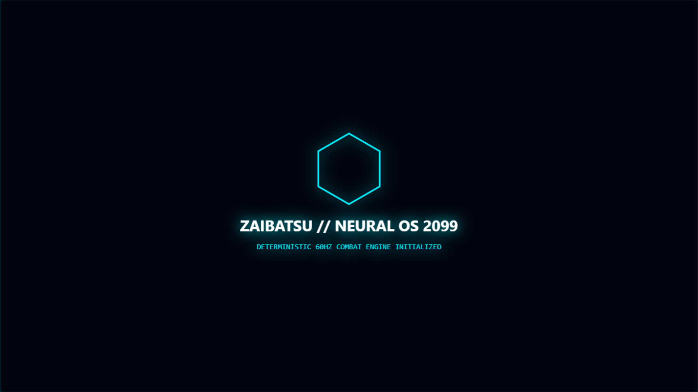](judging/screenshots/A/01-boot-logo.png) | Biểu tượng và tiêu đề giữa màn hình có khoảng cách rõ; dòng trạng thái bên dưới rất nhỏ. Bố cục boot gọn nhưng logo hình học còn phổ thông. |
| [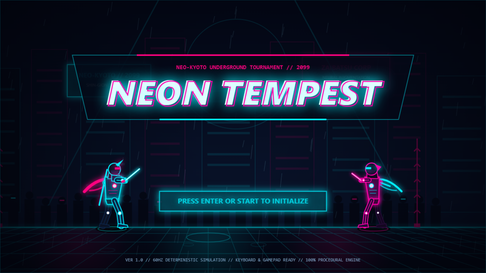](judging/screenshots/A/02-title.png) | Dễ nhận ra tiêu đề và nút xác nhận. Viền cyan, glow lặp lại và võ sĩ nét vẽ nhỏ tạo cảm giác một prototype neon hoạt động được. |
| [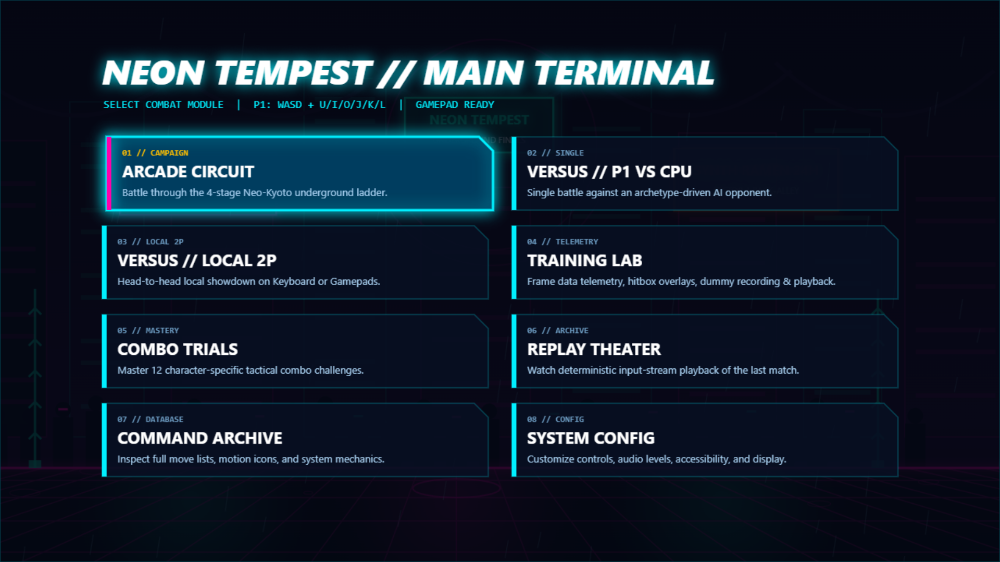](judging/screenshots/A/03-main-menu.png) | Lưới thẻ thẳng hàng, viền chọn rõ. Gần như nhãn nào cũng in hoa/đậm nên chữ phụ dày và phân cấp còn khá phẳng. |
| [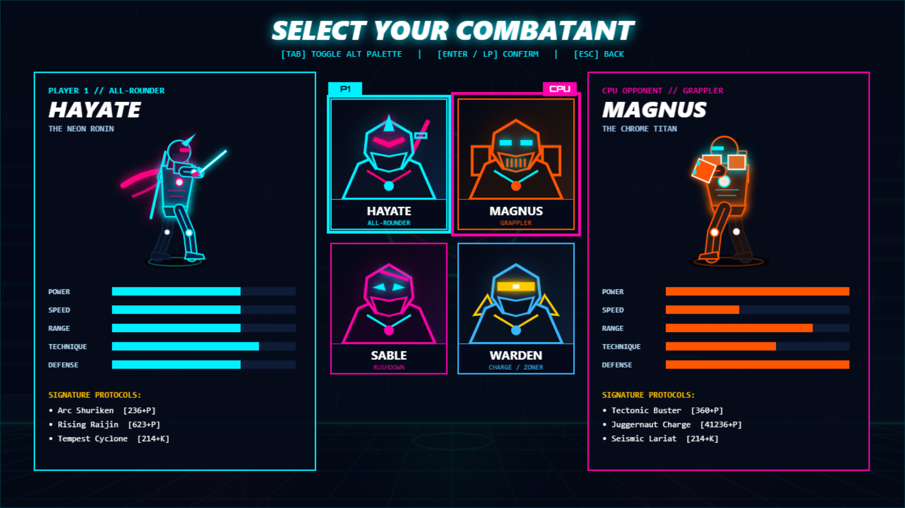](judging/screenshots/A/04-character-select.png) | Hai panel, cursor và thanh chỉ số nằm gọn. Chân dung dạng biểu tượng lớn lấn vai trò preview võ sĩ nhỏ; mô tả chiêu khá chật. |
| [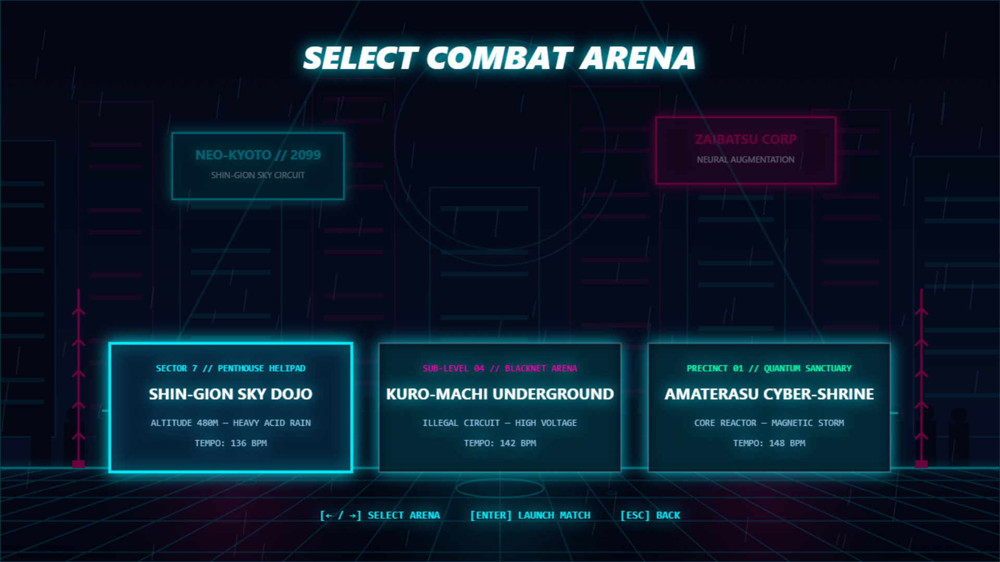](judging/screenshots/A/05-stage-select.png) | Tên sân và trạng thái chọn đọc được, nhưng không có thumbnail riêng cho từng sân. Phần trên trống nhiều và vẫn dùng nền thành phố lặp lại. |
| [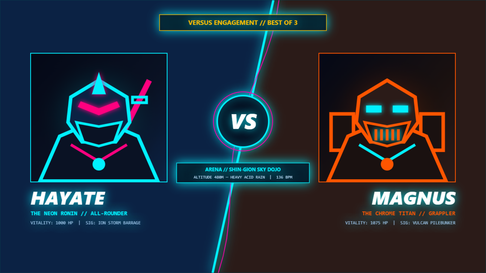](judging/screenshots/A/06-versus-splash.png) | Bố cục chia đôi rõ, tên có tương phản cao. Chân dung biểu tượng và đường neon thống nhất nhưng còn đơn giản; không thấy clipping kéo dài. |
| [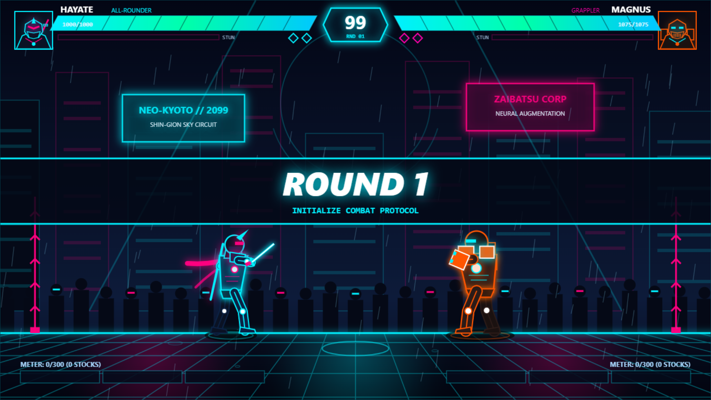](judging/screenshots/A/07-match-hud-start.png) | Timer và health dễ nhận ra; nhãn số nhỏ. Dải intro chiếm nhiều phần giữa, còn võ sĩ nét vẽ có cảm giác thiếu khối lượng. |
| [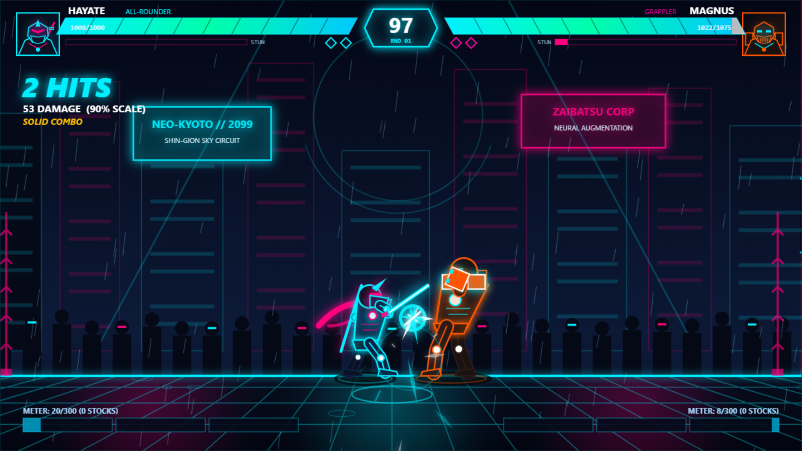](judging/screenshots/A/08-mid-combo.png) | Combo trúng thật có counter và chữ damage/scaling rõ. Hit spark dễ thấy nhưng cơ thể hai võ sĩ vẫn giống hình nét vẽ chia khớp đơn giản. |
| [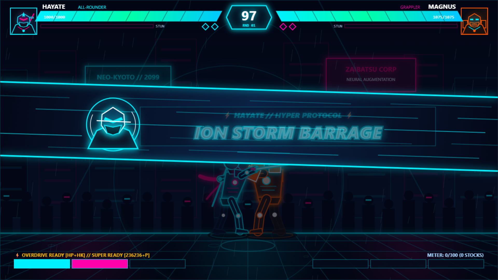](judging/screenshots/A/09-super-active.png) | Dải cut-in đặt đúng hàng. Chữ cyan trên xanh và bloom nhiều làm mềm tên super; bust nhỏ giống icon hơn chân dung cinematic. |
| [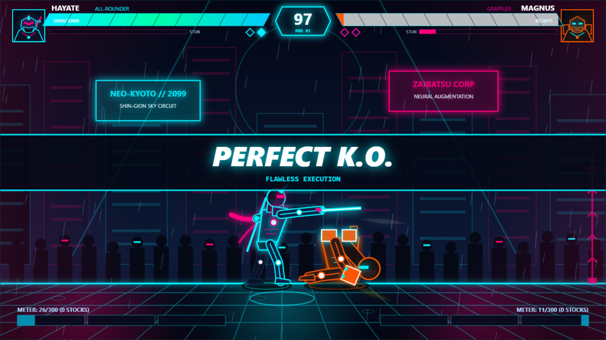](judging/screenshots/A/10-ko-round-end.png) | Thông báo Perfect KO lớn, giữa màn hình và rõ, không đè HUD. Bố cục nền vẫn khá phẳng. |
| [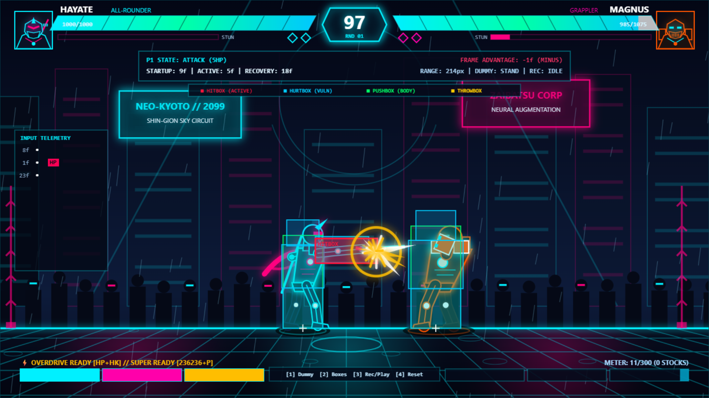](judging/screenshots/A/11-training-hitboxes.png) | Thấy được hit/hurt/push box đang active và frame telemetry thật. Panel nằm vừa, nhưng chú giải nhỏ và phím tắt đáy màn hình cần nhìn kỹ. |
| [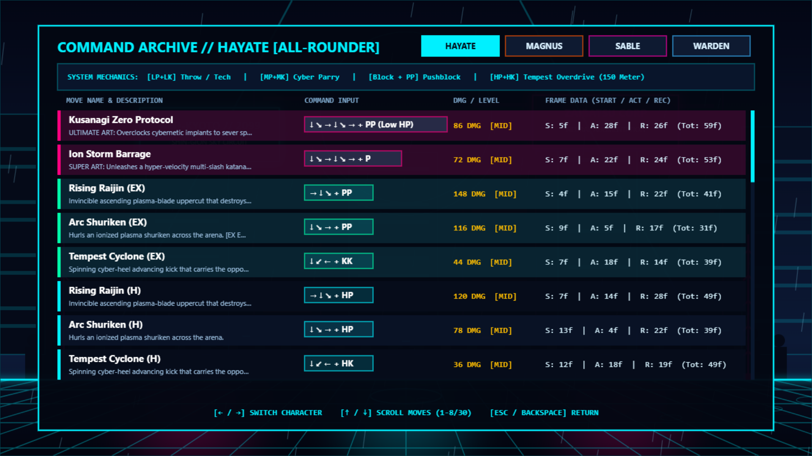](judging/screenshots/A/12-move-list.png) | Hàng chiêu, input và cột frame thẳng hàng. Chữ nhỏ dày và glow làm giảm sự thoải mái khi đọc; cần cuộn để xem các chiêu còn lại. |
| [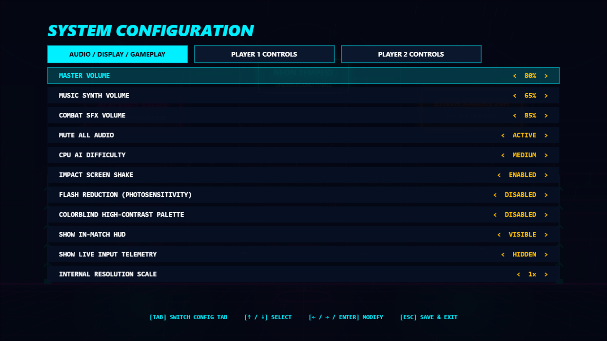](judging/screenshots/A/13-settings.png) | Hàng settings và giá trị đang chọn thẳng hàng. Cách in hoa cùng footer rất nhỏ mang tính công cụ; các tab được hiển thị chỉ remap keyboard. |
| [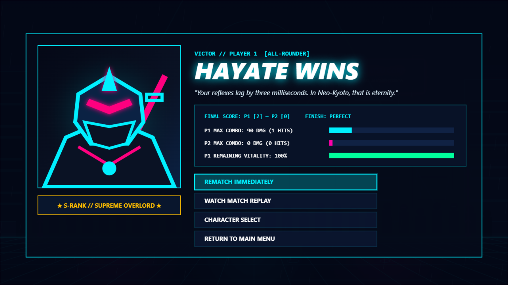](judging/screenshots/A/14-results.png) | Winner, tỉ số, chỉ số và lựa chọn đấu lại có bố cục rõ. Icon quá lớn và câu xếp hạng khá phổ thông; viền và tương phản nút chọn thống nhất. |
| [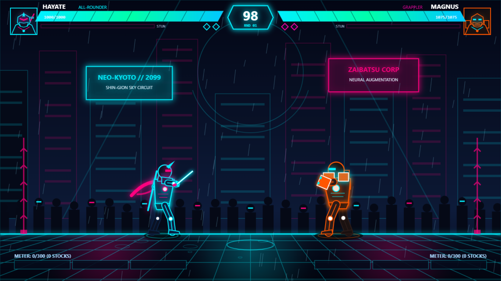](judging/screenshots/A/15-stage-1.png) | Sân mái nhà có võ sĩ, mưa và lưới sàn ướt dễ thấy. Chiều sâu chủ yếu dựa vào nét tòa nhà/biển hiệu lặp, ít biến thể vật liệu hoặc ánh sáng. |
| [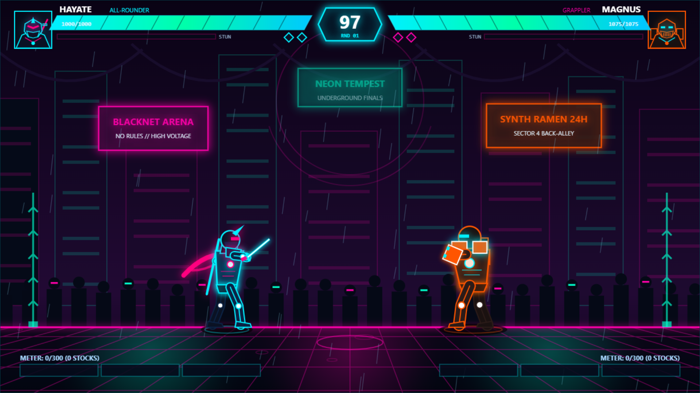](judging/screenshots/A/16-stage-2.png) | Palette magenta và biển hiệu đổi, nhưng bố cục skyline/lưới/đám đông cũ vẫn chiếm chính. HUD và vùng đánh không bị che. |
| [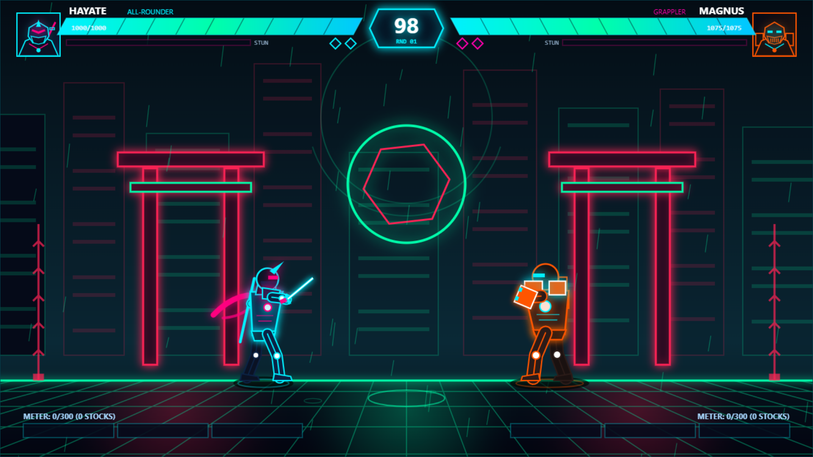](judging/screenshots/A/17-stage-3.png) | Cổng shrine và biểu tượng giữa sân tạo khác biệt. Sân vẫn dùng chung ngôn ngữ nét vẽ phẳng và sàn với các sân còn lại. |
| [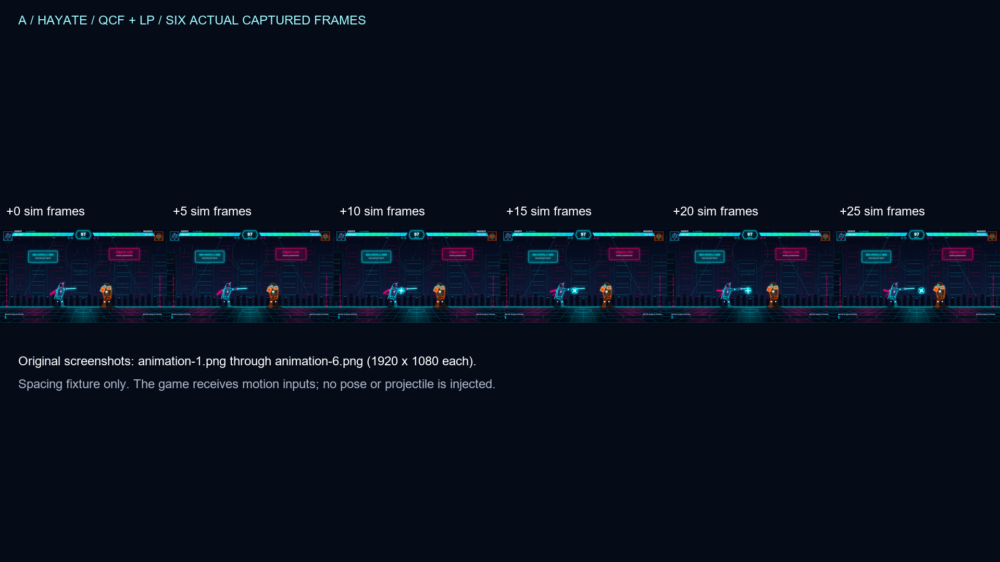](judging/screenshots/A/18-special-strip.png) | Sáu mẫu cast thật cho thấy projectile ngôi sao hình thành rồi di chuyển. Anticipation và đổi trọng tâm rất ít; mở ảnh gốc để xem pose. |
| [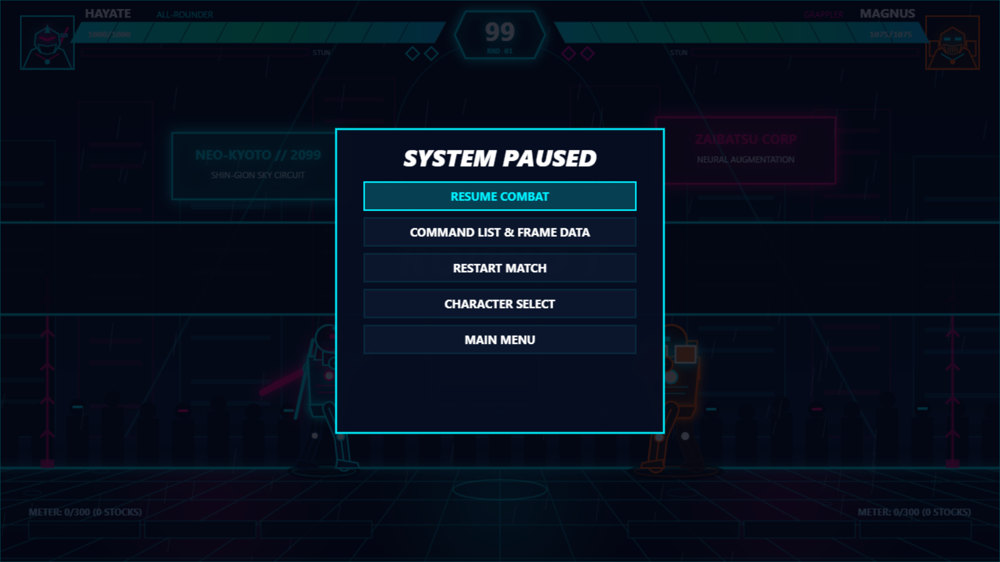](judging/screenshots/A/19-pause-menu.png) | Panel pause giữa màn hình có nút tương phản rõ và khoảng cách đều. Phần dưới trống lớn cùng viền cyan lặp lại còn đơn giản. |
|  | Placeholder của người chấm: chỉ thiếu màn mode select riêng. Lựa chọn mode gộp trong main menu được chụp ở nơi khác, không bị coi là thiếu mode. |
| [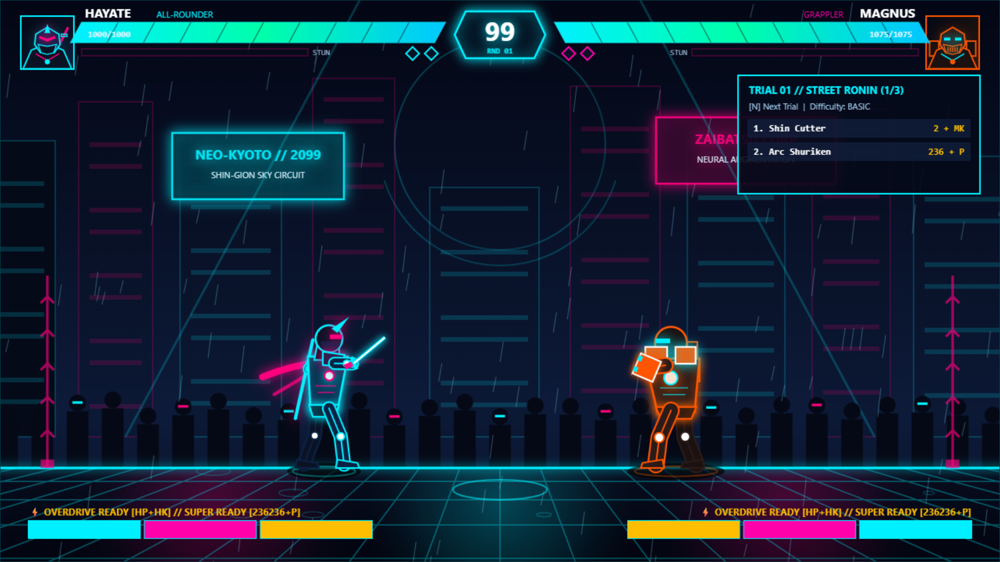](judging/screenshots/A/21-trials.png) | Hướng dẫn trial nằm gọn góc trên phải, không đè HUD. Chữ chỉ dẫn/step nhỏ, phần lớn khung hình vẫn là sân trống quen thuộc. |
| [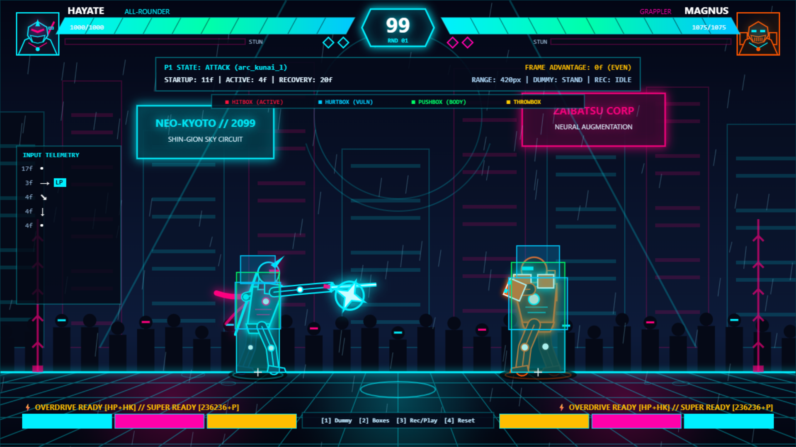](judging/screenshots/A/22-keyboard-qcf.png) | Projectile và telemetry training đến từ motion keyboard thật. Ký hiệu input history nét mảnh và nhãn nhỏ vẫn khó đọc hơn HUD chính. |
| [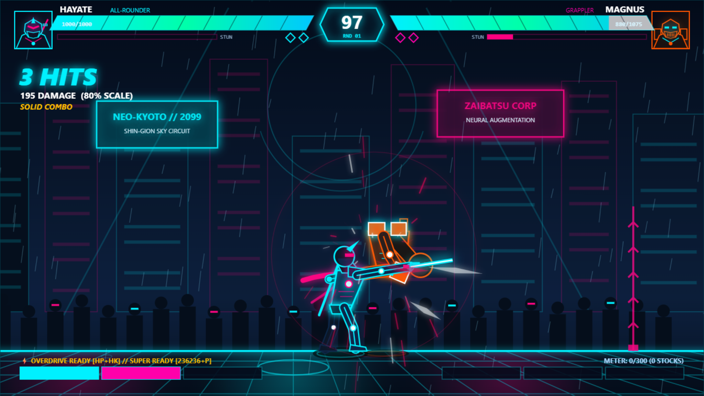](judging/screenshots/A/23-super-followthrough.png) | Các hit super nối nhau cho counter và impact thật. Hiệu ứng rõ, nhưng thay đổi pose chia khớp và độ khối của nhân vật còn hạn chế. |
| [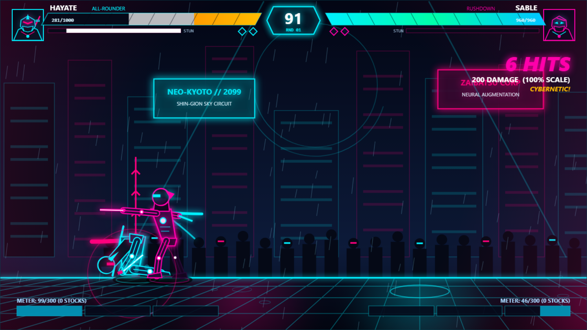](judging/screenshots/A/24-two-minute-play.png) | Ảnh chơi kéo dài giữ được life trail và nhãn combo, không thấy softlock. Nhãn trạng thái nhỏ vẫn là điểm yếu; ảnh này chứng minh gameplay, không phải điểm cảm giác chơi của người. |

Các frame animation gốc: [screenshots/Argon/animation-1.png](judging/screenshots/A/animation-1.png); [screenshots/Argon/animation-2.png](judging/screenshots/A/animation-2.png); [screenshots/Argon/animation-3.png](judging/screenshots/A/animation-3.png); [screenshots/Argon/animation-4.png](judging/screenshots/A/animation-4.png); [screenshots/Argon/animation-5.png](judging/screenshots/A/animation-5.png); [screenshots/Argon/animation-6.png](judging/screenshots/A/animation-6.png)

Sổ ghi nhận việc xem ảnh: [logs/Argon/visual-review.json](judging/logs/A/visual-review.json); [logs/Argon/image-inventory.json](judging/logs/A/image-inventory.json)

### Astra

**Điểm mạnh.** Phân cấp giao diện tốt nhất: tiêu đề lớn rõ, màu tiết chế, focus dễ nhận biết, khoảng cách thống nhất, thẻ preview hữu ích và màn kết quả gọn gàng. Bundle nhỏ nhất, frame pacing tốt nhất trong lượt GPU chung, có test input/round/replay/trial có ý nghĩa, layout responsive chạy đúng và coverage gamepad giả lập.

**Điểm yếu.** Throw tech của throw thường là lỗi tích hợp thực, bị che khuất bởi unit test gọi thẳng resolver. CPU phòng thủ đọc đúng hit level hiện tại của đối thủ. Chuyển động nhân vật có phong cách nhưng thường dùng lại pose góc cạnh; nhãn phụ nhỏ và panel training còn có thể rõ hơn. Điều khiển application/scene UI tập trung trong một file lớn; results không chọn nhánh nhạc chiến thắng.

**Vấn đề — Không tech được throw thường qua pipeline input đầy đủ.** Mở fixture versus tại khoảng cách gần. Bấm LP+LK của bên tấn công, rồi LP+LK của bên phòng thủ ở từng độ trễ trong cửa sổ đã ghi, gồm cả cùng frame. Throw trúng nhưng không phát sinh tech. Throw đồng thời có thể làm cả hai bên mất máu. startMove dùng mất cạnh input của người phòng thủ trước khi resolveHit kiểm tra. [logs/Astra/edge-cases.json](judging/logs/B/edge-cases.json); [Astra/src/core/sim.ts:160](judging/work/B/src/core/sim.ts#L160); [Astra/src/core/sim.ts:338](judging/work/B/src/core/sim.ts#L338); [Astra/tests/sim.test.ts:126](judging/work/B/tests/sim.test.ts#L126)

**Vấn đề — Results không chọn nhánh tempo chiến thắng đã viết.** Kết thúc trận và kiểm tra lựa chọn theme audio. Results giữ theme sân trước đó; điều kiện tempo chiến thắng có trong code nhưng luồng này không chọn nó. [Astra/src/audio/synth.ts:132](judging/work/B/src/audio/synth.ts#L132); [Astra/src/main.ts:297](judging/work/B/src/main.ts#L297)

#### Cân bằng — hàng là phần trăm thắng của Player 1

| P1 / P2 | HAYATE | MAGNUS | SABLE | WARDEN |
| --- | --- | --- | --- | --- |
| HAYATE | 53.12% | 53.12% | 43.75% | 37.50% |
| MAGNUS | 50.00% | 37.50% | 50.00% | 68.75% |
| SABLE | 59.38% | 50.00% | 50.00% | 65.62% |
| WARDEN | 59.38% | 25.00% | 31.25% | 50.00% |

Mỗi ô có thứ tự gồm **32** trận. Win rate tổng hợp tính cả hai phía, bỏ mirror và tính hòa bằng nửa trận thắng. Thời lượng gồm intro/outro, hitstop và chuyển round. Đây là cân bằng của chính sách bot, với seed có liên hệ và độ chính xác từng matchup còn hạn chế.

| Võ sĩ | Win % | Wilson 95% |
| --- | --- | --- |
| HAYATE | 44.27 | 37.43–51.34 |
| MAGNUS | 56.77 | 49.70–63.58 |
| SABLE | 58.33 | 51.26–65.08 |
| WARDEN | 40.62 | 33.93–47.69 |

[logs/Astra/independent-balance.json](judging/logs/B/independent-balance.json); [logs/Astra/roster-inventory.json](judging/logs/B/roster-inventory.json)

#### Gallery do người chấm chụp — bấm để xem ảnh gốc

Mọi ảnh game đều **1920 × 1080**. Ảnh luồng menu dùng điều hướng keyboard thật; ảnh combat cần chính xác dùng fixture đã nêu. Placeholder mode select chỉ đánh dấu thiếu màn riêng. Đã xem toàn bộ ảnh, gồm từng frame animation.

| Màn hình | Nhận xét hình ảnh / bằng chứng |
| --- | --- |
| [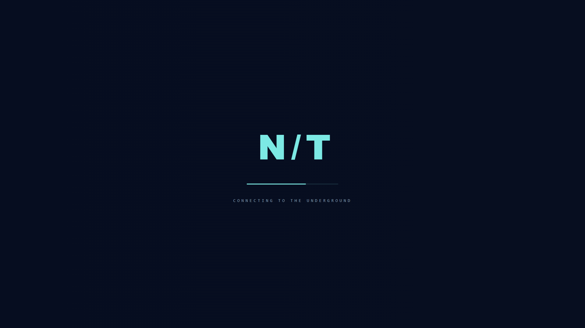](judging/screenshots/B/01-boot-logo.png) | Monogram và thanh tiến trình giữa màn hình cân đối, gọn. Chữ phụ rất nhỏ nhưng bố cục có chủ đích, không mang cảm giác dang dở. |
| [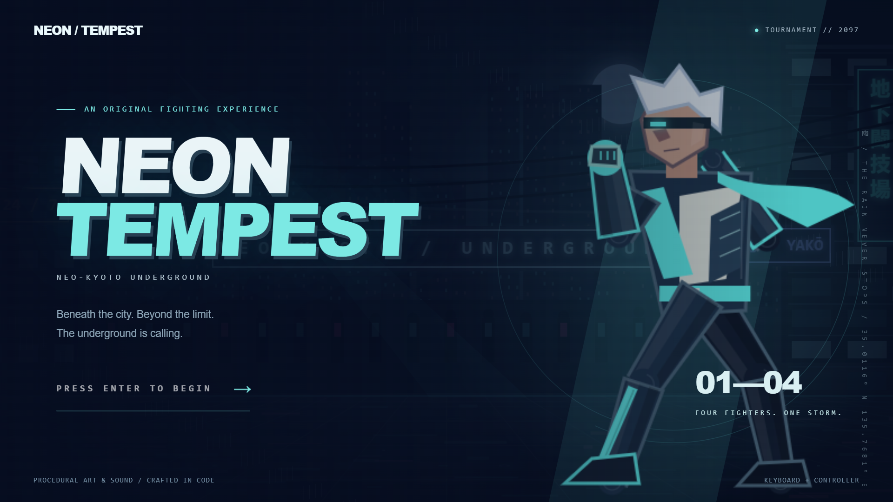](judging/screenshots/B/02-title.png) | Tiêu đề xếp lớn, prompt rõ và silhouette chủ đạo tạo phân cấp tốt nhất. Glow tiết chế và khoảng tối giữ các điểm chính dễ đọc. |
| [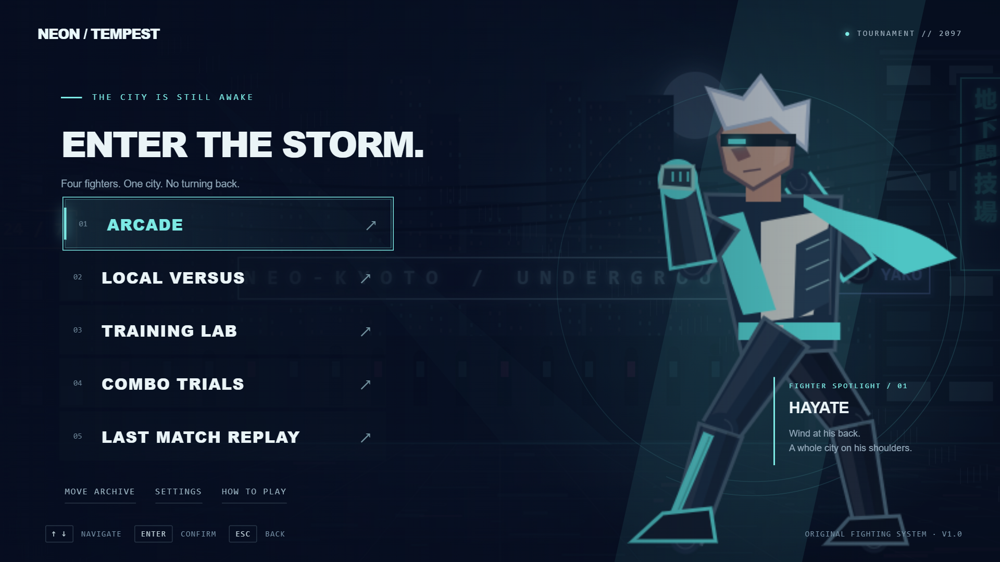](judging/screenshots/B/03-main-menu.png) | Điều hướng lớn bên trái, focus rõ và võ sĩ bên phải cân nhau tốt. Link phụ và flavor text nhỏ, nhưng khoảng cách/tương phản thống nhất. |
| [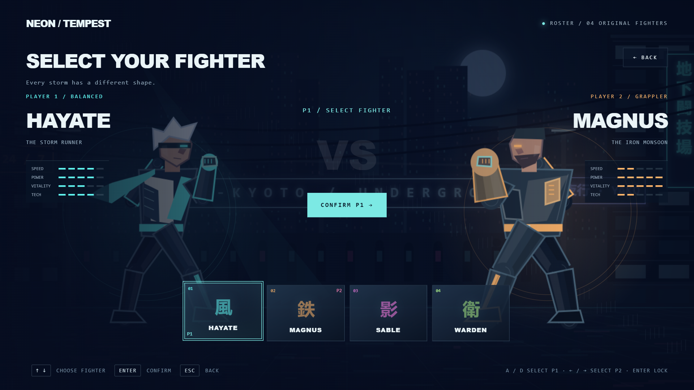](judging/screenshots/B/04-character-select.png) | Tên nhân vật, hai phía và hành động confirm dễ quét mắt. Nhãn chỉ số rất nhỏ, ngôn ngữ pose góc cạnh dùng chung làm chân dung ít đa dạng. |
| [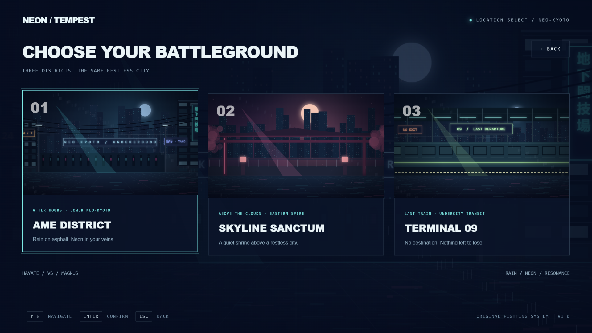](judging/screenshots/B/05-stage-select.png) | Thẻ sân có hình riêng, tiêu đề rõ và viền chọn tạo màn chọn hoàn thiện. Thumbnail, chú thích và khoảng cách thẻ thống nhất. |
| [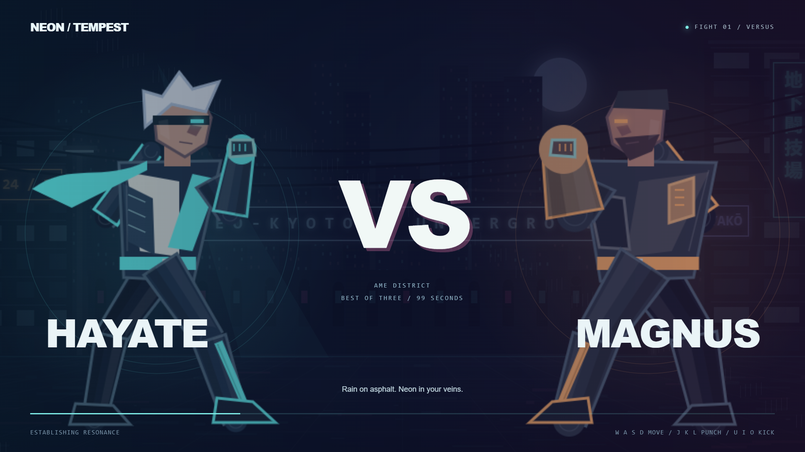](judging/screenshots/B/06-versus-splash.png) | VS và tên lớn thẳng với cột võ sĩ. Bố cục gọn, tiết chế; chữ sân/loading khá nhỏ. |
| [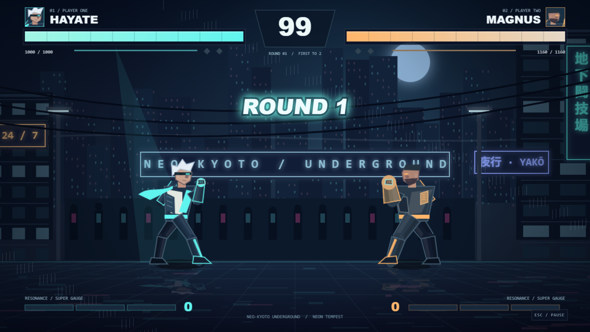](judging/screenshots/B/07-match-hud-start.png) | Health bar, portrait, round pip cân đối và timer lớn rõ. Nhãn health/stun phụ nhỏ, không thấy clipping hoặc đè nhau. |
| [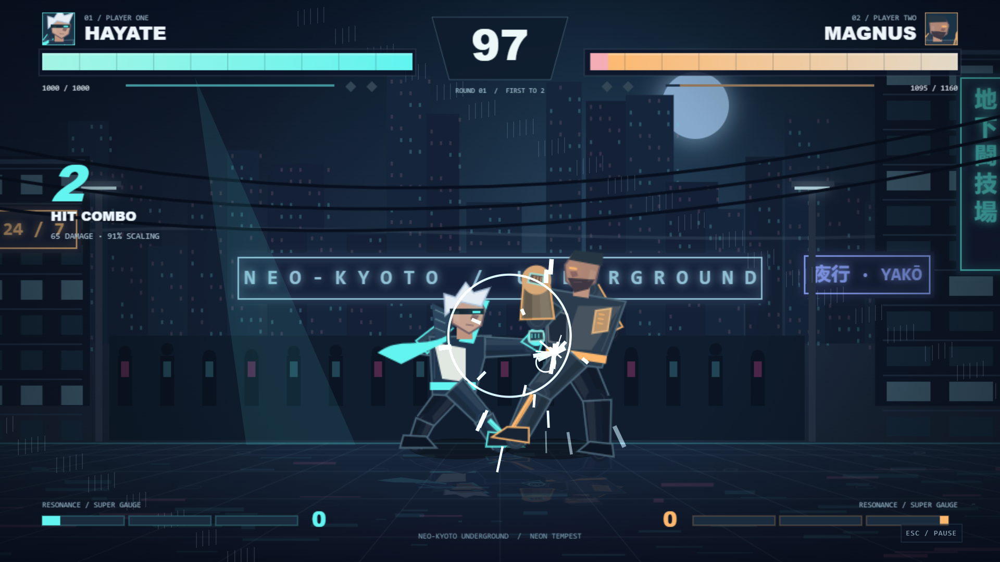](judging/screenshots/B/08-mid-combo.png) | Counter combo thật tách rõ khỏi võ sĩ. Vòng impact trắng có tương phản tốt; dòng damage/scaling nhỏ hơn số hit nhiều. |
| [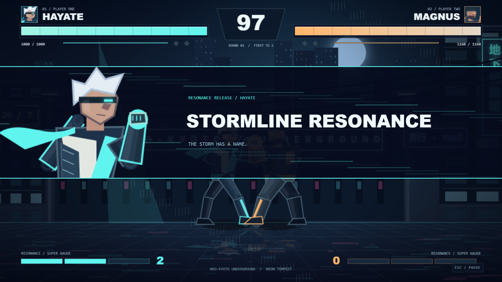](judging/screenshots/B/09-super-active.png) | Dải cinematic, bust cắt cận và tên super tương phản cao được bố trí gọn. Dải tạm che phần trên vùng đánh nhưng vẫn giữ HUD chính dễ đọc. |
| [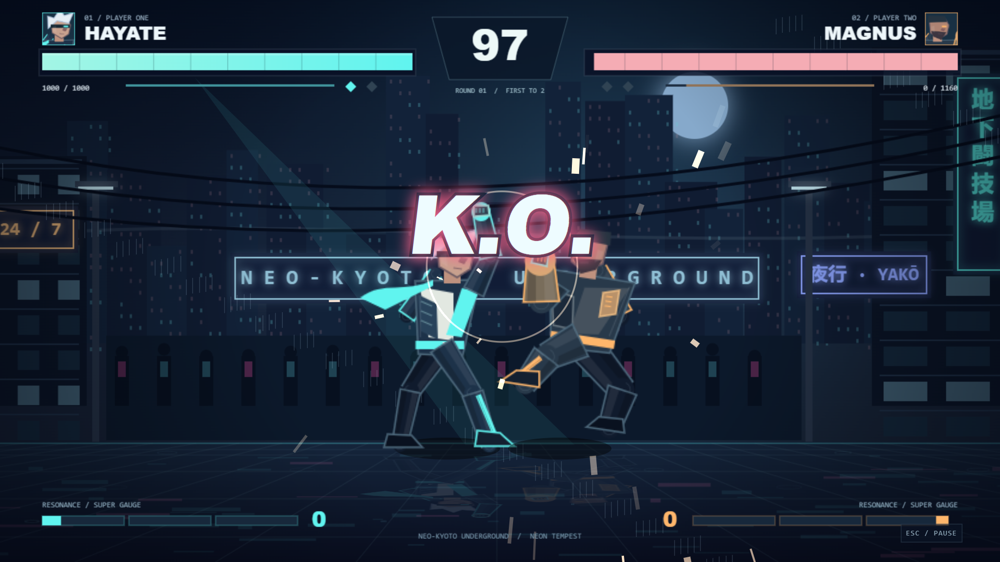](judging/screenshots/B/10-ko-round-end.png) | KO và impact vẫn rõ trên sân tối. HUD giữ thẳng hàng, hình khối nhân vật còn phân biệt được. |
| [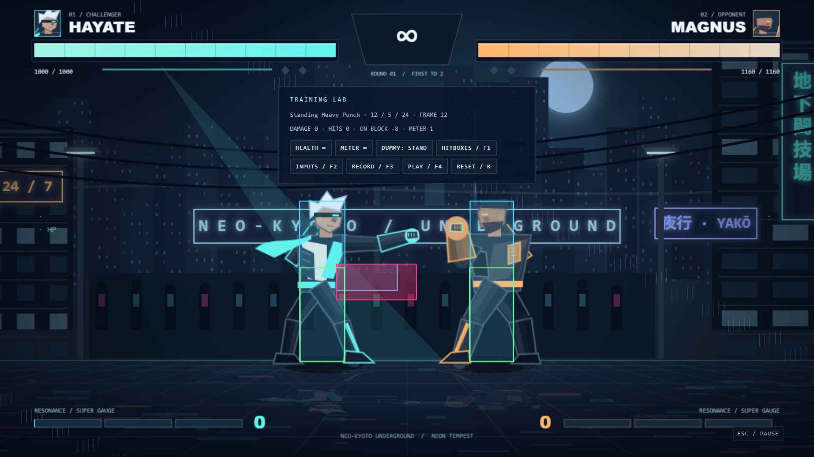](judging/screenshots/B/11-training-hitboxes.png) | Hitbox active và hurtbox được phân màu rõ, panel training nằm trên vùng đánh. Nhãn telemetry và nút công cụ khá nhỏ. |
| [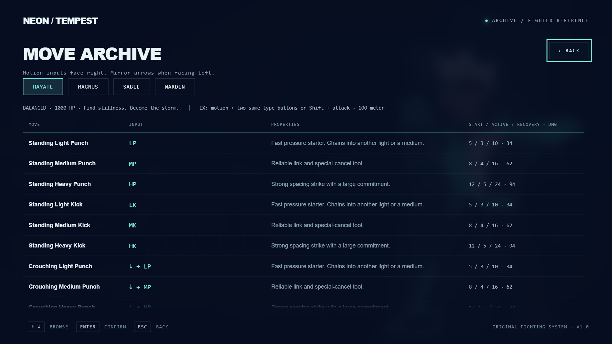](judging/screenshots/B/12-move-list.png) | Move archive có cách tổ chức dạng bảng rõ nhất, mô tả hữu ích. Frame data nét nhỏ và hàng dưới mờ cần cuộn hoặc xem kỹ. |
| [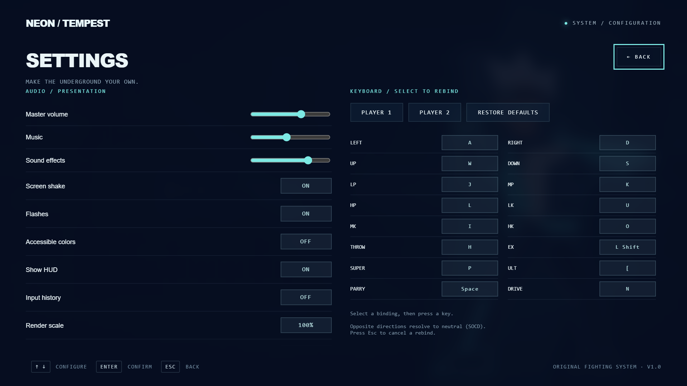](judging/screenshots/B/13-settings.png) | Settings hai cột tách âm thanh/hình ảnh khỏi binding keyboard, control thẳng hàng. Các tùy chọn thiết bị/display khác nằm phía dưới vùng cuộn đang thấy. |
| [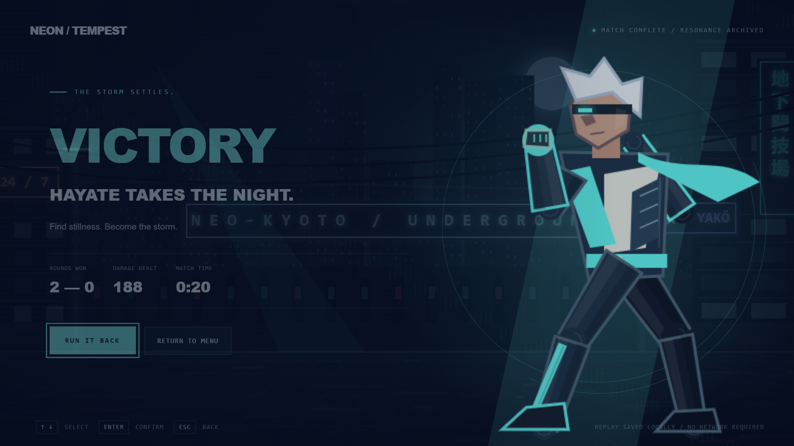](judging/screenshots/B/14-results.png) | Tiêu đề victory, võ sĩ, chỉ số gọn và lựa chọn đấu lại tạo phân cấp kết quả rõ. Chữ phụ nhỏ nhưng không có đè nhau kéo dài. |
| [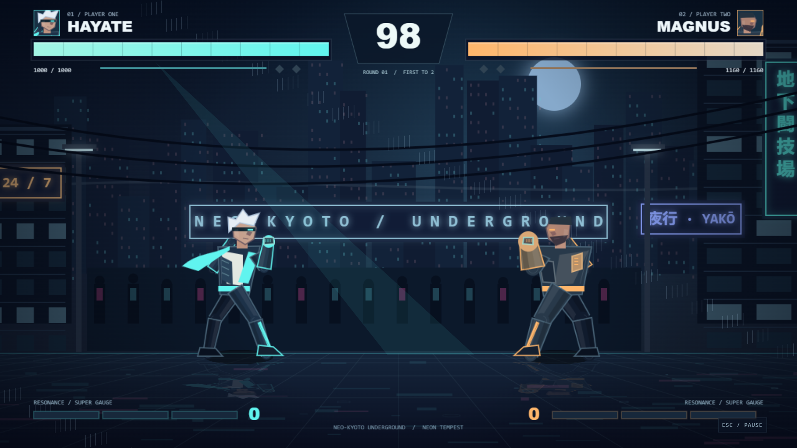](judging/screenshots/B/15-stage-1.png) | Bố cục hẻm có silhouette rõ, chiều sâu, phản chiếu, dây cáp và mưa. Palette tiết chế giúp glow không tranh vai trò chính với HUD. |
| [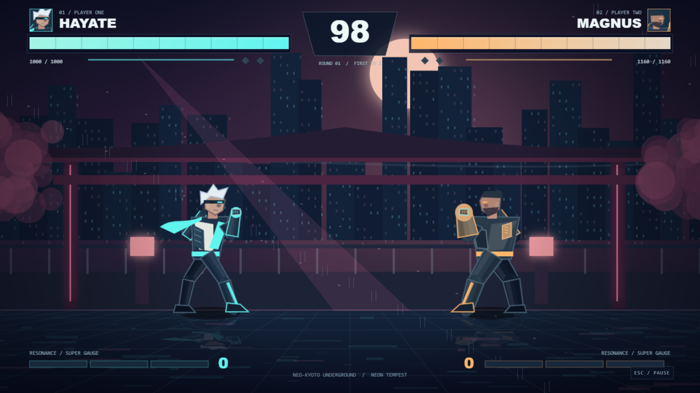](judging/screenshots/B/16-stage-2.png) | Palette skyline/sanctum và silhouette torii tạo không khí riêng. Hình lớn giữ vùng đánh rõ, chi tiết bề mặt ít hơn Opus. |
| [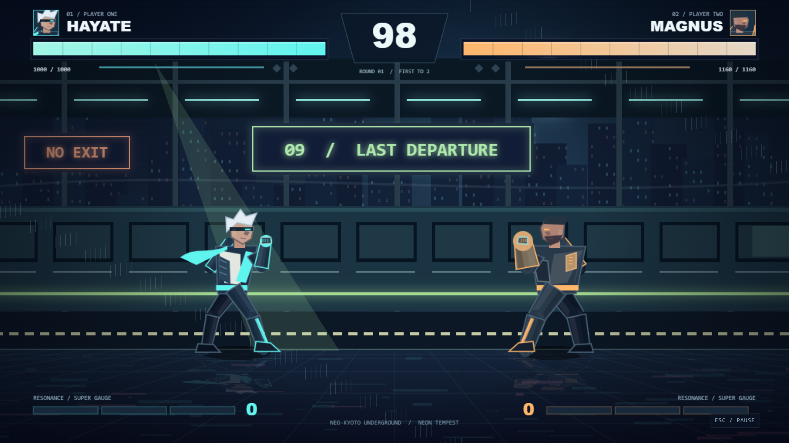](judging/screenshots/B/17-stage-3.png) | Tàu, sân ga, biển hiệu và lưới kiến trúc khác rõ các sân còn lại. Tương phản quanh võ sĩ tốt, HUD ổn định. |
| [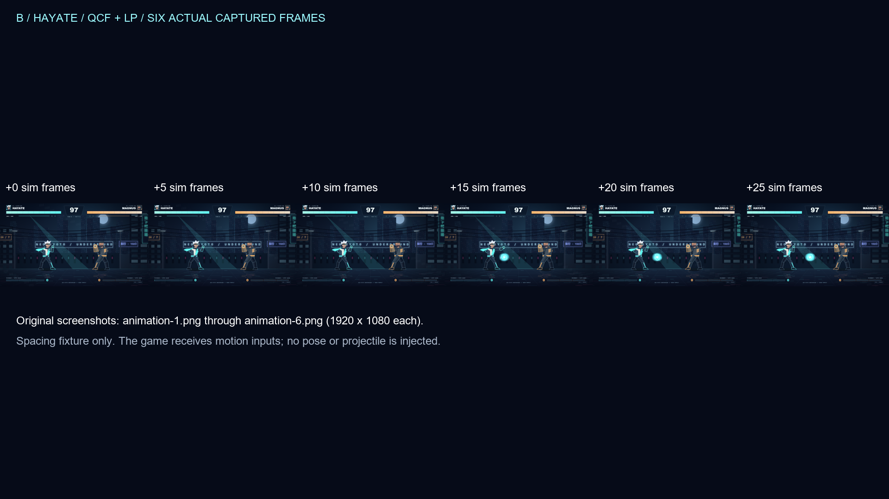](judging/screenshots/B/18-special-strip.png) | Sáu frame thật cho thấy tay duỗi, projectile hình thành và bay. Cơ thể hình học còn tiết kiệm pose; hiệu ứng rõ, không bloom quá mức. |
| [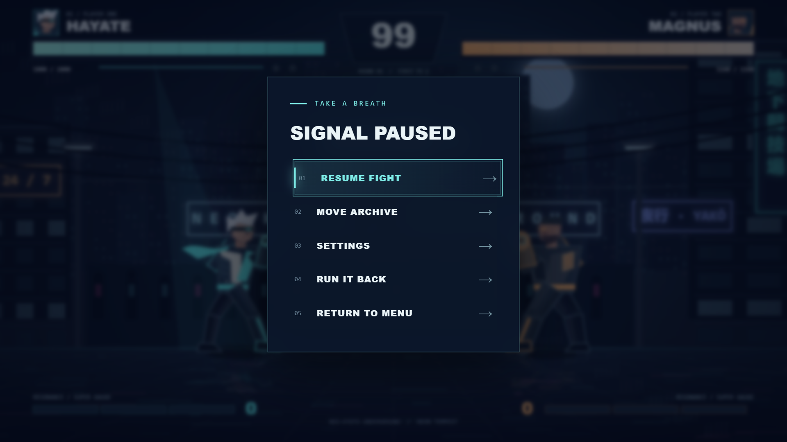](judging/screenshots/B/19-pause-menu.png) | Card giữa màn hình đủ kín, nền giảm sáng và hàng được chọn tạo focus rất tốt. Khoảng cách nút/typography khớp các màn khác. |
| [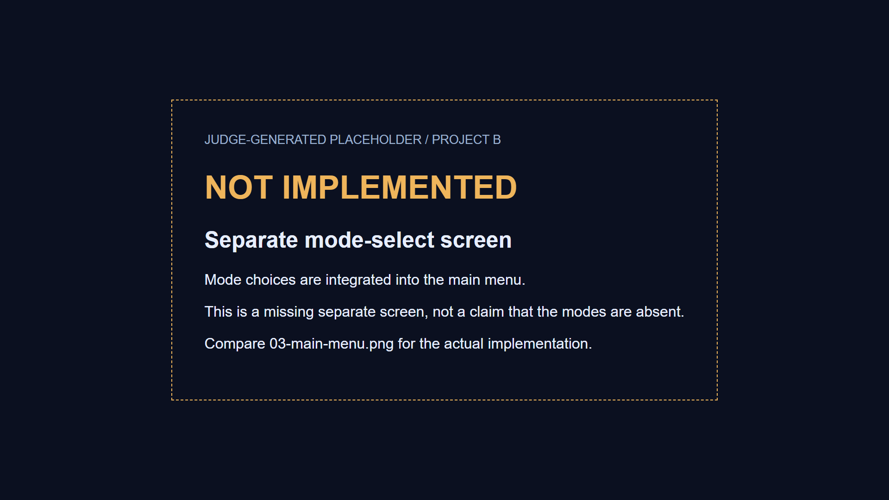](judging/screenshots/B/20-mode-select.png) | Placeholder của người chấm cho màn mode select riêng bị thiếu. Main menu vẫn có các lựa chọn mode hoạt động được. |
| [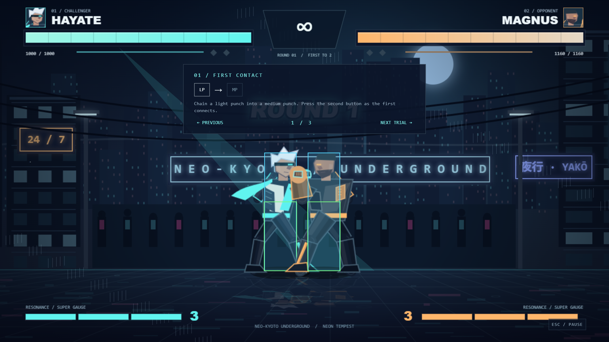](judging/screenshots/B/21-trials.png) | Hướng dẫn trial nằm trên vùng đánh, icon step nối nhau rõ. Chữ giải thích nhỏ; võ sĩ đứng gần nhau là fixture luyện tập có chủ đích. |
| [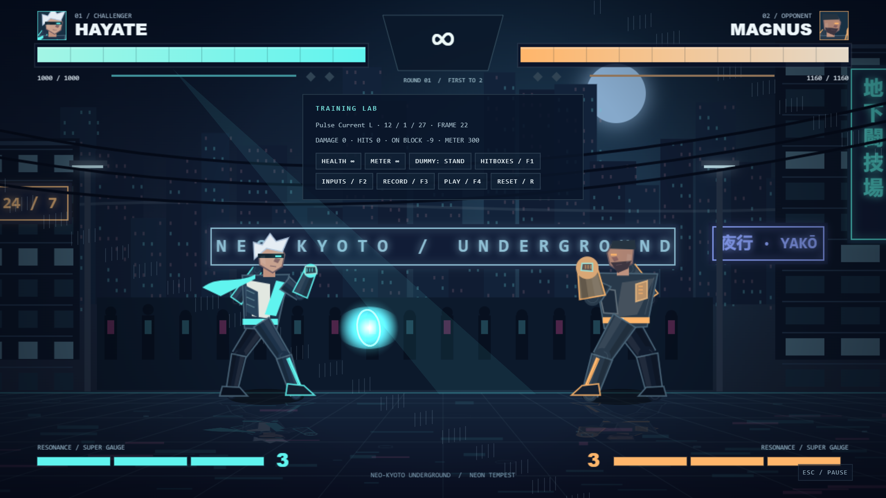](judging/screenshots/B/22-keyboard-qcf.png) | Bằng chứng projectile keyboard thật được chụp sau intro. Chữ training nhỏ nhưng thẳng hàng; projectile thấy rõ trên sàn tối. |
| [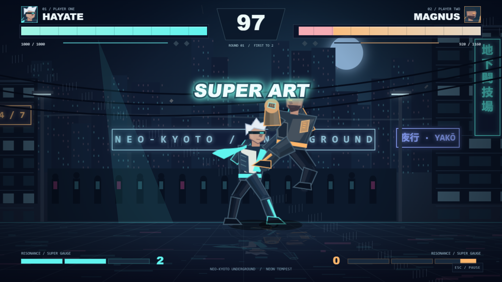](judging/screenshots/B/23-super-followthrough.png) | Phần tiếp diễn super và phản ứng đối thủ vẫn rõ. Thông báo giữa màn hình nổi bật; pose nhân vật vẫn góc cạnh và đơn giản. |
| [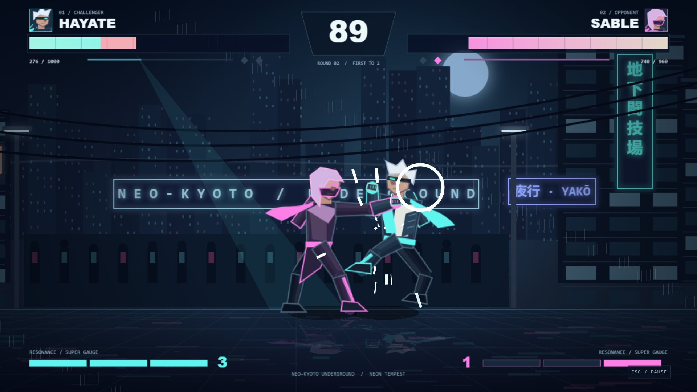](judging/screenshots/B/24-two-minute-play.png) | Life trail, vòng impact và danh tính hai võ sĩ vẫn rõ khi chơi kéo dài. Không thấy softlock hình ảnh; chữ HUD phụ quá nhỏ là giới hạn đọc chính. |

Các frame animation gốc: [screenshots/Astra/animation-1.png](judging/screenshots/B/animation-1.png); [screenshots/Astra/animation-2.png](judging/screenshots/B/animation-2.png); [screenshots/Astra/animation-3.png](judging/screenshots/B/animation-3.png); [screenshots/Astra/animation-4.png](judging/screenshots/B/animation-4.png); [screenshots/Astra/animation-5.png](judging/screenshots/B/animation-5.png); [screenshots/Astra/animation-6.png](judging/screenshots/B/animation-6.png)

Sổ ghi nhận việc xem ảnh: [logs/Astra/visual-review.json](judging/logs/B/visual-review.json); [logs/Astra/image-inventory.json](judging/logs/B/image-inventory.json)

### Opus

**Điểm mạnh.** Combat được triển khai kỹ nhất, cấu trúc scene/module rõ nhất. CPU có observation buffer trễ thực, error/jitter và lập kế hoạch theo nhân vật. Các assertion chi tiết về frame, guard, trade, throw, tài nguyên, rollback và trial đều đạt; browser flow, Arcade đầy đủ, replay, gamepad và phân tích audio cũng đạt. Sân và nhân vật có chi tiết thủ tục phong phú nhất, animation đa dạng nhất.

**Điểm yếu.** Hiệu năng đủ độ phân giải chưa đạt mục tiêu ổn định trên máy kiểm tra; tự hạ resolution mặc định có thể che chi phí đó bằng cách giảm độ sắc nét. Parser rotation nhận cả cardinal sai thứ tự. Bloom neon, nhãn nhỏ nét mảnh và nền chuyển động dày chi tiết cạnh tranh với thông tin trận. Lợi thế life của grappler rất nhỏ và matchup với zoner vẫn yếu dù win rate bot tổng thể chấp nhận được. Việc cấp phát projectile cũng không khớp cách README mô tả allocation-free quá rộng.

**Vấn đề — Rendering ở scale cố định không đạt mục tiêu ổn định.** Chạy benchmark GPU chung trên từng build production với scale cố định và viewport chung. Xem khoảng thời gian thô và số đo đuôi dài; Argon/Opus không đạt trong khi Astra đạt theo cùng ngưỡng. Với Opus, tự hạ scale là giải pháp dự phòng, không phải bằng chứng cho hiệu năng đủ độ phân giải. [logs/Argon/independent-benchmark-gpu.json](judging/logs/A/independent-benchmark-gpu.json); [logs/Astra/independent-benchmark-gpu.json](judging/logs/B/independent-benchmark-gpu.json); [logs/Opus/independent-benchmark-gpu.json](judging/logs/C/independent-benchmark-gpu.json)

**Vấn đề — Parser rotation nhận chuỗi cardinal không tạo thành vòng xoay.** Đưa cùng chuỗi cardinal sai thứ tự trong edge-cases.json vào parser. Argon và Opus nhận thành rotation, Astra từ chối. Opus ghi rõ lựa chọn triển khai này trong comment. Đây là leniency quá rộng, không phải không nhận được motion hợp lệ. [logs/Argon/edge-cases.json](judging/logs/A/edge-cases.json); [logs/Astra/edge-cases.json](judging/logs/B/edge-cases.json); [logs/Opus/edge-cases.json](judging/logs/C/edge-cases.json)

**Vấn đề — Mô tả allocation-free rộng hơn thực tế triển khai.** Xem spawnProjectile: hàm đưa một object projectile mới vào danh sách simulation. Pooling particle là có thật, nhưng không khiến mọi hot path đều allocation-free. Không dùng riêng heap tăng giữa hai đầu để kết luận có leak. [Opus/src/sim/fighter.ts:504](judging/work/C/src/sim/fighter.ts#L504); [Opus/README.md:382](judging/work/C/README.md#L382)

**Vấn đề — Runtime tối thiểu trong tài liệu không khớp dependency đã khóa.** Đối chiếu yêu cầu Node.js 18+ trong README với engine range của Vite đã khóa: ^20.19.0 || >=22.12.0. Lượt chấm này chạy thành công trên Node.js 24; chưa chứng minh được khả năng chạy trên runtime cũ như tài liệu quảng bá. [Opus/README.md:17](judging/work/C/README.md#L17); [Opus/package-lock.json:1574](judging/work/C/package-lock.json#L1574)

#### Cân bằng — hàng là phần trăm thắng của Player 1

| P1 / P2 | HAYATE | MAGNUS | SABLE | WARDEN |
| --- | --- | --- | --- | --- |
| HAYATE | 53.12% | 53.12% | 59.38% | 59.38% |
| MAGNUS | 53.12% | 59.38% | 37.50% | 25.00% |
| SABLE | 40.62% | 46.88% | 53.12% | 62.50% |
| WARDEN | 37.50% | 68.75% | 53.12% | 50.00% |

Mỗi ô có thứ tự gồm **32** trận. Win rate tổng hợp tính cả hai phía, bỏ mirror và tính hòa bằng nửa trận thắng. Thời lượng gồm intro/outro, hitstop và chuyển round. Đây là cân bằng của chính sách bot, với seed có liên hệ và độ chính xác từng matchup còn hạn chế.

| Võ sĩ | Win % | Wilson 95% |
| --- | --- | --- |
| HAYATE | 56.77 | 49.70–63.58 |
| MAGNUS | 41.15 | 34.43–48.21 |
| SABLE | 50.00 | 43.00–57.00 |
| WARDEN | 52.08 | 45.05–59.04 |

[logs/Opus/independent-balance.json](judging/logs/C/independent-balance.json); [logs/Opus/roster-inventory.json](judging/logs/C/roster-inventory.json)

#### Gallery do người chấm chụp — bấm để xem ảnh gốc

Mọi ảnh game đều **1920 × 1080**. Ảnh luồng menu dùng điều hướng keyboard thật; ảnh combat cần chính xác dùng fixture đã nêu. Placeholder mode select chỉ đánh dấu thiếu màn riêng. Đã xem toàn bộ ảnh, gồm từng frame animation.

| Màn hình | Nhận xét hình ảnh / bằng chứng |
| --- | --- |
| [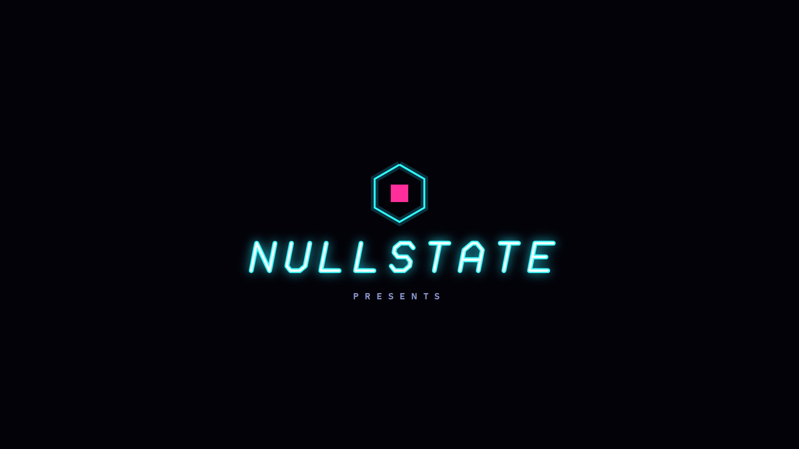](judging/screenshots/C/01-boot-logo.png) | Biểu tượng và wordmark neon giữa màn hình có khoảng cách có chủ đích. Dòng presents nhỏ, tương phản thấp nhưng nhận diện boot thống nhất. |
| [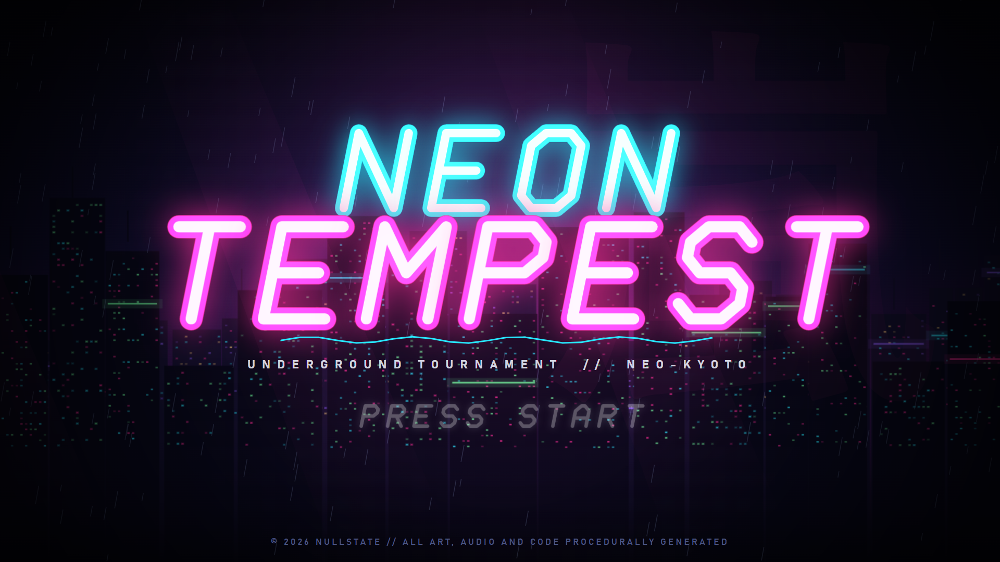](judging/screenshots/C/02-title.png) | Chữ neon có cá tính, mưa và skyline tạo màn tiêu đề mạnh. Prompt press-start nhấp nháy có tương phản thấp hơn tiêu đề nhiều; bloom làm mềm mép. |
| [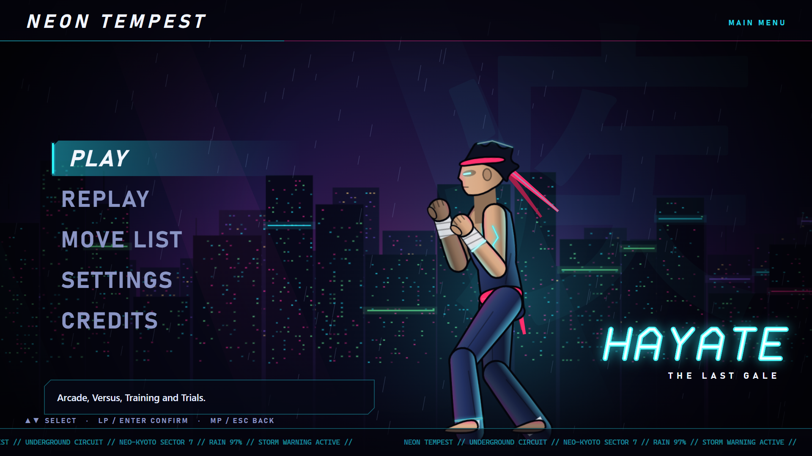](judging/screenshots/C/03-main-menu.png) | Phân cấp menu đơn giản và preview võ sĩ động dễ đọc. Chi tiết thành phố/glow trang trí cạnh tranh với footer nhỏ và dòng mô tả. |
|  | Preview toàn thân, archetype, palette và chỉ số tạo bố cục chọn đầy đủ. Nhãn mảnh nhỏ, hơi mềm vì bloom; lề vẫn gọn. |
|  | Preview sân lớn và thẻ chọn rõ cung cấp ngữ cảnh hữu ích. Phân cấp tên mạnh; chú thích vị trí/flavor dài và nhỏ nhưng không đè nhau. |
|  | Panel chia đôi theo màu, hình toàn thân và VS lớn có chủ đích thiết kế. Quote nhỏ; tên chính và banner sân vẫn tách biệt. |
|  | Health, timer, pip và portrait thẳng hàng; ROUND lớn, có chuyển động. Biển hiệu động cạnh tranh với thông tin stun/tên nét nhỏ. |
|  | Combo counter thật và impact nổi bật. Biển hiệu nền bão hòa cùng FX chạm sáng tạo nhiều nhiễu thị giác hơn Astra. |
|  | Tên super đầy đủ, cut-in võ sĩ và speed line được tích hợp tốt. Dải chiếm nhiều phần giữa, có tương phản cyan/magenta mạnh. |
|  | Typography KO lớn báo kết quả rõ. Chữ cố ý che phần giữa; HUD health vẫn thấy được và không thấy clipping khi đã ổn định. |
|  | Thấy box hit/hurt/push active chi tiết, frame data và input history. Nhãn mảnh cùng nền billboard động làm khó đọc nhanh. |
|  | Nhóm chiêu, icon motion, hàng biến thể và mô tả được tổ chức tốt. Nhãn phiên bản phụ nhỏ và tab không chọn có thể tăng tương phản. |
|  | Tab audio/video/gameplay/controls/accessibility rõ, giá trị thẳng hàng. Panel rộng thoáng nhưng footer/nhãn nhỏ vẫn có glow hơi nhiều. |
|  | Animation người thắng, thống kê và lựa chọn đấu lại/replay tạo màn đầy đủ. Chỉ số phụ nhỏ và nền thành phố hơi cạnh tranh nhau. |
|  | Mái nhà có biển hiệu phong phú, cá hologram, mưa, ký hiệu sàn và phản chiếu. Võ sĩ vẫn tách nền, dù nền khá dày chi tiết. |
|  | Hẻm shrine có palette ấm riêng, đèn lồng, silhouette đám đông và chiều sâu không khí. Vùng đánh rõ khi thông báo intro đã qua. |
|  | Pit dùng sàn đấu công nghiệp, rào, đám đông và bảng thông tin riêng. Vật liệu tối giúp võ sĩ rõ, nhưng bảng tạo thêm chi tiết giống HUD. |
|  | Sáu frame thật cho thấy thân lấy đà, tay tung, cloth chuyển động và projectile bay. Biến thể chuyển động toàn thân tốt nhất trong ba bài. |
|  | Chữ pause và hàng focus rõ. Thông báo round bị đóng băng còn thấy sau menu trong suốt, làm pause giữa intro rối hơn cần thiết. |
|  | Các thẻ mode động riêng tạo luồng màn hình sát spec nhất. Thẻ chọn tương phản tốt, icon rõ; chữ không chọn khá nhẹ. |
|  | Panel trial hiển thị step theo thứ tự và highlight đang hoạt động. Ở thời điểm vào mode được chụp, thông báo FIGHT lớn cạnh tranh với hướng dẫn. |
|  | Motion keyboard thật tạo projectile thấy được và telemetry chiêu. Hiệu ứng/icon rõ; nhiều biển nền nét nhỏ vẫn thu hút chú ý. |
|  | Phần tiếp diễn nhiều hit thật cho thấy damage combo rõ và pose phản ứng đáng kể. Bloom chạm mạnh nhưng HUD chính vẫn đọc được. |
|  | Chơi keyboard kéo dài đi tới KO thật, có thay đổi combo/life. Thông báo lớn che cơ thể giữa màn hình theo thiết kế; không thấy softlock. |

Các frame animation gốc: [screenshots/Opus/animation-1.png](judging/screenshots/C/animation-1.png); [screenshots/Opus/animation-2.png](judging/screenshots/C/animation-2.png); [screenshots/Opus/animation-3.png](judging/screenshots/C/animation-3.png); [screenshots/Opus/animation-4.png](judging/screenshots/C/animation-4.png); [screenshots/Opus/animation-5.png](judging/screenshots/C/animation-5.png); [screenshots/Opus/animation-6.png](judging/screenshots/C/animation-6.png)

Sổ ghi nhận việc xem ảnh: [logs/Opus/visual-review.json](judging/logs/C/visual-review.json); [logs/Opus/image-inventory.json](judging/logs/C/image-inventory.json)

## 5. Đối chiếu màn hình cạnh nhau

| Màn hình | Argon | Astra | Opus |
| --- | --- | --- | --- |
| Boot / logo |  |  |  |
| Màn tiêu đề |  |  |  |
| Menu chính |  |  |  |
| Chọn nhân vật |  |  |  |
| Chọn sân |  |  |  |
| Màn versus |  |  |  |
| HUD đầu round |  |  |  |
| Combo thực |  |  |  |
| Super cut-in / active |  |  |  |
| KO / cuối round |  |  |  |
| Training + box |  |  |  |
| Danh sách chiêu |  |  |  |
| Thiết lập |  |  |  |
| Kết quả |  |  |  |
| Sân I |  |  |  |
| Sân II |  |  |  |
| Sân III |  |  |  |
| Dải frame special |  |  |  |
| Pause |  |  |  |
| Chọn mode riêng |  |  |  |
| Trial |  |  |  |
| Bằng chứng QCF keyboard |  |  |  |
| Phần tiếp diễn của super |  |  |  |
| Chơi keyboard kéo dài |  |  |  |

## 6. Phân tích điểm theo từng hạng mục

### Khả năng chạy và độ ổn định (10)

**Argon: 8.0/10 — verified by tool.** Cài sạch theo tài liệu, build, chơi keyboard kéo dài và lượt cân bằng an toàn chung đều đạt. Điểm chạy được cố ý giữ bằng nhau; browser suite gốc trượt bị trừ ở mục Test, không bị tính lại thành lỗi khởi động. [logs/Argon/readme-start.log](judging/logs/A/readme-start.log); [logs/Argon/build.log](judging/logs/A/build.log); [logs/Argon/two-minute-play.json](judging/logs/A/two-minute-play.json); [logs/Argon/independent-balance.json](judging/logs/A/independent-balance.json)

**Astra: 8.0/10 — verified by tool.** Launcher tự cài dependency bằng một lệnh chạy được; trong workload đo, game không có lỗi console hoặc softlock. Kết quả này không xóa đi lỗi combat được ghi riêng. [logs/Astra/readme-start.log](judging/logs/B/readme-start.log); [logs/Astra/build.log](judging/logs/B/build.log); [logs/Astra/two-minute-play.json](judging/logs/B/two-minute-play.json); [logs/Astra/independent-balance.json](judging/logs/B/independent-balance.json)

**Opus: 8.0/10 — verified by tool.** Installer lần chạy đầu và build production thành công. Lượt chơi dài, workload trận headless và coverage mode của browser suite gốc đều hoàn tất. Các lần chậm render được chấm ở Hiệu năng. [logs/Opus/readme-start.log](judging/logs/C/readme-start.log); [logs/Opus/build.log](judging/logs/C/build.log); [logs/Opus/two-minute-play.json](judging/logs/C/two-minute-play.json); [logs/Opus/independent-balance.json](judging/logs/C/independent-balance.json)

### Độ sâu và tính đúng đắn của combat (20)

**Argon: 7.2/10 — judged visually/by reading.** Các probe bắt buộc qua input đều đạt và move data khá đầy đặn. Độ tin cậy còn bị giới hạn bởi rotation quá dễ, coverage biên mỏng và binding/chi phí trong tài liệu không thống nhất. Đây là combat engine hoạt động thực, có nhiều cơ chế. [logs/Argon/combat-spotchecks.json](judging/logs/A/combat-spotchecks.json); [logs/Argon/edge-cases.json](judging/logs/A/edge-cases.json); [logs/Argon/roster-inventory.json](judging/logs/A/roster-inventory.json)

**Astra: 7.1/10 — judged visually/by reading.** Parser từ chối rotation sai thứ tự; guard, cancel/scaling, tài nguyên và round được kiểm tra khá rộng. Throw tech thường không hoạt động khi đi qua full step là lỗi tính đúng đắn của cơ chế phòng thủ cốt lõi; test resolver đạt không đủ để chấm độ chắc chắn cao. [logs/Astra/combat-spotchecks.json](judging/logs/B/combat-spotchecks.json); [logs/Astra/edge-cases.json](judging/logs/B/edge-cases.json); [logs/Astra/roster-inventory.json](judging/logs/B/roster-inventory.json)

**Opus: 8.4/10 — judged visually/by reading.** Có bằng chứng mạnh nhất cho thực thi frame, advantage đo được, contact/cancel window, guard/cross-up, throw, trade, juggle, tài nguyên và replay. Mọi spot-check bắt buộc đều đạt. Chính sách rotation quá dễ và việc chưa kiểm tra exploit bởi người chơi giữ điểm dưới mức thương mại xuất sắc. [logs/Opus/combat-spotchecks.json](judging/logs/C/combat-spotchecks.json); [logs/Opus/edge-cases.json](judging/logs/C/edge-cases.json); [logs/Opus/roster-inventory.json](judging/logs/C/roster-inventory.json)

### Game feel — ước lượng từ code (10)

**Argon: 6.5/10 — judged visually/by reading.** Code có hitstop theo sức đòn, buffer cancel trong freeze, zoom theo khoảng cách và shake giảm dần. Giá trị camera/trình diễn nằm trong simulation và phần lớn được chỉnh bằng hằng số cố định. Điểm chỉ ước lượng các cơ chế đã triển khai; chưa chấm cảm giác phản hồi bằng tay. [Argon/src/core/simulation.ts:2284](judging/work/A/src/core/simulation.ts#L2284); [Argon/src/core/simulation.ts:2336](judging/work/A/src/core/simulation.ts#L2336); [Argon/src/core/simulation.ts:2284](judging/work/A/src/core/simulation.ts#L2284)

**Astra: 7.1/10 — judged visually/by reading.** Code có input buffer ngắn, hitstop theo sức đòn, giữ ngữ cảnh input qua freeze, camera easing và shake ngắn. Các cơ chế thống nhất nhưng việc theo dõi freeze/input riêng từng võ sĩ chưa rõ bằng Opus. Điểm này không dùng cảm giác chơi của người hoặc sở thích về animation. [Astra/src/core/sim.ts:193](judging/work/B/src/core/sim.ts#L193); [Astra/src/render/renderer.ts:164](judging/work/B/src/render/renderer.ts#L164); [Astra/src/core/sim.ts:193](judging/work/B/src/core/sim.ts#L193)

**Opus: 8.0/10 — judged visually/by reading.** Code có input history nhận biết freeze, quy ước frame rõ, hitstop riêng từng võ sĩ, camera interpolation/giới hạn riêng và xử lý shake/recoil nhiều lớp. Thiết kế cơ chế được thể hiện rõ nhất trong ba bài. Input latency, sự thoải mái và cảm nhận lực đánh thực vẫn cần người chơi kiểm tra. [Opus/src/core/loop.ts:2](judging/work/C/src/core/loop.ts#L2); [Opus/src/sim/input.ts:20](judging/work/C/src/sim/input.ts#L20); [Opus/src/sim/match.ts:132](judging/work/C/src/sim/match.ts#L132); [Opus/src/render/camera.ts:54](judging/work/C/src/render/camera.ts#L54); [Opus/src/core/loop.ts:2](judging/work/C/src/core/loop.ts#L2)

### Chất lượng CPU AI (8)

**Argon: 5.0/10 — judged visually/by reading.** Có spacing, chuỗi charge/motion, anti-air, dùng meter và hit-confirm route. Tuy nhiên, nhánh phòng thủ/throw tech đọc trạng thái hiện tại trước cooldown quyết định neutral, cho phép phản ứng nhanh hơn nhiều so với mô hình cảm nhận con người. [Argon/src/ai/cpuController.ts:133](judging/work/A/src/ai/cpuController.ts#L133); [logs/Argon/independent-balance.json](judging/logs/A/independent-balance.json)

**Astra: 6.2/10 — judged visually/by reading.** Queue theo nhân vật và thời gian chờ theo độ khó giúp CPU hoạt động và tái lập được. Phòng thủ chọn hit level hiện tại đúng ngay, không qua quan sát trễ; chiến thuật vẫn là một bộ luật tương đối gọn. [Astra/src/ai/cpu.ts:71](judging/work/B/src/ai/cpu.ts#L71); [logs/Astra/independent-balance.json](judging/logs/B/independent-balance.json)

**Opus: 8.2/10 — judged visually/by reading.** Observation delay thực, execution error/jitter, phân tích chiêu và cá tính từng võ sĩ dẫn dắt các lớp phòng thủ, punish và route. CPU dùng motion raw input và giữ charge thật. Bot chạy thành công chứng minh phần triển khai, chưa chứng minh mức thú vị khi người chơi đối đầu. [Opus/src/ai/cpu.ts:135](judging/work/C/src/ai/cpu.ts#L135); [logs/Opus/independent-balance.json](judging/logs/C/independent-balance.json)

### UI/UX (20)

**Argon: 6.0/10 — judged visually/by reading.** Phần lớn màn cần có đều vào được, có telemetry hữu ích và trạng thái chọn rõ. Main menu dày, mode select gộp chung, nhãn phụ nhỏ và panel chủ yếu dùng viền cyan đơn giản. Một số settings yêu cầu còn thiếu. [logs/Argon/browser-flow.json](judging/logs/A/browser-flow.json); [screenshots/Argon/03-main-menu.png](judging/screenshots/A/03-main-menu.png); [screenshots/Argon/04-character-select.png](judging/screenshots/A/04-character-select.png); [screenshots/Argon/13-settings.png](judging/screenshots/A/13-settings.png)

**Astra: 8.2/10 — judged visually/by reading.** Phân cấp typography, khoảng cách, dấu hiệu focus và ngôn ngữ hình ảnh tiết chế tốt nhất. Control DOM được kiểm tra bằng keyboard/thiết bị, layout responsive ổn. Nhãn phụ và overlay training nhỏ; thiếu màn mode select riêng. [logs/Astra/browser-flow.json](judging/logs/B/browser-flow.json); [screenshots/Astra/03-main-menu.png](judging/screenshots/B/03-main-menu.png); [screenshots/Astra/04-character-select.png](judging/screenshots/B/04-character-select.png); [screenshots/Astra/13-settings.png](judging/screenshots/B/13-settings.png)

**Opus: 7.8/10 — judged visually/by reading.** Luồng màn hình và cấu trúc settings đầy đủ nhất, có preview võ sĩ động, thẻ mode riêng và ký hiệu chiêu phong phú. Nền nhiều chi tiết, bloom và chữ chức năng nhỏ làm giao diện thống nhất này kém rõ hơn mức có thể đạt. [logs/Opus/browser-flow.json](judging/logs/C/browser-flow.json); [screenshots/Opus/03-main-menu.png](judging/screenshots/C/03-main-menu.png); [screenshots/Opus/04-character-select.png](judging/screenshots/C/04-character-select.png); [screenshots/Opus/13-settings.png](judging/screenshots/C/13-settings.png)

### Đồ họa, VFX, sân đấu, âm thanh (10)

**Argon: 5.4/10 — judged visually/by reading.** Rendering thủ tục nguyên bản có tính thống nhất, có mưa, spark, phân màu và biến thể sân. Rig nét vẽ giản lược, bố cục thành phố/lưới lặp và pose đổi ít vẫn khá đơn giản. Có đường tổng hợp âm thanh, nhưng chưa được người chấm nghe bản mix. [screenshots/Argon/15-stage-1.png](judging/screenshots/A/15-stage-1.png); [screenshots/Argon/16-stage-2.png](judging/screenshots/A/16-stage-2.png); [screenshots/Argon/17-stage-3.png](judging/screenshots/A/17-stage-3.png); [screenshots/Argon/09-super-active.png](judging/screenshots/A/09-super-active.png); [screenshots/Argon/18-special-strip.png](judging/screenshots/A/18-special-strip.png)

**Astra: 7.1/10 — judged visually/by reading.** Bố cục hẻm, skyline và ga tàu riêng biệt, phản chiếu và silhouette nhân vật rõ được sắp đặt tốt. Animation còn mang tính hình học và khá tiết kiệm. Audio có pattern sân/menu thủ tục và các nhóm hành động rộng; results bỏ qua nhánh tempo chiến thắng riêng. [screenshots/Astra/15-stage-1.png](judging/screenshots/B/15-stage-1.png); [screenshots/Astra/16-stage-2.png](judging/screenshots/B/16-stage-2.png); [screenshots/Astra/17-stage-3.png](judging/screenshots/B/17-stage-3.png); [screenshots/Astra/09-super-active.png](judging/screenshots/B/09-super-active.png); [screenshots/Astra/18-special-strip.png](judging/screenshots/B/18-special-strip.png)

**Opus: 8.0/10 — judged visually/by reading.** Có sân thủ tục đa dạng nhất, võ sĩ chia khớp, cloth, impact và cinematic phong phú. Test analyser chạy thực kiểm tra tín hiệu/clipping của toàn bộ track/SFX/ambience đã viết, mạnh hơn một lời hứa trong README; kết quả này vẫn không đánh giá được gu âm nhạc. [screenshots/Opus/15-stage-1.png](judging/screenshots/C/15-stage-1.png); [screenshots/Opus/16-stage-2.png](judging/screenshots/C/16-stage-2.png); [screenshots/Opus/17-stage-3.png](judging/screenshots/C/17-stage-3.png); [screenshots/Opus/09-super-active.png](judging/screenshots/C/09-super-active.png); [screenshots/Opus/18-special-strip.png](judging/screenshots/C/18-special-strip.png)

### Cân bằng và độ đầy đủ của roster (5)

**Argon: 6.6/10 — judged visually/by reading.** Roster và công cụ archetype đầy đủ; win rate tổng thể nằm trong dải yêu cầu. Một số ô matchup vẫn rất lệch và mẫu mỗi ô còn nhỏ, chưa chứng minh cân bằng giữa người chơi. [logs/Argon/independent-balance.json](judging/logs/A/independent-balance.json); [logs/Argon/roster-inventory.json](judging/logs/A/roster-inventory.json)

**Astra: 7.2/10 — judged visually/by reading.** Roster đầy đủ và độ lệch matchup tổng thể ít cực đoan nhất trong lượt này. Zoner vẫn yếu hơn và kết quả chịu ảnh hưởng lớn của chính sách CPU. Lỗi throw tech càng khiến ma trận này khó suy rộng sang đấu người. [logs/Astra/independent-balance.json](judging/logs/B/independent-balance.json); [logs/Astra/roster-inventory.json](judging/logs/B/roster-inventory.json)

**Opus: 6.7/10 — judged visually/by reading.** Move set đầy đủ, đa dạng và trial chơi được, nhưng matchup grappler/zoner yếu. Data nạp thực cho rushdown life cao nhất, làm mờ ý đồ heavy/high-HP so với fast/low-damage. Chỉ win rate tổng thể không giải quyết được các điểm này. [logs/Opus/independent-balance.json](judging/logs/C/independent-balance.json); [logs/Opus/roster-inventory.json](judging/logs/C/roster-inventory.json)

### Hiệu năng (7)

**Argon: 4.0/10 — verified by tool.** Kết quả rAF thực dùng chung thấp hơn nhiều so với mục tiêu ổn định dù render target nội bộ nhỏ hơn. Benchmark offscreen tự lên lịch của bài nộp không phù hợp để khẳng định cùng hiệu năng trên màn hình game. [logs/Argon/independent-benchmark-gpu.json](judging/logs/A/independent-benchmark-gpu.json); [logs/Argon/independent-benchmark.json](judging/logs/A/independent-benchmark.json)

**Astra: 8.5/10 — verified by tool.** Frame pacing đo được tốt nhất ở backing resolution đầy đủ; điểm theo ngưỡng được tính từ mẫu thô chung. Đây là bằng chứng mạnh trên máy này, không phải lời hứa cho mọi máy hoặc phép đo latency. [logs/Astra/independent-benchmark-gpu.json](judging/logs/B/independent-benchmark-gpu.json); [logs/Astra/independent-benchmark.json](judging/logs/B/independent-benchmark.json)

**Opus: 5.0/10 — verified by tool.** Lượt chạy cố định đủ độ phân giải không đạt mục tiêu ổn định và có frame đuôi dài. GPU cải thiện đáng kể so với software rendering, tự hạ scale cũng là phương án dự phòng hữu ích, nhưng chi phí ở scale đầy đủ vẫn là hạn chế đáng kể. [logs/Opus/independent-benchmark-gpu.json](judging/logs/C/independent-benchmark-gpu.json); [logs/Opus/independent-benchmark.json](judging/logs/C/independent-benchmark.json)

### Test và tự kiểm chứng (7)

**Argon: 3.8/10 — verified by tool.** Các assertion unit rộng là kiểm tra thật nhưng thưa. E2E trượt ở điều hướng; phần sau còn dùng gọi simulation trực tiếp thay vì thực hiện special bằng keyboard như quảng bá. Kiểm tra parser riêng không xác minh được mapping chiêu trong tài liệu. [logs/Argon/unit-results.json](judging/logs/A/unit-results.json); [logs/Argon/own-e2e.log](judging/logs/A/own-e2e.log); [logs/Argon/edge-cases.json](judging/logs/A/edge-cases.json)

**Astra: 7.3/10 — verified by tool.** Unit coverage có ý nghĩa cho biên buffer, chạy tiếp có determinism, replay đầy đủ, combat invariant và trial thực thi; browser test gốc chạy đạt. Test throw tech gọi resolver trực tiếp che khuất lỗi tiêu input khi đi qua full step, nên chưa thể chấm cao hơn. [logs/Astra/unit-results.json](judging/logs/B/unit-results.json); [logs/Astra/own-e2e.log](judging/logs/B/own-e2e.log); [logs/Astra/edge-cases.json](judging/logs/B/edge-cases.json)

**Opus: 8.6/10 — verified by tool.** Coverage unit hành vi sâu nhất, gồm frame advantage, trade, rollback và mọi trial. Browser test kiểm tra menu/input thật, Arcade đầy đủ và replay, fixture gamepad và chất lượng tín hiệu audio. Rotation quá dễ và tuyên bố về chi phí render vẫn lọt qua các quality gate này. [logs/Opus/unit-results.json](judging/logs/C/unit-results.json); [logs/Opus/own-e2e.log](judging/logs/C/own-e2e.log); [logs/Opus/edge-cases.json](judging/logs/C/edge-cases.json)

### Kiến trúc code và độ chính xác của README (3)

**Argon: 4.8/10 — judged visually/by reading.** Có module có type và tách data, nhưng file simulation/application/scene rất lớn. README lệch ở binding throw, chi phí Ultimate, SOCD và tuyên bố E2E đạt; mô tả benchmark cũng gây hiểu nhầm về phương pháp. [logs/Argon/source-evidence.json](judging/logs/A/source-evidence.json); [logs/Argon/own-e2e.log](judging/logs/A/own-e2e.log); [Argon/src/scenes/gameApp.ts:68](judging/work/A/src/scenes/gameApp.ts#L68)

**Astra: 7.0/10 — judged visually/by reading.** Simulation, data, input, render, particle và audio có type, gọn và tách khá rõ; controller scene DOM vẫn tập trung. Tài liệu nhìn chung thẳng thắn về hiệu năng và cân bằng bot, nhưng luật tech và trình diễn chiến thắng vượt quá hành vi quan sát được. [logs/Astra/source-evidence.json](judging/logs/B/source-evidence.json); [logs/Astra/own-e2e.log](judging/logs/B/own-e2e.log); [Astra/src/main.ts:89](judging/work/B/src/main.ts#L89)

**Opus: 8.1/10 — judged visually/by reading.** Tách app service, loop, simulation serialize được, schema/nhân vật, controller, scene, HUD, sân và audio tốt nhất. Cách nói allocation-free quá rộng vì vẫn cấp phát projectile. Phiên bản runtime tối thiểu trong README cũng không khớp yêu cầu engine của Vite đã khóa. Kiến trúc mạnh không miễn việc kiểm tra độ chính xác của tài liệu. [logs/Opus/source-evidence.json](judging/logs/C/source-evidence.json); [logs/Opus/own-e2e.log](judging/logs/C/own-e2e.log); [Opus/src/core/app.ts:36](judging/work/C/src/core/app.ts#L36)

## 7. Các lỗi cần ưu tiên xử lý

### Astra — High — Không tech được throw thường qua pipeline input đầy đủ

Mở fixture versus tại khoảng cách gần. Bấm LP+LK của bên tấn công, rồi LP+LK của bên phòng thủ ở từng độ trễ trong cửa sổ đã ghi, gồm cả cùng frame. Throw trúng nhưng không phát sinh tech. Throw đồng thời có thể làm cả hai bên mất máu. startMove dùng mất cạnh input của người phòng thủ trước khi resolveHit kiểm tra.

[logs/Astra/edge-cases.json](judging/logs/B/edge-cases.json); [Astra/src/core/sim.ts:160](judging/work/B/src/core/sim.ts#L160); [Astra/src/core/sim.ts:338](judging/work/B/src/core/sim.ts#L338); [Astra/tests/sim.test.ts:126](judging/work/B/tests/sim.test.ts#L126)

### Argon/Opus — High — Rendering ở scale cố định không đạt mục tiêu ổn định

Chạy benchmark GPU chung trên từng build production với scale cố định và viewport chung. Xem khoảng thời gian thô và số đo đuôi dài; Argon/Opus không đạt trong khi Astra đạt theo cùng ngưỡng. Với Opus, tự hạ scale là giải pháp dự phòng, không phải bằng chứng cho hiệu năng đủ độ phân giải.

[logs/Argon/independent-benchmark-gpu.json](judging/logs/A/independent-benchmark-gpu.json); [logs/Astra/independent-benchmark-gpu.json](judging/logs/B/independent-benchmark-gpu.json); [logs/Opus/independent-benchmark-gpu.json](judging/logs/C/independent-benchmark-gpu.json)

### Argon — Medium — Browser verification gốc trượt và mô tả quá mức coverage keyboard

Chạy lệnh E2E đã ghi. Assertion move list trượt vì menu chưa vào scene đó sau chuỗi bấm nhanh. Điều hướng keyboard độc lập có nhịp chờ vẫn chạy được. Phần special phía sau gọi step simulation trực tiếp, nên ngay cả khi qua điều hướng cũng chưa chứng minh đường keyboard được quảng bá.

[logs/Argon/own-e2e.log](judging/logs/A/own-e2e.log); [logs/Argon/browser-flow.json](judging/logs/A/browser-flow.json); [Argon/tests/e2e.spec.ts:113](judging/work/A/tests/e2e.spec.ts#L113)

### Argon — Medium — Binding command grab và chi phí Ultimate trong README lệch code

Làm theo HCF+punch để command grab trong README: chiêu được chọn là shoulder charge có armor. Grab thật dùng binding rotation. Move data cũng đặt chi phí Ultimate thấp hơn README. Move archive trong game chính xác hơn phần tài liệu mô tả.

[logs/Argon/edge-cases.json](judging/logs/A/edge-cases.json); [Argon/README.md:119](judging/work/A/README.md#L119); [Argon/src/data/characters.ts:747](judging/work/A/src/data/characters.ts#L747)

### Argon/Opus — Low — Parser rotation nhận chuỗi cardinal không tạo thành vòng xoay

Đưa cùng chuỗi cardinal sai thứ tự trong edge-cases.json vào parser. Argon và Opus nhận thành rotation, Astra từ chối. Opus ghi rõ lựa chọn triển khai này trong comment. Đây là leniency quá rộng, không phải không nhận được motion hợp lệ.

[logs/Argon/edge-cases.json](judging/logs/A/edge-cases.json); [logs/Astra/edge-cases.json](judging/logs/B/edge-cases.json); [logs/Opus/edge-cases.json](judging/logs/C/edge-cases.json)

### Astra — Low — Results không chọn nhánh tempo chiến thắng đã viết

Kết thúc trận và kiểm tra lựa chọn theme audio. Results giữ theme sân trước đó; điều kiện tempo chiến thắng có trong code nhưng luồng này không chọn nó.

[Astra/src/audio/synth.ts:132](judging/work/B/src/audio/synth.ts#L132); [Astra/src/main.ts:297](judging/work/B/src/main.ts#L297)

### Opus — Low — Mô tả allocation-free rộng hơn thực tế triển khai

Xem spawnProjectile: hàm đưa một object projectile mới vào danh sách simulation. Pooling particle là có thật, nhưng không khiến mọi hot path đều allocation-free. Không dùng riêng heap tăng giữa hai đầu để kết luận có leak.

[Opus/src/sim/fighter.ts:504](judging/work/C/src/sim/fighter.ts#L504); [Opus/README.md:382](judging/work/C/README.md#L382)

### Opus — Low — Runtime tối thiểu trong tài liệu không khớp dependency đã khóa

Đối chiếu yêu cầu Node.js 18+ trong README với engine range của Vite đã khóa: ^20.19.0 || >=22.12.0. Lượt chấm này chạy thành công trên Node.js 24; chưa chứng minh được khả năng chạy trên runtime cũ như tài liệu quảng bá.

[Opus/README.md:17](judging/work/C/README.md#L17); [Opus/package-lock.json:1574](judging/work/C/package-lock.json#L1574)

## 8. Khuyến nghị và phần người chơi cần kiểm tra

### Argon

- Sửa timing E2E và kiểm tra special bằng keyboard thật cùng hash replay. Thêm test thực thi từng binding được tài liệu hóa, chi phí Ultimate và toàn bộ trial; đồng bộ README với data thực thi.
- Cho CPU phòng thủ dùng snapshot có perception delay thực. Hoàn thiện remap gamepad và fullscreen, sau đó giảm việc tính glow lặp lại và cache thành phần sân/HUD.
- Phát triển silhouette, pose anticipation/recovery và bố cục riêng cho từng sân; chỉ tăng backing resolution sau khi profile được chi phí render hiện tại.

### Astra

- Kiểm tra throw tech trước khi tiêu cạnh input của người phòng thủ; assertion phải đi qua step simulation đầy đủ và chord keyboard/gamepad thật, gồm cả throw đồng thời.
- Giữ hệ thống hình ảnh và tối ưu hiệu năng hiện có. Thêm mô hình perception delay cho CPU, tăng biến thể pose và dùng nhạc chiến thắng riêng.
- Tách controller scene/UI thành module và thêm cách trình bày mode select riêng nếu cần khớp luồng màn hình theo spec. Kiểm tra lại matchup yếu nhất bằng mẫu lớn hơn và người chơi thật.

### Opus

- Ưu tiên profile rendering đủ độ phân giải: composite sân, cache glyph/portrait, phản chiếu, mưa và super FX. Cho người dùng thấy mức dynamic resolution đang dùng và kiểm chứng mục tiêu ổn định ở một mức chất lượng được ghi rõ.
- Giới hạn rotation theo shortcut có thứ tự được ghi rõ và test các trường hợp phải từ chối. Dùng pool cho projectile hoặc thu hẹp tuyên bố hiệu năng trong README.
- Giảm glow sau chữ chức năng nhỏ và đơn giản hóa nền sau HUD. Cho người chơi thử matchup grappler/zoner và kiểm tra việc rushdown có life cao hơn grappler có hợp lý hay không.

Vẫn cần chơi trực tiếp để kiểm tra input latency và input bị hụt, remap tay cầm vật lý, độ thoải mái điều khiển, công bằng phòng thủ, khám phá combo/exploit, mix/gu âm thanh, accessibility khi chơi lâu, chất lượng dynamic resolution và cân bằng matchup giữa người. Hãy điền cột Human playtest score trống độc lập với ước lượng từ code.

## Phụ lục — toàn bộ yêu cầu phần A–E

Mỗi yêu cầu có trọng số ngang nhau; Implemented tính đủ, Partial tính nửa, Missing/Broken tính không. Hai bullet không đánh số ở phần D được ghi là D1/D2. Chỉ phần A–E được tính phần trăm này.

### Argon

| ID / yêu cầu | Trạng thái | Bằng chứng và nhận định |
| --- | --- | --- |
| A1 — Vite/npm, Canvas/WebGL, khởi động bằng một lệnh | Implemented | Lệnh trong README mở được server; build production chạy đạt. [logs/Argon/readme-start.log](judging/logs/A/readme-start.log); [logs/Argon/build.log](judging/logs/A/build.log) |
| A2 — Đồ họa, sân đấu, animation, VFX và Web Audio sinh bằng code; không dùng asset ngoài | Implemented | Source dùng lệnh vẽ và tổng hợp âm thanh; không có file ảnh/font/audio dùng lúc chạy trong source. [Argon/src/main.ts:1](judging/work/A/src/main.ts#L1); [logs/Argon/original-manifest.json](judging/logs/A/original-manifest.json) |
| A3 — Simulation 60 Hz có tính determinism, serialize được, tách khỏi rendering | Implemented | Replay độc lập với cùng input và phần chạy tiếp sau JSON serialization khớp; vòng lặp fixed-step tách khỏi trình diễn. [logs/Argon/determinism.json](judging/logs/A/determinism.json) |
| A4 — Nhân vật, chiêu, frame data, các loại box và projectile được định nghĩa bằng data | Implemented | Inventory lấy trực tiếp từ character data có đầy đủ normal theo tư thế. [logs/Argon/roster-inventory.json](judging/logs/A/roster-inventory.json) |
| B1 — Frame data đầy đủ; tách riêng các loại collision box theo frame | Implemented | Schema có type và simulation định nghĩa timing, box, hit level, cancel, armor và invulnerability. [logs/Argon/roster-inventory.json](judging/logs/A/roster-inventory.json); [logs/Argon/combat-spotchecks.json](judging/logs/A/combat-spotchecks.json) |
| B2 — Buffer, SOCD, motion/charge, negative edge, macro và remap thiết bị | Partial | Binding HCF grab trong tài liệu lại chọn shoulder charge; cardinal sai thứ tự cũng được nhận là rotation. Remap gamepad/macro còn thiếu. [logs/Argon/edge-cases.json](judging/logs/A/edge-cases.json); [Argon/src/input/inputBuffer.ts:318](judging/work/A/src/input/inputBuffer.ts#L318) |
| B3 — Đầy đủ normal, command normal, throw, special/EX/Super/Ultimate | Implemented | Mỗi võ sĩ có đủ normal đứng/ngồi/trên không, throw theo hướng, các bản special, EX và chiêu kết liễu. [logs/Argon/roster-inventory.json](judging/logs/A/roster-inventory.json) |
| B4 — Di chuyển, block, pushblock, throw tech, wakeup, juggle, air tech và xử lý góc sân | Implemented | Đã đọc xử lý di chuyển/phòng thủ và chạy probe throw, guard, charge, di chuyển trên không trong trình duyệt. [logs/Argon/combat-spotchecks.json](judging/logs/A/combat-spotchecks.json) |
| B5 — Link/chain/cancel, scaling, hiển thị combo/damage và dizzy | Implemented | Combo tạo từ input chạy được, counter tăng, có scaling và assertion kiểm tra combat thực. [logs/Argon/combat-spotchecks.json](judging/logs/A/combat-spotchecks.json); [screenshots/Argon/08-mid-combo.png](judging/screenshots/A/08-mid-combo.png) |
| B6 — Meter ba stock, EX, công cụ phòng thủ và overdrive có đánh đổi | Implemented | Đã quan sát meter tăng và Super Art tiêu meter; có định nghĩa chi phí/rủi ro của EX, công cụ phòng thủ và overdrive. [logs/Argon/combat-spotchecks.json](judging/logs/A/combat-spotchecks.json); [screenshots/Argon/09-super-active.png](judging/screenshots/A/09-super-active.png) |
| B7 — Đấu theo round, timer, time-over, KO/draw/perfect và phần trình diễn | Implemented | Timer giảm, fixture gần hết giờ đi qua xử lý time-over thật, KO từ đòn đánh chuyển được round. [logs/Argon/combat-spotchecks.json](judging/logs/A/combat-spotchecks.json); [screenshots/Argon/10-ko-round-end.png](judging/screenshots/A/10-ko-round-end.png) |
| B8 — Hitstop, shake, spark, block FX, camera, bóng nhân vật và super cinematic | Implemented | Code có hitstop, input buffer, camera/shake, impact FX; quan sát được phần trình diễn super. [screenshots/Argon/09-super-active.png](judging/screenshots/A/09-super-active.png); [screenshots/Argon/18-special-strip.png](judging/screenshots/A/18-special-strip.png); [logs/Argon/combat-spotchecks.json](judging/logs/A/combat-spotchecks.json) |
| B9 — Độ khó/cá tính, spacing/phòng thủ/combo/meter, CPU dùng input công bằng | Partial | Đọc đòn/hit level hiện tại của đối thủ trước cooldown neutral; quyết định phòng thủ không có perception delay. [Argon/src/ai/cpuController.ts:217](judging/work/A/src/ai/cpuController.ts#L217); [logs/Argon/independent-balance.json](judging/logs/A/independent-balance.json) |
| B10 — Arcade, versus tại máy, training đầy đủ, trial có kiểm tra và replay trận gần nhất | Partial | Có code training/trial/replay, nhưng chưa có kiểm tra thực thi toàn bộ trial hoặc hash replay trong trình duyệt. [Argon/src/scenes/gameApp.ts:762](judging/work/A/src/scenes/gameApp.ts#L762); [logs/Argon/unit-results.json](judging/logs/A/unit-results.json) |
| C1 — Luồng màn hình có animation, chọn nhân vật/sân, kết quả, pause và quay lại | Partial | Các lựa chọn mode nằm chung trong main menu; không có màn mode select riêng. [screenshots/Argon/03-main-menu.png](judging/screenshots/A/03-main-menu.png); [screenshots/Argon/20-mode-select.png](judging/screenshots/A/20-mode-select.png) |
| C2 — HUD đủ thành phần, dễ đọc, có trail, meter, input, thông báo và cảnh báo | Implemented | Đã kiểm tra cách vẽ health, stock meter, round pip, timer, stun/input/combo/thông báo. [screenshots/Argon/07-match-hud-start.png](judging/screenshots/A/07-match-hud-start.png); [screenshots/Argon/08-mid-combo.png](judging/screenshots/A/08-mid-combo.png) |
| C3 — Move list có mô tả, ký hiệu motion rõ ràng và frame data trong training | Implemented | Có tab nhân vật, ký hiệu motion, mô tả chiêu và thông tin frame. [screenshots/Argon/12-move-list.png](judging/screenshots/A/12-move-list.png) |
| C4 — Remap, thiết lập âm thanh/hình ảnh/accessibility, fullscreen, sẵn cấu trúc ngôn ngữ | Partial | Có remap keyboard và tùy chọn âm thanh/hình ảnh; thiếu UI fullscreen và remap gamepad. Nhiều nhãn viết cứng trong code. [screenshots/Argon/13-settings.png](judging/screenshots/A/13-settings.png); [Argon/src/data/settings.ts:3](judging/work/A/src/data/settings.ts#L3) |
| C5 — Letterbox theo cửa sổ, rendering rõ theo DPR, menu dùng keyboard/gamepad | Partial | Letterbox chạy đúng, nhưng backing canvas vẫn có độ phân giải thấp hơn viewport kiểm tra, làm chữ nhỏ bị mềm. [logs/Argon/resize.json](judging/logs/A/resize.json); [Argon/src/scenes/gameApp.ts:203](judging/work/A/src/scenes/gameApp.ts#L203) |
| C6 — Thiết kế thống nhất, tương tác có chuyển động/âm thanh, không mang cảm giác placeholder | Partial | Đánh giá tính thống nhất từ toàn bộ ảnh do người chấm chụp; có ghi rõ giới hạn về khả năng đọc và animation. [screenshots/Argon/03-main-menu.png](judging/screenshots/A/03-main-menu.png); [screenshots/Argon/04-character-select.png](judging/screenshots/A/04-character-select.png); [logs/Argon/visual-review.json](judging/logs/A/visual-review.json) |
| C7 — Các sân đấu riêng biệt, có animation/parallax và âm thanh/nhạc tương ứng | Implemented | Tất cả biến thể sân render được với môi trường có chuyển động; ảnh cho thấy bố cục thực tế. [screenshots/Argon/15-stage-1.png](judging/screenshots/A/15-stage-1.png); [screenshots/Argon/16-stage-2.png](judging/screenshots/A/16-stage-2.png); [screenshots/Argon/17-stage-3.png](judging/screenshots/A/17-stage-3.png) |
| C8 — Nhạc menu/sân/chiến thắng, SFX cho hành động/UI, mute và chỉnh âm lượng | Implemented | Có âm thanh tổng hợp và chỉnh âm lượng; chất lượng nghe chưa được người chơi đánh giá. [screenshots/Argon/13-settings.png](judging/screenshots/A/13-settings.png) |
| D1 — FPS/GC ổn định, pooling, độ trễ thấp, cleanup, pause khi ẩn tab, console sạch | Partial | Lượt chơi chung không có lỗi trình duyệt; sự kiện visibility dừng simulation, nhưng frame-time đuôi và chỗ cấp phát bộ nhớ chưa đạt trọn yêu cầu. [logs/Argon/two-minute-play.json](judging/logs/A/two-minute-play.json); [logs/Argon/visibility.json](judging/logs/A/visibility.json); [logs/Argon/independent-benchmark-gpu.json](judging/logs/A/independent-benchmark-gpu.json) |
| D2 — Kiến trúc có type, chia module rõ và comment hữu ích | Partial | Đã đọc cách chia module có type; chỉ ra những phần scene/application quá tập trung và thiếu sót cleanup. [logs/Argon/source-evidence.json](judging/logs/A/source-evidence.json) |
| E1 — Unit test có ý nghĩa, chạy đạt và bao phủ các chủ đề combat/input đã yêu cầu | Partial | Suite nhỏ có assertion hành vi hữu ích, nhưng thiếu coverage chi tiết cho biên input, trial, replay và finisher. [logs/Argon/unit-results.json](judging/logs/A/unit-results.json); [Argon/tests/simulation.test.ts:38](judging/work/A/tests/simulation.test.ts#L38) |
| E2 — Browser test chạy đạt cho keyboard/menu/special/HUD/round | Broken | E2E của bài nộp trượt ở assertion điều hướng keyboard vào move list. [logs/Argon/own-e2e.log](judging/logs/A/own-e2e.log) |
| E3 — Chạy cân bằng CPU tái lập được, có ma trận và thời lượng trận | Implemented | Script cân bằng headless chung, có seed, hoàn thành số trận yêu cầu mà không crash hoặc chạm giới hạn frame. [logs/Argon/independent-balance.json](judging/logs/A/independent-balance.json) |
| E4 — Có bộ ảnh kiểm tra và bằng chứng rà soát/sửa lỗi hình ảnh | Partial | Có công cụ/ảnh screenshot của bài nộp; chưa xác minh độc lập được quy trình tự xem và sửa mà tác giả tuyên bố. Ảnh của người chấm là bằng chứng riêng. [logs/Argon/original-manifest.json](judging/logs/A/original-manifest.json); [logs/Argon/visual-review.json](judging/logs/A/visual-review.json) |
| E5 — Benchmark trận được render thực, có frame pacing và memory | Broken | Script thay vòng lặp game, vẽ vào canvas phần mềm ngoài màn hình và tự lên lịch step; đây không phải benchmark FPS rAF của màn hình game. [Argon/scripts/bench.ts:50](judging/work/A/scripts/bench.ts#L50); [Argon/scripts/bench.ts:85](judging/work/A/scripts/bench.ts#L85) |
| E6 — Build production thành công và đo bundle | Implemented | Lệnh build production chạy đạt; đã đo mọi file đầu ra, gồm cả gzip. [logs/Argon/build.log](judging/logs/A/build.log); [judging/data/objective.json](judging/data/objective.json) |

### Astra

| ID / yêu cầu | Trạng thái | Bằng chứng và nhận định |
| --- | --- | --- |
| A1 — Vite/npm, Canvas/WebGL, khởi động bằng một lệnh | Implemented | Lệnh trong README mở được server; build production chạy đạt. [logs/Astra/readme-start.log](judging/logs/B/readme-start.log); [logs/Astra/build.log](judging/logs/B/build.log) |
| A2 — Đồ họa, sân đấu, animation, VFX và Web Audio sinh bằng code; không dùng asset ngoài | Implemented | Source dùng lệnh vẽ và tổng hợp âm thanh; không có file ảnh/font/audio dùng lúc chạy trong source. [Astra/src/main.ts:1](judging/work/B/src/main.ts#L1); [logs/Astra/original-manifest.json](judging/logs/B/original-manifest.json) |
| A3 — Simulation 60 Hz có tính determinism, serialize được, tách khỏi rendering | Implemented | Replay độc lập với cùng input và phần chạy tiếp sau JSON serialization khớp; vòng lặp fixed-step tách khỏi trình diễn. [logs/Astra/determinism.json](judging/logs/B/determinism.json) |
| A4 — Nhân vật, chiêu, frame data, các loại box và projectile được định nghĩa bằng data | Implemented | Inventory lấy trực tiếp từ character data có đầy đủ normal theo tư thế. [logs/Astra/roster-inventory.json](judging/logs/B/roster-inventory.json) |
| B1 — Frame data đầy đủ; tách riêng các loại collision box theo frame | Implemented | Schema có type và simulation định nghĩa timing, box, hit level, cancel, armor và invulnerability. [logs/Astra/roster-inventory.json](judging/logs/B/roster-inventory.json); [logs/Astra/combat-spotchecks.json](judging/logs/B/combat-spotchecks.json) |
| B2 — Buffer, SOCD, motion/charge, negative edge, macro và remap thiết bị | Implemented | Đã đọc và kiểm tra đường xử lý motion/charge/negative edge và thiết bị; các giới hạn ở biên được nêu bên dưới. [logs/Astra/keyboard-qcf-state.json](judging/logs/B/keyboard-qcf-state.json); [logs/Astra/edge-cases.json](judging/logs/B/edge-cases.json) |
| B3 — Đầy đủ normal, command normal, throw, special/EX/Super/Ultimate | Implemented | Mỗi võ sĩ có đủ normal đứng/ngồi/trên không, throw theo hướng, các bản special, EX và chiêu kết liễu. [logs/Astra/roster-inventory.json](judging/logs/B/roster-inventory.json) |
| B4 — Di chuyển, block, pushblock, throw tech, wakeup, juggle, air tech và xử lý góc sân | Partial | Throw thường trúng, nhưng không timing throw tech nào trong probe full-step thành công: throw phòng thủ dùng mất cạnh input trước khi resolve va chạm. [logs/Astra/edge-cases.json](judging/logs/B/edge-cases.json); [Astra/src/core/sim.ts:160](judging/work/B/src/core/sim.ts#L160); [Astra/src/core/sim.ts:338](judging/work/B/src/core/sim.ts#L338) |
| B5 — Link/chain/cancel, scaling, hiển thị combo/damage và dizzy | Implemented | Combo tạo từ input chạy được, counter tăng, có scaling và assertion kiểm tra combat thực. [logs/Astra/combat-spotchecks.json](judging/logs/B/combat-spotchecks.json); [screenshots/Astra/08-mid-combo.png](judging/screenshots/B/08-mid-combo.png) |
| B6 — Meter ba stock, EX, công cụ phòng thủ và overdrive có đánh đổi | Implemented | Đã quan sát meter tăng và Super Art tiêu meter; có định nghĩa chi phí/rủi ro của EX, công cụ phòng thủ và overdrive. [logs/Astra/combat-spotchecks.json](judging/logs/B/combat-spotchecks.json); [screenshots/Astra/09-super-active.png](judging/screenshots/B/09-super-active.png) |
| B7 — Đấu theo round, timer, time-over, KO/draw/perfect và phần trình diễn | Implemented | Timer giảm, fixture gần hết giờ đi qua xử lý time-over thật, KO từ đòn đánh chuyển được round. [logs/Astra/combat-spotchecks.json](judging/logs/B/combat-spotchecks.json); [screenshots/Astra/10-ko-round-end.png](judging/screenshots/B/10-ko-round-end.png) |
| B8 — Hitstop, shake, spark, block FX, camera, bóng nhân vật và super cinematic | Implemented | Code có hitstop, input buffer, camera/shake, impact FX; quan sát được phần trình diễn super. [screenshots/Astra/09-super-active.png](judging/screenshots/B/09-super-active.png); [screenshots/Astra/18-special-strip.png](judging/screenshots/B/18-special-strip.png); [logs/Astra/combat-spotchecks.json](judging/logs/B/combat-spotchecks.json) |
| B9 — Độ khó/cá tính, spacing/phòng thủ/combo/meter, CPU dùng input công bằng | Partial | Có thời gian chờ quyết định và motion từng frame, nhưng chọn guard vẫn đọc chiêu và hit level hiện tại của đối thủ. [Astra/src/ai/cpu.ts:123](judging/work/B/src/ai/cpu.ts#L123); [logs/Astra/independent-balance.json](judging/logs/B/independent-balance.json) |
| B10 — Arcade, versus tại máy, training đầy đủ, trial có kiểm tra và replay trận gần nhất | Implemented | Có các mode và công cụ; đã mở overlay training và trial, đồng thời đọc assertion replay. [screenshots/Astra/11-training-hitboxes.png](judging/screenshots/B/11-training-hitboxes.png); [screenshots/Astra/21-trials.png](judging/screenshots/B/21-trials.png); [logs/Astra/unit-results.json](judging/logs/B/unit-results.json) |
| C1 — Luồng màn hình có animation, chọn nhân vật/sân, kết quả, pause và quay lại | Partial | Main menu kiêm mode select; các phần còn lại của luồng chạy được và đã chụp ảnh. [screenshots/Astra/03-main-menu.png](judging/screenshots/B/03-main-menu.png); [screenshots/Astra/20-mode-select.png](judging/screenshots/B/20-mode-select.png) |
| C2 — HUD đủ thành phần, dễ đọc, có trail, meter, input, thông báo và cảnh báo | Implemented | Đã kiểm tra cách vẽ health, stock meter, round pip, timer, stun/input/combo/thông báo. [screenshots/Astra/07-match-hud-start.png](judging/screenshots/B/07-match-hud-start.png); [screenshots/Astra/08-mid-combo.png](judging/screenshots/B/08-mid-combo.png) |
| C3 — Move list có mô tả, ký hiệu motion rõ ràng và frame data trong training | Implemented | Có tab nhân vật, ký hiệu motion, mô tả chiêu và thông tin frame. [screenshots/Astra/12-move-list.png](judging/screenshots/B/12-move-list.png) |
| C4 — Remap, thiết lập âm thanh/hình ảnh/accessibility, fullscreen, sẵn cấu trúc ngôn ngữ | Implemented | Settings có âm lượng, tùy chọn hình ảnh và remap; đã đọc đường xử lý thiết bị/fullscreen/ngôn ngữ. [screenshots/Astra/13-settings.png](judging/screenshots/B/13-settings.png) |
| C5 — Letterbox theo cửa sổ, rendering rõ theo DPR, menu dùng keyboard/gamepad | Implemented | Cửa sổ dọc và siêu rộng giữ đúng tỉ lệ sân đấu; luồng keyboard chạy được; đã đọc code thiết bị. [logs/Astra/resize.json](judging/logs/B/resize.json); [logs/Astra/browser-flow.json](judging/logs/B/browser-flow.json) |
| C6 — Thiết kế thống nhất, tương tác có chuyển động/âm thanh, không mang cảm giác placeholder | Implemented | Đánh giá tính thống nhất từ toàn bộ ảnh do người chấm chụp; có ghi rõ giới hạn về khả năng đọc và animation. [screenshots/Astra/03-main-menu.png](judging/screenshots/B/03-main-menu.png); [screenshots/Astra/04-character-select.png](judging/screenshots/B/04-character-select.png); [logs/Astra/visual-review.json](judging/logs/B/visual-review.json) |
| C7 — Các sân đấu riêng biệt, có animation/parallax và âm thanh/nhạc tương ứng | Implemented | Tất cả biến thể sân render được với môi trường có chuyển động; ảnh cho thấy bố cục thực tế. [screenshots/Astra/15-stage-1.png](judging/screenshots/B/15-stage-1.png); [screenshots/Astra/16-stage-2.png](judging/screenshots/B/16-stage-2.png); [screenshots/Astra/17-stage-3.png](judging/screenshots/B/17-stage-3.png) |
| C8 — Nhạc menu/sân/chiến thắng, SFX cho hành động/UI, mute và chỉnh âm lượng | Partial | Nhạc sân/menu tổng hợp chạy được, nhưng luồng results không chọn nhánh tempo chiến thắng riêng; SFX gom theo nhóm hành động rộng. [Astra/src/audio/synth.ts:132](judging/work/B/src/audio/synth.ts#L132); [Astra/src/main.ts:297](judging/work/B/src/main.ts#L297) |
| D1 — FPS/GC ổn định, pooling, độ trễ thấp, cleanup, pause khi ẩn tab, console sạch | Partial | Lượt chơi chung không có lỗi trình duyệt; sự kiện visibility dừng simulation, nhưng frame-time đuôi và chỗ cấp phát bộ nhớ chưa đạt trọn yêu cầu. [logs/Astra/two-minute-play.json](judging/logs/B/two-minute-play.json); [logs/Astra/visibility.json](judging/logs/B/visibility.json); [logs/Astra/independent-benchmark-gpu.json](judging/logs/B/independent-benchmark-gpu.json) |
| D2 — Kiến trúc có type, chia module rõ và comment hữu ích | Partial | Đã đọc cách chia module có type; chỉ ra những phần scene/application quá tập trung và thiếu sót cleanup. [logs/Astra/source-evidence.json](judging/logs/B/source-evidence.json) |
| E1 — Unit test có ý nghĩa, chạy đạt và bao phủ các chủ đề combat/input đã yêu cầu | Implemented | Đã chạy unit suite của dự án và đọc assertion theo hành vi, không dựa vào tên test hay lời hứa trong README. [logs/Astra/unit-results.json](judging/logs/B/unit-results.json); [logs/Astra/source-evidence.json](judging/logs/B/source-evidence.json) |
| E2 — Browser test chạy đạt cho keyboard/menu/special/HUD/round | Implemented | Đã chạy browser suite gốc ở viewport chung; lưu nguyên kết quả đạt/trượt. [logs/Astra/own-e2e.log](judging/logs/B/own-e2e.log); [logs/Astra/e2e-results.json](judging/logs/B/e2e-results.json) |
| E3 — Chạy cân bằng CPU tái lập được, có ma trận và thời lượng trận | Implemented | Script cân bằng headless chung, có seed, hoàn thành số trận yêu cầu mà không crash hoặc chạm giới hạn frame. [logs/Astra/independent-balance.json](judging/logs/B/independent-balance.json) |
| E4 — Có bộ ảnh kiểm tra và bằng chứng rà soát/sửa lỗi hình ảnh | Partial | Có công cụ/ảnh screenshot của bài nộp; chưa xác minh độc lập được quy trình tự xem và sửa mà tác giả tuyên bố. Ảnh của người chấm là bằng chứng riêng. [logs/Astra/original-manifest.json](judging/logs/B/original-manifest.json); [logs/Astra/visual-review.json](judging/logs/B/visual-review.json) |
| E5 — Benchmark trận được render thực, có frame pacing và memory | Implemented | Đã đối chiếu cách benchmark của dự án với workload rAF thực dùng chung; số liệu nộp kèm được xem là tuyên bố cần kiểm chứng. [logs/Astra/submitted-bench.json](judging/logs/B/submitted-bench.json); [logs/Astra/independent-benchmark-gpu.json](judging/logs/B/independent-benchmark-gpu.json) |
| E6 — Build production thành công và đo bundle | Implemented | Lệnh build production chạy đạt; đã đo mọi file đầu ra, gồm cả gzip. [logs/Astra/build.log](judging/logs/B/build.log); [judging/data/objective.json](judging/data/objective.json) |

### Opus

| ID / yêu cầu | Trạng thái | Bằng chứng và nhận định |
| --- | --- | --- |
| A1 — Vite/npm, Canvas/WebGL, khởi động bằng một lệnh | Implemented | Lệnh trong README mở được server; build production chạy đạt. [logs/Opus/readme-start.log](judging/logs/C/readme-start.log); [logs/Opus/build.log](judging/logs/C/build.log) |
| A2 — Đồ họa, sân đấu, animation, VFX và Web Audio sinh bằng code; không dùng asset ngoài | Implemented | Source dùng lệnh vẽ và tổng hợp âm thanh; không có file ảnh/font/audio dùng lúc chạy trong source. [Opus/src/main.ts:10](judging/work/C/src/main.ts#L10); [logs/Opus/original-manifest.json](judging/logs/C/original-manifest.json) |
| A3 — Simulation 60 Hz có tính determinism, serialize được, tách khỏi rendering | Implemented | Replay độc lập với cùng input và phần chạy tiếp sau JSON serialization khớp; vòng lặp fixed-step tách khỏi trình diễn. [logs/Opus/determinism.json](judging/logs/C/determinism.json) |
| A4 — Nhân vật, chiêu, frame data, các loại box và projectile được định nghĩa bằng data | Implemented | Inventory lấy trực tiếp từ character data có đầy đủ normal theo tư thế. [logs/Opus/roster-inventory.json](judging/logs/C/roster-inventory.json) |
| B1 — Frame data đầy đủ; tách riêng các loại collision box theo frame | Implemented | Schema có type và simulation định nghĩa timing, box, hit level, cancel, armor và invulnerability. [logs/Opus/roster-inventory.json](judging/logs/C/roster-inventory.json); [logs/Opus/combat-spotchecks.json](judging/logs/C/combat-spotchecks.json) |
| B2 — Buffer, SOCD, motion/charge, negative edge, macro và remap thiết bị | Partial | Parser có coverage rộng và remap thiết bị chạy được; rotation cố ý nhận cardinal không theo thứ tự, làm điều kiện motion quá dễ. [logs/Opus/edge-cases.json](judging/logs/C/edge-cases.json); [Opus/src/sim/input.ts:267](judging/work/C/src/sim/input.ts#L267) |
| B3 — Đầy đủ normal, command normal, throw, special/EX/Super/Ultimate | Implemented | Mỗi võ sĩ có đủ normal đứng/ngồi/trên không, throw theo hướng, các bản special, EX và chiêu kết liễu. [logs/Opus/roster-inventory.json](judging/logs/C/roster-inventory.json) |
| B4 — Di chuyển, block, pushblock, throw tech, wakeup, juggle, air tech và xử lý góc sân | Implemented | Đã đọc xử lý di chuyển/phòng thủ và chạy probe throw, guard, charge, di chuyển trên không trong trình duyệt. [logs/Opus/combat-spotchecks.json](judging/logs/C/combat-spotchecks.json) |
| B5 — Link/chain/cancel, scaling, hiển thị combo/damage và dizzy | Implemented | Combo tạo từ input chạy được, counter tăng, có scaling và assertion kiểm tra combat thực. [logs/Opus/combat-spotchecks.json](judging/logs/C/combat-spotchecks.json); [screenshots/Opus/08-mid-combo.png](judging/screenshots/C/08-mid-combo.png) |
| B6 — Meter ba stock, EX, công cụ phòng thủ và overdrive có đánh đổi | Implemented | Đã quan sát meter tăng và Super Art tiêu meter; có định nghĩa chi phí/rủi ro của EX, công cụ phòng thủ và overdrive. [logs/Opus/combat-spotchecks.json](judging/logs/C/combat-spotchecks.json); [screenshots/Opus/09-super-active.png](judging/screenshots/C/09-super-active.png) |
| B7 — Đấu theo round, timer, time-over, KO/draw/perfect và phần trình diễn | Implemented | Timer giảm, fixture gần hết giờ đi qua xử lý time-over thật, KO từ đòn đánh chuyển được round. [logs/Opus/combat-spotchecks.json](judging/logs/C/combat-spotchecks.json); [screenshots/Opus/10-ko-round-end.png](judging/screenshots/C/10-ko-round-end.png) |
| B8 — Hitstop, shake, spark, block FX, camera, bóng nhân vật và super cinematic | Implemented | Code có hitstop, input buffer, camera/shake, impact FX; quan sát được phần trình diễn super. [screenshots/Opus/09-super-active.png](judging/screenshots/C/09-super-active.png); [screenshots/Opus/18-special-strip.png](judging/screenshots/C/18-special-strip.png); [logs/Opus/combat-spotchecks.json](judging/logs/C/combat-spotchecks.json) |
| B9 — Độ khó/cá tính, spacing/phòng thủ/combo/meter, CPU dùng input công bằng | Implemented | CPU Hard hoàn thành lượt chạy cân bằng chung; đã đọc chính sách quyết định/input để đánh giá tính công bằng và cá tính. [logs/Opus/independent-balance.json](judging/logs/C/independent-balance.json) |
| B10 — Arcade, versus tại máy, training đầy đủ, trial có kiểm tra và replay trận gần nhất | Implemented | Có các mode và công cụ; đã mở overlay training và trial, đồng thời đọc assertion replay. [screenshots/Opus/11-training-hitboxes.png](judging/screenshots/C/11-training-hitboxes.png); [screenshots/Opus/21-trials.png](judging/screenshots/C/21-trials.png); [logs/Opus/unit-results.json](judging/logs/C/unit-results.json) |
| C1 — Luồng màn hình có animation, chọn nhân vật/sân, kết quả, pause và quay lại | Implemented | Luồng keyboard vào được màn chọn, versus và trận; đã chụp settings, move list, pause và results. [logs/Opus/browser-flow.json](judging/logs/C/browser-flow.json); [screenshots/Opus/14-results.png](judging/screenshots/C/14-results.png) |
| C2 — HUD đủ thành phần, dễ đọc, có trail, meter, input, thông báo và cảnh báo | Implemented | Đã kiểm tra cách vẽ health, stock meter, round pip, timer, stun/input/combo/thông báo. [screenshots/Opus/07-match-hud-start.png](judging/screenshots/C/07-match-hud-start.png); [screenshots/Opus/08-mid-combo.png](judging/screenshots/C/08-mid-combo.png) |
| C3 — Move list có mô tả, ký hiệu motion rõ ràng và frame data trong training | Implemented | Có tab nhân vật, ký hiệu motion, mô tả chiêu và thông tin frame. [screenshots/Opus/12-move-list.png](judging/screenshots/C/12-move-list.png) |
| C4 — Remap, thiết lập âm thanh/hình ảnh/accessibility, fullscreen, sẵn cấu trúc ngôn ngữ | Implemented | Settings có âm lượng, tùy chọn hình ảnh và remap; đã đọc đường xử lý thiết bị/fullscreen/ngôn ngữ. [screenshots/Opus/13-settings.png](judging/screenshots/C/13-settings.png) |
| C5 — Letterbox theo cửa sổ, rendering rõ theo DPR, menu dùng keyboard/gamepad | Implemented | Cửa sổ dọc và siêu rộng giữ đúng tỉ lệ sân đấu; luồng keyboard chạy được; đã đọc code thiết bị. [logs/Opus/resize.json](judging/logs/C/resize.json); [logs/Opus/browser-flow.json](judging/logs/C/browser-flow.json); [Opus/src/core/view.ts:59](judging/work/C/src/core/view.ts#L59) |
| C6 — Thiết kế thống nhất, tương tác có chuyển động/âm thanh, không mang cảm giác placeholder | Partial | Typography neon và panel thống nhất, có cá tính; glow, nhãn nhỏ nét mảnh và nền dày chi tiết làm giảm khả năng đọc, chưa đạt mức xuất sắc. [screenshots/Opus/04-character-select.png](judging/screenshots/C/04-character-select.png); [screenshots/Opus/11-training-hitboxes.png](judging/screenshots/C/11-training-hitboxes.png); [logs/Opus/visual-review.json](judging/logs/C/visual-review.json) |
| C7 — Các sân đấu riêng biệt, có animation/parallax và âm thanh/nhạc tương ứng | Implemented | Tất cả biến thể sân render được với môi trường có chuyển động; ảnh cho thấy bố cục thực tế. [screenshots/Opus/15-stage-1.png](judging/screenshots/C/15-stage-1.png); [screenshots/Opus/16-stage-2.png](judging/screenshots/C/16-stage-2.png); [screenshots/Opus/17-stage-3.png](judging/screenshots/C/17-stage-3.png) |
| C8 — Nhạc menu/sân/chiến thắng, SFX cho hành động/UI, mute và chỉnh âm lượng | Implemented | Có âm thanh tổng hợp và chỉnh âm lượng; chất lượng nghe chưa được người chơi đánh giá. [screenshots/Opus/13-settings.png](judging/screenshots/C/13-settings.png) |
| D1 — FPS/GC ổn định, pooling, độ trễ thấp, cleanup, pause khi ẩn tab, console sạch | Partial | Lượt chơi chung không có lỗi trình duyệt; sự kiện visibility dừng simulation, nhưng frame-time đuôi và chỗ cấp phát bộ nhớ chưa đạt trọn yêu cầu. [logs/Opus/two-minute-play.json](judging/logs/C/two-minute-play.json); [logs/Opus/visibility.json](judging/logs/C/visibility.json); [logs/Opus/independent-benchmark-gpu.json](judging/logs/C/independent-benchmark-gpu.json) |
| D2 — Kiến trúc có type, chia module rõ và comment hữu ích | Implemented | Đã đọc cách chia module có type; chỉ ra những phần scene/application quá tập trung và thiếu sót cleanup. [logs/Opus/source-evidence.json](judging/logs/C/source-evidence.json) |
| E1 — Unit test có ý nghĩa, chạy đạt và bao phủ các chủ đề combat/input đã yêu cầu | Implemented | Đã chạy unit suite của dự án và đọc assertion theo hành vi, không dựa vào tên test hay lời hứa trong README. [logs/Opus/unit-results.json](judging/logs/C/unit-results.json); [logs/Opus/source-evidence.json](judging/logs/C/source-evidence.json) |
| E2 — Browser test chạy đạt cho keyboard/menu/special/HUD/round | Implemented | Đã chạy browser suite gốc ở viewport chung; lưu nguyên kết quả đạt/trượt. [logs/Opus/own-e2e.log](judging/logs/C/own-e2e.log); [logs/Opus/e2e-results.json](judging/logs/C/e2e-results.json) |
| E3 — Chạy cân bằng CPU tái lập được, có ma trận và thời lượng trận | Implemented | Script cân bằng headless chung, có seed, hoàn thành số trận yêu cầu mà không crash hoặc chạm giới hạn frame. [logs/Opus/independent-balance.json](judging/logs/C/independent-balance.json) |
| E4 — Có bộ ảnh kiểm tra và bằng chứng rà soát/sửa lỗi hình ảnh | Partial | Có công cụ/ảnh screenshot của bài nộp; chưa xác minh độc lập được quy trình tự xem và sửa mà tác giả tuyên bố. Ảnh của người chấm là bằng chứng riêng. [logs/Opus/original-manifest.json](judging/logs/C/original-manifest.json); [logs/Opus/visual-review.json](judging/logs/C/visual-review.json) |
| E5 — Benchmark trận được render thực, có frame pacing và memory | Implemented | Đã đối chiếu cách benchmark của dự án với workload rAF thực dùng chung; số liệu nộp kèm được xem là tuyên bố cần kiểm chứng. [logs/Opus/submitted-bench.json](judging/logs/C/submitted-bench.json); [logs/Opus/independent-benchmark-gpu.json](judging/logs/C/independent-benchmark-gpu.json) |
| E6 — Build production thành công và đo bundle | Implemented | Lệnh build production chạy đạt; đã đo mọi file đầu ra, gồm cả gzip. [logs/Opus/build.log](judging/logs/C/build.log); [judging/data/objective.json](judging/data/objective.json) |

## Tái lập và kiểm tra cuối

Dữ liệu máy đọc chuẩn nằm trong [scores.json](judging/data/scores.json), [metrics.json](judging/data/metrics.json) và [checklist.json](judging/data/checklist.json). [Hướng dẫn script](judging/scripts/README.md) ghi lệnh cụ thể, điều kiện môi trường và phạm vi bảo vệ source. [Ghi chú harness](judging/logs/harness-notes.md) công khai những probe và timing chụp đã được chỉnh của người chấm.

Kiểm tra tự động cuối xác minh đường dẫn ảnh, giá trị bảng điểm/chỉ số, số/ảnh đồng nhất giữa hai ngôn ngữ, hash source, ảnh bắt buộc và đường dẫn bằng chứng cho điểm. HTML được mở headless để kiểm tra nút ngôn ngữ, lưu lựa chọn và mọi ảnh ở cả hai ngôn ngữ. Xem [kiểm tra file](judging/data/verification.json) và [kiểm tra browser](judging/data/html-verification.json).
