# NEON TEMPEST

An underground martial-arts tournament in a rain-soaked cyberpunk Neo-Kyoto. A complete 2D fighting
game for the browser: four original fighters, deep frame-data-driven combat, a deterministic
rollback-ready simulation, CPU opponents, six modes, and everything — art, animation, stages, UI,
music and sound — generated procedurally in code. There are **no asset files**.

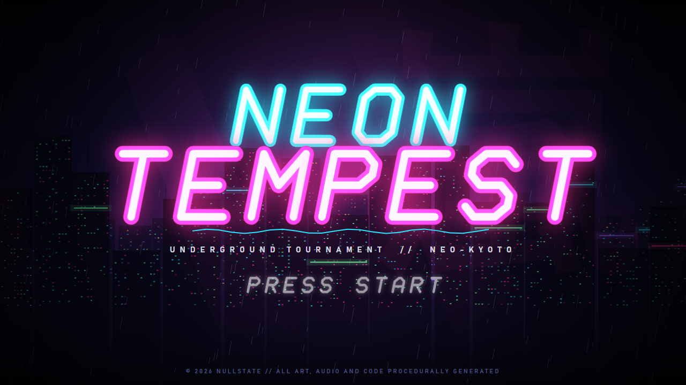

## Quick start

```bash
npm start
```

That single command installs dependencies on the first run (`scripts/ensure-deps.mjs`), starts the
Vite dev server and opens the game in your browser. Requires Node.js 18+ (developed on Node 24).
Click or press any key once so the browser allows audio.

| Command | What it does |
|---|---|
| `npm start` | Install (first run) + dev server + open browser |
| `npm run build` | Type-check (`tsc`) and build the production bundle into `dist/` |
| `npm run preview` | Serve the production build |
| `npm test` | Unit tests (Vitest) |
| `npm run test:e2e` | End-to-end tests (Playwright, headless Chromium) |
| `npm run botsim -- 32 2` | CPU-vs-CPU simulation (32 matches per ordered pair, difficulty 2) → `balance-report.json`, `BALANCE.md` |
| `npm run bench` | 60 s CPU-vs-CPU benchmark of the production build → `bench-results.json` (`-- --headed` for a real window) |
| `npm run screenshots` | Rebuilds and captures the gallery in `screenshots/` |
| `npm run movelist` | Prints every move list with frame data as Markdown, straight from the data files |
| `npm run diag -- magnus warden 12` | Damage-by-move breakdown for a matchup (balance work) |

The Playwright-based scripts need the Chromium build once: `npx playwright install chromium`.

## Controls

Menus work with keyboard, gamepad and mouse/touch. Every gameplay binding can be remapped in
**Settings → Controls** (keyboard per player, gamepad shared).

| Action | Player 1 keyboard | Player 2 keyboard | Gamepad (standard mapping) |
|---|---|---|---|
| Move / jump / crouch | `W A S D` | Arrow keys | D-pad or left stick |
| Light / Medium / Heavy Punch | `U` / `I` / `O` | `Num4` / `Num5` / `Num6` (or `Ins` / `Home` / `PgUp`) | X / Y / RB |
| Light / Medium / Heavy Kick | `J` / `K` / `L` | `Num1` / `Num2` / `Num3` (or `Del` / `End` / `PgDn`) | A / B / RT |
| Throw macro (LP+LK) | `H` | `Num7` | LB |
| Storm Drive macro (MP+MK) | `P` | `Num8` | LT |
| 3 Punches / 3 Kicks macros | `Y` / `N` | `Num9` / `Num0` | L3 / R3 |
| Start / Pause | `Enter` / `Esc` | `NumEnter` | Start |

Menus: arrows/WASD navigate, `Enter`/`Space`/`U` confirm, `Esc`/`Backspace`/`I` back, `Q`/`E`
switch tabs (LB/RB on a pad). In single-player modes every keyboard layout and pad controls player 1.
In Training: `F1` record the dummy, `F2` play the recording back, `F4` (or pad Select) resets positions.

Notation below uses numpad directions for a fighter facing right (`6` = forward, `2` = down,
`3` = down-forward, `4` = back, `8` = up). `[4]6` means *hold back about ⅔ s, then press forward*.

## Modes

- **Arcade** — story intro, a four-fight ladder (the last fight is your rival, CPU level rises), ending and credits. Losing offers a continue.
- **Versus** — local 2-player with independent character select cursors.
- **Versus CPU** — single match against the CPU at Easy / Normal / Hard / Nightmare.
- **Training** — infinite life/meter toggles, stun toggle, hitbox/hurtbox/pushbox/throwbox overlay, live frame data (startup / active / recovery from data and *measured* advantage on hit or block), input history, dummy actions (stand, crouch, jump, CPU, playback), dummy guard (none / all / after first hit / random), record & playback.
- **Trials** — 3–4 combo trials per fighter with step-by-step validation (each step must hit, in order, inside one combo). Completion is saved.
- **Replay** — re-simulates the last match from its seed and recorded inputs (with 0.25×–4× speed). Because the simulation is deterministic, the replay ends on the exact same state hash (verified by an e2e test).

## Combat systems

The game runs a **fixed 60 Hz simulation**. All frame numbers below are 60 Hz frames.

**Frame data conventions.** Move frames are 1-based: a move with startup *S*, active *A* and recovery *R*
hits first on frame *S* and lasts *S − 1 + A + R* frames. *N* frames of hitstun/blockstun means *N* full
frames after hitstop; the victim acts on the next frame. Advantage = stun − frames the attacker has left.
The data files author "on hit / on block" numbers and the builder derives hitstun/blockstun from them.

**Hit levels.** *Mid* is blocked high or low; *low* must be blocked crouching; *overhead* (all jump-ins
and command overheads) must be blocked standing; *high* is blockable either way but never hits a
crouching opponent. The blocking direction is computed from the attacker's side, not the defender's
facing, so cross-ups work. Holding back near an active attack or incoming projectile puts you in a
guard stance instead of walking away (proximity guard).

**Boxes.** Every frame of every move has its own hurtboxes (stance boxes plus an extended-limb box around
the active frames), hitboxes per hit, a pushbox and, for throws, a throwbox. Pushboxes keep fighters apart
(you can jump over a standing opponent for a cross-up). Pushback that can't move a cornered victim is
transferred to the attacker (wall push). A camera-width limit keeps both fighters on screen.

**Combos.** Light normals chain into lights (Sable has target combos such as 5LP > 5MP > 5HP). Medium
and heavy normals special-cancel inside their cancel window, specials super-cancel, and links come
from frame advantage. Inputs pressed during hitstop stay buffered, so cancels and links can be
hit-confirmed. Damage scaling: hits 1–2 deal 100%, the third 80%, then −10% per hit down to 20%. Supers
never scale below 50%. Counter hits (hitting startup/active frames) deal +20% damage and +2 hitstun;
hitting recovery shows PUNISH.

**Juggles.** Airborne victims carry a juggle counter. A hit only connects on a juggled victim if its
`juggleMax` is above the counter, and each juggle hit adds `juggleAdd`. Normals have no juggle
potential; launchers and specials do. Non-knockdown air hits allow an **air recovery** (press any
button once hitstun ends).

**Knockdowns.** Soft knockdowns (sweeps, most specials) allow a **quick rise** (any button). Hard
knockdowns (supers, ultimates, H Rising Storm, Iron Cradle) don't. Wake-up is invulnerable and throw-protected for a few frames.

**Throws.** LP+LK at close range (hold back for a back throw that swaps sides). **Tech** with LP+LK
within 8 frames of being grabbed. You can't throw opponents who are in hit/blockstun, airborne, or in
the first frames after leaving stun. Magnus's command grabs are unblockable and untechable.

**Stun.** Hits fill the stun gauge under the life bar. It decays after a short delay. When full, the
victim is DIZZY after their current hitstun or knockdown. Mash to recover faster.

**Resources.** The **Storm gauge** has 3 stocks (300 units). It fills when your attacks hit or are
blocked, when you whiff specials, when you take damage (damage / 12) and when you block (+3).

| Spend | Cost | Effect |
|---|---|---|
| **EX special** (special motion + 2 punches or 2 kicks) | ½ stock | Faster, more hits, often invincible or armored |
| **Super Art** | 1 stock | Cinematic cut-in, startup invincibility |
| **Ultimate** | 3 stocks, life ≤ 35% | Massive comeback move |
| **Storm Drive** — offensive overdrive (MP+MK) | 1 stock | 20-frame flash, then 6 s of +10% damage, any normal cancels into any normal and specials cancel into specials on contact. It can also cancel the recovery of any normal/special that made contact, extending combos. **Risk:** you take +15% damage while it's active, then **Burnout** for 3 s: no meter gain and +25% stun damage taken. |
| **Shock Guard** — guard cancel (MP+MK while blocking) | 1 stock | Invincible counter-burst that knocks the attacker away |
| **Repel** — pushblock (2 punches while blocking) | free | Pushes the attacker far away; you keep guarding (30-frame cooldown) |

**Rounds.** Best of 3 with a 99-second timer. Time over goes to the higher life percentage, and equal life
is a draw. A double KO gives both fighters a round. If both reach match point together a FINAL ROUND
is played (up to round 5, then the match is drawn). PERFECT shows on a KO at full life. KO triggers
slow motion, a camera zoom on the loser and cinematic letterbox bars. Round intro/outro, win poses and
the kinetic announcer frame each round.

**Input system.** Inputs are sampled once per 60 Hz frame into a 64-frame history per fighter.
- **SOCD:** left+right = neutral; up+down = up.
- **Buffers:** specials and supers 6 frames, normals 4. Frames spent in hitstop or super-freeze don't count against buffers or motion windows.
- **Motion windows:** 16 frames (QCF/QCB/DP), 22 (half circles), 30–36 (doubles and 360). The button may come up to 8 frames after the final direction.
- **Shortcuts:** DP also accepts 3-2-3.
- **360:** back, down and forward plus any up direction (from the jump's pre-jump frames, so command grabs never leak into a jump).
- **Charge:** 40 frames, with a 10-frame window after release; a recent long charge survives a short re-tap, which enables `[4]646` supers.
- **Negative edge:** releasing a button counts for specials, but only if that press wasn't already used.
- **Multi-button:** presses within 3 frames of each other.
- **Priority:** Ultimate > Super > guard actions > EX > special > Drive > throw > command normal > normal. Among specials, the motion completed most recently wins (walk-forward + QCF gives a fireball, not a DP). Among normals pressed together, the strongest button wins.

## Fighters and move lists

Generated from `src/data/characters/*.ts` (`npm run movelist`). Damage is per move before scaling. Air
moves list "-" for advantage because it depends on height. Every fighter also has the universal Storm
Drive, Shock Guard, Repel, throws, tech, quick rise, air recovery and dashes (Sable adds a double jump and an air dash).

### HAYATE (疾風) — Balanced All-Rounder

*The Last Gale.* A disciplined storm-dojo exile. Fireball, invincible uppercut and an advancing spin kick give him an answer for every situation.

Life 1000 · Stun 1000 · Walk 4/3.2 px/f

| Move | Input | Startup | Active | Recovery | On hit | On block | Damage | Level | Notes |
|---|---|---|---|---|---|---|---|---|---|
| Storm Breaker | `↓↘→↓↘→ P` | 5 | 26 | 30 | KD | -24 | 300 | mid | 1 stock, strike inv 1-12 |
| Heaven's Tempest | `↓↘→↓↘→ K` | 10 | 40 | 30 | KD | -16 | 500 | mid | 3 stocks, life ≤ 35%, strike inv 1-30 |
| Tempest Orb (L) | `↓↘→ LP` | 12 | - | 32 | proj | proj | 60 | mid |  |
| Tempest Orb (M) | `↓↘→ MP` | 12 | - | 32 | proj | proj | 60 | mid |  |
| Tempest Orb (H) | `↓↘→ HP` | 12 | - | 32 | proj | proj | 60 | mid |  |
| Rising Storm (L) | `→↓↘ LP` | 3 | 10 | 20 | KD | - | 100 | mid | strike inv 1-5 |
| Rising Storm (M) | `→↓↘ MP` | 3 | 10 | 20 | KD | - | 120 | mid | strike inv 1-7 |
| Rising Storm (H) | `→↓↘ HP` | 3 | 10 | 20 | KD | - | 140 | mid | strike inv 1-9 |
| Cyclone Heel (L) | `↓↙← LK` | 10 | 14 | 14 | KD | - | 80 | mid |  |
| Cyclone Heel (M) | `↓↙← MK` | 10 | 20 | 14 | KD | - | 110 | mid |  |
| Cyclone Heel (H) | `↓↙← HK` | 10 | 26 | 14 | KD | - | 130 | mid |  |
| EX Tempest Orb (EX) | `↓↘→ PP` | 10 | - | 28 | proj | proj | 100 | mid | 0.5 stocks |
| EX Rising Storm (EX) | `→↓↘ PP` | 3 | 10 | 20 | KD | - | 160 | mid | 0.5 stocks, strike inv 1-16 |
| EX Cyclone Heel (EX) | `↓↙← KK` | 10 | 28 | 14 | KD | - | 170 | mid | 0.5 stocks, strike inv 1-9 |
| Gale Elbow | `→ MP` | 19 | 2 | 14 | +2 | -3 | 60 | overhead |  |
| Forward Throw | `LP+LK` | 5 | 2 | 20 | - | - | 120 | throw |  |
| Back Throw | `← LP+LK` | 5 | 2 | 20 | - | - | 130 | throw |  |
| Squall Jab | `LP` | 3 | 2 | 6 | +4 | +2 | 30 | mid | special-cancelable |
| Thunder Straight | `MP` | 5 | 3 | 9 | +5 | +1 | 60 | mid | special-cancelable |
| Gale Hammer | `HP` | 7 | 4 | 17 | +3 | -3 | 90 | mid | special-cancelable |
| Flick Kick | `LK` | 4 | 3 | 8 | +3 | 0 | 30 | mid | special-cancelable |
| Crescent Kick | `MK` | 7 | 3 | 14 | +2 | -2 | 70 | mid | special-cancelable |
| Thunderhead Kick | `HK` | 9 | 4 | 19 | +3 | -4 | 100 | high |  |
| Low Jab | `↓ LP` | 3 | 2 | 7 | +5 | +1 | 25 | mid | special-cancelable |
| Rain Strike | `↓ MP` | 5 | 3 | 9 | +4 | +1 | 55 | mid | special-cancelable |
| Sky Splitter | `↓ HP` | 6 | 5 | 20 | +2 | -6 | 90 | mid | special-cancelable |
| Ankle Tap | `↓ LK` | 4 | 2 | 8 | +2 | 0 | 25 | low | special-cancelable |
| Ground Current | `↓ MK` | 6 | 3 | 13 | +1 | -3 | 60 | low | special-cancelable |
| Riptide Sweep | `↓ HK` | 8 | 3 | 24 | KD | -12 | 90 | low |  |
| Air Jab | `(air) LP` | 4 | 8 | 6 | - | - | 35 | overhead |  |
| Air Straight | `(air) MP` | 5 | 6 | 10 | - | - | 60 | overhead |  |
| Storm Hammer | `(air) HP` | 7 | 6 | 12 | - | - | 90 | overhead |  |
| Cross Knee | `(air) LK` | 4 | 10 | 6 | - | - | 35 | overhead |  |
| Air Slice | `(air) MK` | 6 | 6 | 10 | - | - | 60 | overhead |  |
| Falling Bolt | `(air) HK` | 7 | 6 | 12 | - | - | 95 | overhead |  |

### MAGNUS (鉄塔) — Heavy Grappler

*The Iron Tower.* A dockyard titan rebuilt with salvaged war-machine parts. Slow and enormous, but one read is all he needs: his command grabs end rounds.

Life 1020 · Stun 1100 · Walk 2.5/2.3 px/f

| Move | Input | Startup | Active | Recovery | On hit | On block | Damage | Level | Notes |
|---|---|---|---|---|---|---|---|---|---|
| Meltdown Piledriver | `↓↘→↓↘→ P` | 2 | 3 | 44 | - | - | 340 | throw | 1 stock, strike inv 1-4, untechable |
| Atlas Crusher | `↓↘→↓↘→ K` | 8 | 34 | 30 | KD | -20 | 500 | mid | 3 stocks, life ≤ 35%, strike inv 1-14, armor ×9 (1-40) |
| Iron Cradle (L) | `360° LP` | 6 | 2 | 32 | - | - | 160 | throw | untechable |
| Iron Cradle (M) | `360° MP` | 7 | 2 | 32 | - | - | 175 | throw | untechable |
| Iron Cradle (H) | `360° HP` | 8 | 2 | 32 | - | - | 195 | throw | untechable |
| Harbor Hook (L) | `←↙↓↘→ LK` | 14 | 8 | 26 | - | - | 125 | throw | untechable |
| Harbor Hook (M) | `←↙↓↘→ MK` | 14 | 8 | 26 | - | - | 135 | throw | untechable |
| Harbor Hook (H) | `←↙↓↘→ HK` | 14 | 8 | 26 | - | - | 145 | throw | untechable |
| Bulwark Charge (L) | `→↘↓↙← LP` | 14 | 10 | 20 | KD | -8 | 80 | mid | armor ×1 (3-20) |
| Bulwark Charge (M) | `→↘↓↙← MP` | 14 | 12 | 20 | KD | -9 | 100 | mid | armor ×1 (3-22) |
| Bulwark Charge (H) | `→↘↓↙← HP` | 14 | 14 | 20 | KD | -10 | 130 | mid | armor ×1 (3-24) |
| Crown Breaker (L) | `→↓↘ LK` | 6 | 6 | 24 | KD | - | 85 | mid | strike inv 1-4 |
| Crown Breaker (M) | `→↓↘ MK` | 6 | 6 | 24 | KD | - | 95 | mid | strike inv 1-6 |
| Crown Breaker (H) | `→↓↘ HK` | 6 | 6 | 24 | KD | - | 105 | mid | strike inv 1-8 |
| EX Iron Cradle (EX) | `360° PP` | 5 | 2 | 32 | - | - | 235 | throw | 0.5 stocks, strike inv 1-5, untechable |
| EX Harbor Hook (EX) | `←↙↓↘→ KK` | 10 | 8 | 26 | - | - | 170 | throw | 0.5 stocks, untechable |
| EX Bulwark Charge (EX) | `→↘↓↙← PP` | 11 | 12 | 20 | KD | -4 | 160 | mid | 0.5 stocks, armor ×2 (1-24) |
| EX Crown Breaker (EX) | `→↓↘ KK` | 6 | 6 | 24 | KD | - | 180 | mid | 0.5 stocks, strike inv 1-14 |
| Anvil Drop | `→ HP` | 20 | 3 | 16 | +3 | -3 | 90 | overhead |  |
| Forward Throw | `LP+LK` | 5 | 2 | 20 | - | - | 150 | throw |  |
| Back Throw | `← LP+LK` | 5 | 2 | 20 | - | - | 160 | throw |  |
| Knuckle Jab | `LP` | 4 | 2 | 8 | +3 | +1 | 35 | mid | special-cancelable |
| Piston Palm | `MP` | 7 | 3 | 12 | +3 | -2 | 65 | mid | special-cancelable |
| Wrecking Hammer | `HP` | 12 | 4 | 22 | +4 | -4 | 130 | mid | special-cancelable |
| Shin Breaker | `LK` | 5 | 3 | 10 | +2 | -1 | 35 | mid | special-cancelable |
| Gate Kick | `MK` | 8 | 3 | 15 | +2 | -3 | 80 | mid | special-cancelable |
| Foundry Stomp | `HK` | 14 | 4 | 20 | +3 | -5 | 120 | mid |  |
| Low Knuckle | `↓ LP` | 4 | 2 | 8 | +3 | +1 | 30 | mid | special-cancelable |
| Rivet Punch | `↓ MP` | 7 | 3 | 11 | +3 | 0 | 65 | mid | special-cancelable |
| Skyhook | `↓ HP` | 8 | 5 | 22 | +2 | -8 | 110 | mid | special-cancelable |
| Ankle Crush | `↓ LK` | 5 | 2 | 9 | +2 | -1 | 30 | low | special-cancelable |
| Dock Sweep | `↓ MK` | 9 | 3 | 15 | +1 | -4 | 55 | low | special-cancelable |
| Ground Quake | `↓ HK` | 11 | 3 | 28 | KD | -14 | 110 | low |  |
| Air Knuckle | `(air) LP` | 5 | 7 | 6 | - | - | 35 | overhead |  |
| Air Ram | `(air) MP` | 6 | 6 | 10 | - | - | 70 | overhead |  |
| Meteor Fist | `(air) HP` | 9 | 6 | 12 | - | - | 110 | overhead |  |
| Cross Knee | `(air) LK` | 5 | 8 | 6 | - | - | 35 | overhead |  |
| Air Boot | `(air) MK` | 7 | 6 | 10 | - | - | 70 | overhead |  |
| Body Splash | `(air) HK` | 8 | 8 | 10 | - | - | 105 | overhead |  |

### SABLE (黒刃) — Rushdown

*The Black Courier.* A data-courier who never misses a delivery. Double jump, air dash, teleports and a three-way rekka let her overwhelm anyone who blinks.

Life 1040 · Stun 1000 · Walk 5.2/3.8 px/f · Double jump · Air dash

| Move | Input | Startup | Active | Recovery | On hit | On block | Damage | Level | Notes |
|---|---|---|---|---|---|---|---|---|---|
| Thousand Cuts | `↓↘→↓↘→ K` | 5 | 30 | 26 | KD | -22 | 328 | mid | 1 stock, strike inv 1-12 |
| Eclipse Requiem | `↓↙←↓↙← P` | 14 | 34 | 26 | KD | -16 | 526 | mid | 3 stocks, life ≤ 35%, strike inv 1-22 |
| Fang Rekka (L) | `↓↘→ LP` | 6 | 3 | 16 | +2 | -6 | 54 | mid | special-cancelable |
| Fang Rekka (M) | `↓↘→ MP` | 7 | 3 | 16 | +2 | -6 | 59 | mid | special-cancelable |
| Fang Rekka (H) | `↓↘→ HP` | 8 | 3 | 16 | +2 | -7 | 70 | mid | special-cancelable |
| Fang Rekka II | `↓↘→ P` | 7 | 3 | 16 | +2 | -6 | 59 | mid | after fang1, special-cancelable |
| Fang Rekka: Low Tide | `↓↘→ P` | 9 | 4 | 20 | KD | -12 | 86 | low | after fang2 |
| Fang Rekka: Moonfall | `↓↘→ K` | 15 | 3 | 16 | KD | - | 86 | overhead | after fang2 |
| Phantom Step (L) | `↓↙← LK` | 16 | 1 | 12 | - | - | 0 | - | strike inv 8-16 |
| Phantom Step (M) | `↓↙← MK` | 16 | 1 | 14 | - | - | 0 | - | strike inv 8-18 |
| Phantom Step (H) | `↓↙← HK` | 16 | 1 | 2 | - | - | 0 | - | strike inv 8-14 |
| Night Needle (L) | `↓↘→ LK` | 8 | 10 | 18 | KD | -9 | 81 | low |  |
| Night Needle (M) | `↓↘→ MK` | 8 | 10 | 18 | KD | -10 | 86 | low |  |
| Night Needle (H) | `↓↘→ HK` | 8 | 12 | 18 | KD | -12 | 92 | low |  |
| EX Fang Rekka (EX) | `↓↘→ PP` | 5 | 3 | 16 | +7 | -2 | 98 | mid | 0.5 stocks, strike inv 1-6, special-cancelable |
| EX Phantom Step (EX) | `↓↙← KK` | 10 | 1 | 8 | - | - | 0 | - | 0.5 stocks, strike inv 1-16 |
| EX Night Needle (EX) | `↓↘→ KK` | 6 | 12 | 18 | KD | -6 | 140 | low | 0.5 stocks |
| Stiletto Dive | `(air) ↓ HK` | 6 | 24 | 8 | - | - | 70 | overhead |  |
| Axe Heel | `→ MK` | 17 | 2 | 14 | +2 | -3 | 65 | overhead |  |
| Forward Throw | `LP+LK` | 5 | 2 | 20 | - | - | 110 | throw |  |
| Back Throw | `← LP+LK` | 5 | 2 | 20 | - | - | 120 | throw |  |
| Needle Jab | `LP` | 3 | 2 | 5 | +5 | +2 | 29 | mid | special-cancelable |
| Twin Fang | `MP` | 4 | 2 | 9 | +4 | +1 | 50 | mid | special-cancelable |
| Crescent Slash | `HP` | 6 | 3 | 14 | +2 | -3 | 80 | mid | special-cancelable |
| Snap Kick | `LK` | 4 | 2 | 7 | +3 | 0 | 32 | mid | special-cancelable |
| Wire Kick | `MK` | 5 | 3 | 11 | +2 | -2 | 55 | mid | special-cancelable |
| Moon Arc | `HK` | 8 | 4 | 16 | +2 | -4 | 90 | mid |  |
| Low Needle | `↓ LP` | 3 | 2 | 6 | +4 | +2 | 25 | mid | special-cancelable |
| Gut Slice | `↓ MP` | 4 | 2 | 9 | +4 | +1 | 50 | mid | special-cancelable |
| Rising Fang | `↓ HP` | 5 | 5 | 18 | +2 | -5 | 85 | mid | special-cancelable |
| Heel Tap | `↓ LK` | 3 | 2 | 7 | +3 | 0 | 25 | low | special-cancelable |
| Ground Wire | `↓ MK` | 5 | 3 | 12 | +1 | -3 | 50 | low | special-cancelable |
| Shadow Slide | `↓ HK` | 7 | 5 | 22 | KD | -11 | 90 | low |  |
| Air Needle | `(air) LP` | 3 | 6 | 6 | - | - | 34 | overhead |  |
| Air Slash | `(air) MP` | 4 | 6 | 9 | - | - | 55 | overhead |  |
| Falling Crescent | `(air) HP` | 6 | 5 | 11 | - | - | 85 | overhead |  |
| Cross Heel | `(air) LK` | 3 | 10 | 5 | - | - | 34 | overhead |  |
| Air Wire | `(air) MK` | 5 | 6 | 9 | - | - | 55 | overhead |  |
| Raven Kick | `(air) HK` | 6 | 6 | 11 | - | - | 90 | overhead |  |

### WARDEN (守衛) — Charge Zoner

*The Last Patrol.* A decommissioned riot officer who still walks the beat. Charge-input lances, rising discs and a flip kick lock down every angle of approach.

Life 900 · Stun 1000 · Walk 3.4/3 px/f

| Move | Input | Startup | Active | Recovery | On hit | On block | Damage | Level | Notes |
|---|---|---|---|---|---|---|---|---|---|
| Containment Grid | `[←] → ← → P` | 10 | - | 28 | proj | proj | 330 | mid | 1 stock, strike inv 1-12 |
| Riot Protocol | `[←] → ← → K` | 6 | 36 | 28 | KD | -18 | 508 | mid | 3 stocks, life ≤ 35%, strike inv 1-16 |
| Pulse Lance (L) | `[←] → LP` | 12 | - | 31 | proj | proj | 50 | mid |  |
| Pulse Lance (M) | `[←] → MP` | 12 | - | 31 | proj | proj | 50 | mid |  |
| Pulse Lance (H) | `[←] → HP` | 12 | - | 31 | proj | proj | 50 | mid |  |
| Halo Disc (L) | `[↓] ↑ LP` | 10 | - | 30 | proj | proj | 60 | mid |  |
| Halo Disc (M) | `[↓] ↑ MP` | 10 | - | 30 | proj | proj | 60 | mid |  |
| Halo Disc (H) | `[↓] ↑ HP` | 10 | - | 30 | proj | proj | 60 | mid |  |
| Arc Sentry (L) | `[↓] ↑ LK` | 4 | 8 | 24 | KD | - | 95 | mid | strike inv 1-5 |
| Arc Sentry (M) | `[↓] ↑ MK` | 4 | 8 | 24 | KD | - | 105 | mid | strike inv 1-7 |
| Arc Sentry (H) | `[↓] ↑ HK` | 4 | 8 | 24 | KD | - | 105 | mid | strike inv 1-9 |
| Riot Rush (L) | `[←] → LK` | 12 | 8 | 16 | KD | -5 | 75 | mid |  |
| Riot Rush (M) | `[←] → MK` | 12 | 9 | 16 | KD | -7 | 85 | mid |  |
| Riot Rush (H) | `[←] → HK` | 12 | 10 | 16 | KD | -10 | 95 | mid |  |
| EX Pulse Lance (EX) | `[←] → PP` | 9 | - | 26 | proj | proj | 84 | mid | 0.5 stocks |
| EX Halo Disc (EX) | `[↓] ↑ PP` | 8 | - | 26 | proj | proj | 90 | mid | 0.5 stocks |
| EX Arc Sentry (EX) | `[↓] ↑ KK` | 4 | 8 | 24 | KD | - | 170 | mid | 0.5 stocks, strike inv 1-14 |
| EX Riot Rush (EX) | `[←] → KK` | 9 | 12 | 16 | KD | -3 | 140 | mid | 0.5 stocks |
| Breach Kick | `→ HK` | 13 | 3 | 18 | +1 | -4 | 80 | mid |  |
| Forward Throw | `LP+LK` | 5 | 2 | 20 | - | - | 120 | throw |  |
| Back Throw | `← LP+LK` | 5 | 2 | 20 | - | - | 130 | throw |  |
| Gauntlet Jab | `LP` | 4 | 2 | 7 | +4 | +1 | 30 | mid | special-cancelable |
| Baton Jab | `MP` | 6 | 3 | 10 | +3 | 0 | 60 | mid | special-cancelable |
| Riot Baton | `HP` | 9 | 4 | 18 | +2 | -3 | 90 | mid | special-cancelable |
| Boot Check | `LK` | 5 | 3 | 9 | +2 | -1 | 32 | mid | special-cancelable |
| Long Shin | `MK` | 7 | 3 | 15 | +1 | -3 | 60 | mid | special-cancelable |
| Barrier Kick | `HK` | 11 | 4 | 20 | +2 | -4 | 100 | mid |  |
| Low Jab | `↓ LP` | 4 | 2 | 7 | +4 | +1 | 28 | mid | special-cancelable |
| Stun Prod | `↓ MP` | 6 | 3 | 10 | +3 | 0 | 55 | mid | special-cancelable |
| Halo Swat | `↓ HP` | 7 | 6 | 20 | +2 | -6 | 90 | mid | special-cancelable |
| Ankle Check | `↓ LK` | 5 | 2 | 8 | +2 | -1 | 26 | low | special-cancelable |
| Patrol Sweep | `↓ MK` | 7 | 3 | 14 | +1 | -3 | 55 | low | special-cancelable |
| Lockdown Sweep | `↓ HK` | 9 | 3 | 24 | KD | -12 | 90 | low |  |
| Air Jab | `(air) LP` | 4 | 7 | 6 | - | - | 32 | overhead |  |
| Air Baton | `(air) MP` | 6 | 6 | 10 | - | - | 60 | overhead |  |
| Gavel | `(air) HP` | 8 | 6 | 12 | - | - | 90 | overhead |  |
| Air Knee | `(air) LK` | 4 | 9 | 6 | - | - | 32 | overhead |  |
| Air Boot | `(air) MK` | 6 | 6 | 10 | - | - | 60 | overhead |  |
| Riot Boot | `(air) HK` | 7 | 6 | 12 | - | - | 90 | overhead |  |

## Architecture

```
src/
  sim/        deterministic core: types (plain serializable state), input parser, fighter state
              machine, combat (hits/blocks/throws/projectiles), match & round flow, RNG, hashing
  data/       schema + builders, the four characters (moves, frame data, boxes, AI personality,
              trials, story), pose library (IK targets)
  ai/         CPU controller (perception delay, input generation, personalities)
  input/      keyboard + Gamepad API + pointer, SOCD, macros, remappable bindings, menu events
  render/     camera, sprite-baked fighter rig + painters, cloth, fighter view, HUD, cut-ins,
              projectiles, hitbox overlay, stages/ (three procedural stages)
  vfx/        pooled particle system (typed arrays)
  audio/      Web Audio engine, synthesized SFX, step-sequenced music, ambience
  ui/         design tokens, strokes font + glyph atlas, menus, panels, strings (i18n-ready)
  scenes/     boot, title, menus, select screens, versus, match (+pause, training, trials), results…
  core/       app services, fixed-timestep loop, view (letterbox + DPR), settings
tests/        Vitest unit tests        e2e/  Playwright specs
scripts/      botsim, bench, screenshots, movelist, diagnostics      dev/  stage harness + pose gallery
```

**Simulation model.** `stepMatch(state, [p1Bits, p2Bits])` is the only way the game advances. State is
plain data: positions are fixed-point integers (1 px = 100 units), there's no floating-point
trigonometry, and the seeded RNG lives inside the state. That makes it deterministic and serializable:
`cloneState`/`hashState` give rollback snapshots and desync checks, and replays are just seed + inputs.
Rendering is fully decoupled and interpolates between frames. The fixed-step loop snaps rAF jitter on
60/120/144 Hz displays. Presentation never feeds back into the simulation.

**Data-driven content.** Characters are TypeScript data files built from `schema.ts`. Every move lists
startup/active/recovery, per-hit frames and boxes, damage, chip, stun, hitstun/blockstun, hitstop,
level, pushback, meter gain, knockdown/launch, juggle data, cancel windows and classes, invincibility
ranges, armor, movement keys, projectiles, throws (with victim keyframes), teleports and animation
keys. `build.ts` expands compact specs (e.g. L/M/H/EX variants) into full records.

**Art.** Fighters are articulated skeletons posed by IK targets (hip, hands, feet; two-bone IK for
elbows and knees). Each body part is painted once per match into a texture atlas with muscle-shaped
outlines, two-tone neon rim lighting and real blur glows, then posed every frame with one
`setTransform` + `drawImage` per part. That's ~16 cheap draws per fighter. Hair, headbands, scarves,
tabards and coat tails are verlet chains. Wet-floor reflections, afterimages, hit flashes, Storm Drive
auras and motion smears reuse the same rig. The three stages pre-render static parallax layers to
offscreen canvases and animate rain, neon flicker, holograms, crowds, vehicles and weather on top. All
display text is drawn with an original stroke font whose glyphs are rasterized once into an atlas.

**CPU.** The AI plays through the same input system as a human. It rolls motions frame by frame, holds
real charges, and perceives the opponent through a delay line (10–26 frames by difficulty). It
hit-confirms with a delay, makes execution errors and adds timing jitter, so it never acts
frame-perfectly. Its layers are: defense (blocking with level guessing, teching, wake-up reversals,
anti-airs, projectile answers including armor/projectile-invincible moves), combo routes (cancels and
buffered links), punishes, and per-character personality (Hayate balanced, Magnus grab-hungry, Sable
aggressive mix-ups, Warden charge-holding zoner).

**Performance.** The hot paths are allocation-free: particles and cloth use typed arrays, gradients and
fonts are cached, glyphs are atlased and rigs baked. **Dynamic resolution** (Settings → Video →
Resolution scale → AUTO) lowers the render scale on weak GPUs and restores it when there's headroom.
Stage caches are released on exit. Hiding the tab auto-pauses the match and suspends audio.

## Verification

| Gate | Result |
|---|---|
| Unit tests (`npm test`) | **68 passed**: input parser (all motions, charge, 360, buffer & leniency edges, negative edge, simultaneous presses, dashes), frame-data execution, hit/block/throw/tech, trades, high/low/overhead/cross-up, juggles, combo scaling, meter math, EX/Super/Ultimate/Drive costs, rounds/timer/double KO/perfect, determinism and rollback, **every combo trial performed through the input system**, audio API safety |
| E2E (`npm run test:e2e`) | **5 specs passed**. (1) Boot → title → every main-menu entry → mode select → character select → stage select → VS → match by keyboard; performs a QCF special, verifies HUD updates, finishes a round, and checks for no console errors or warnings. (2) Replay ends on the same state hash as the original match. (3) Full Arcade run (story, 4 fights, ending, credits). (4) Mocked gamepad drives menus and a fighter. (5) All 10 music tracks, 55 sound effects and 3 ambiences are audible with no clipping (master-bus analyser). |
| Bot simulation (`npm run botsim`) | **512 matches**, 0 crashes, 0 softlocks, 0 stuck states, simulated in 50 s (66,188 frames/s). Win rates: HAYATE 49.5%, MAGNUS 46.4%, SABLE 49%, WARDEN 55.2%. Average match 107.6 s of game time, 2.52 rounds. |
| Benchmark (`npm run bench`) | **59.7 FPS average**, 1% low 38.3 FPS, frame time p50/p95/p99 16.67/16.67/16.67 ms, CPU render 1.82 ms avg, JS heap 4.6–6.6 MB (no growth), 21 of 3626 frames over 20 ms. Intel UHD 620, 1280×720. The empty-canvas baseline in the same environment measured 59.9 FPS average and a 49.8 FPS 1% low. |
| Build (`npm run build`) | `tsc` clean; bundle **401 KB (130 KB gzip)** (single JS chunk, no assets) |
| Screenshots | 16 captures in `screenshots/`, reviewed after each improvement pass |

### Win-rate matrix (row vs column, CPU difficulty Hard)

| | HAYATE | MAGNUS | SABLE | WARDEN | Overall |
|---|---|---|---|---|---|
| **HAYATE** | 50% | 36% | 56% | 56% | **49.5%** |
| **MAGNUS** | 64% | 50% | 53% | 22% | **46.4%** |
| **SABLE** | 44% | 47% | 50% | 56% | **49%** |
| **WARDEN** | 44% | 78% | 44% | 50% | **55.2%** |

Side wins P1 262 / P2 250. Round outcomes: ko 1278, perfect 3, double 5, timeout 2. Per match: 4246 damage, best combo 6.79 hits, 2.77 supers, 30.5 specials, 5.24 throws. Tuning history: Magnus started at 96% and Sable at 8%. Fixes came from AI work (charge retention for Warden, grab avoidance, buffered links, armor and projectile-invincible answers to fireballs) and data changes (Magnus command-grab range/damage and life down, Sable life and damage up, Warden lance startup and rush/arc damage down). Full report: `BALANCE.md`.

## Screenshots

| | |
|---|---|
| 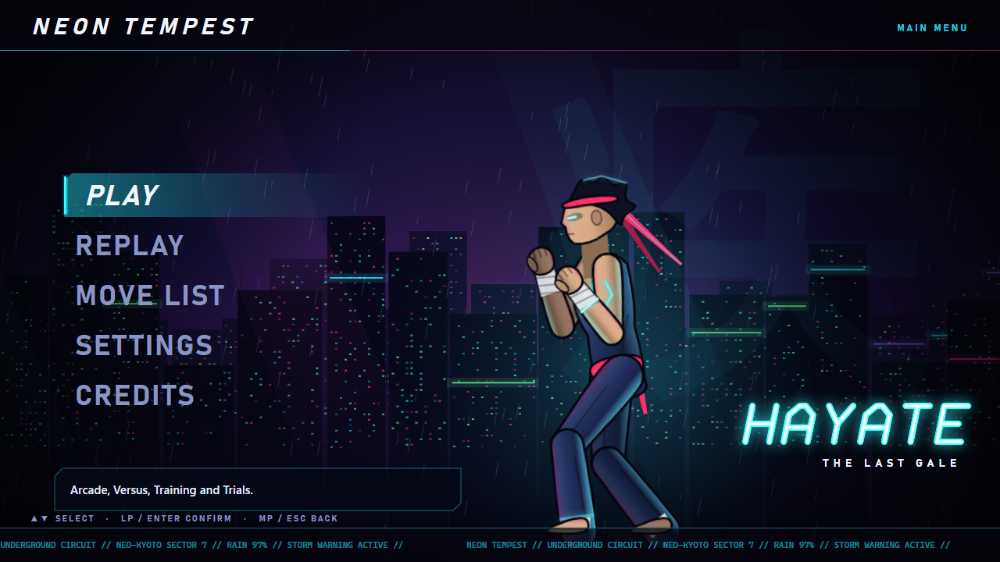 | 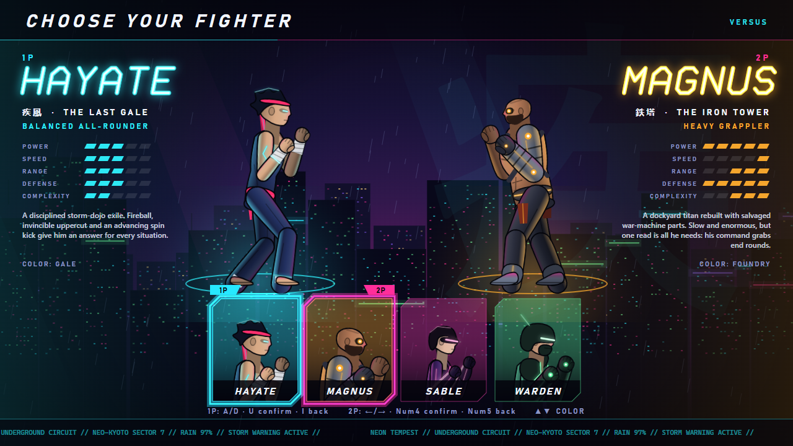 |
| 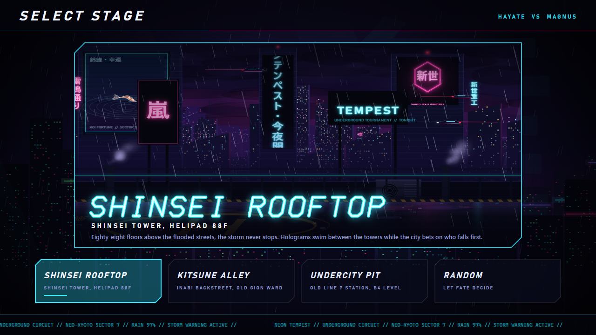 | 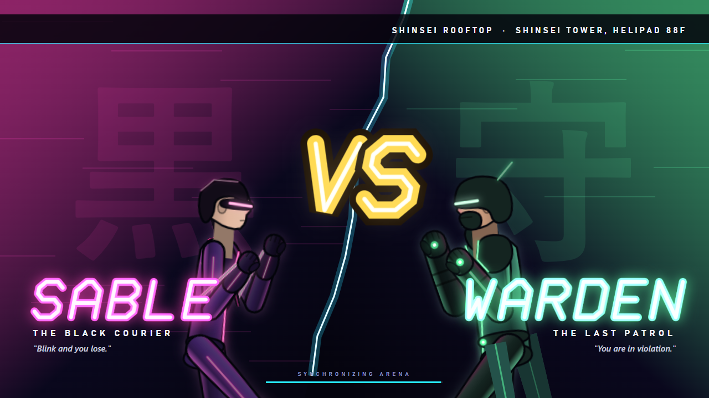 |
| 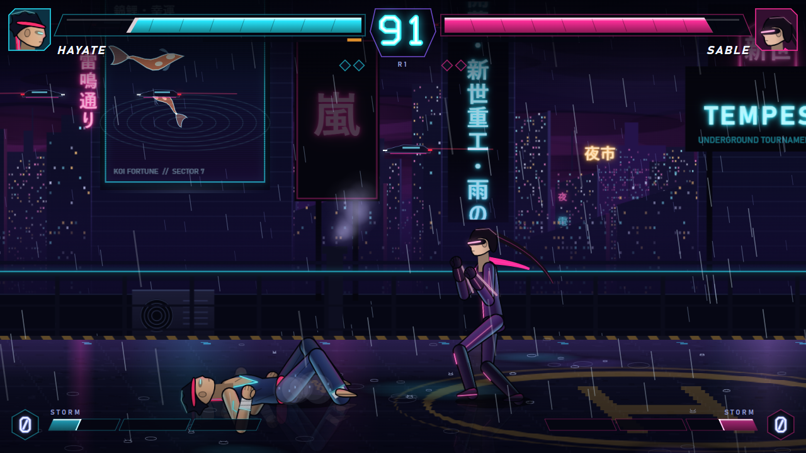 | 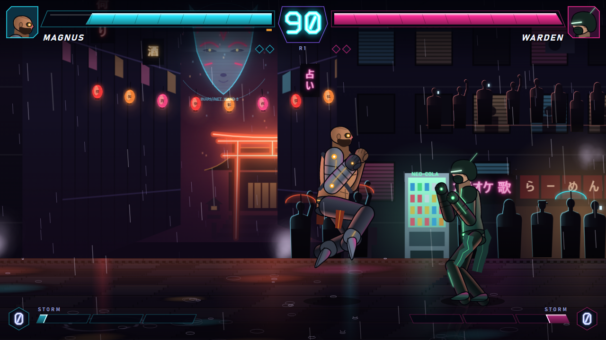 |
| 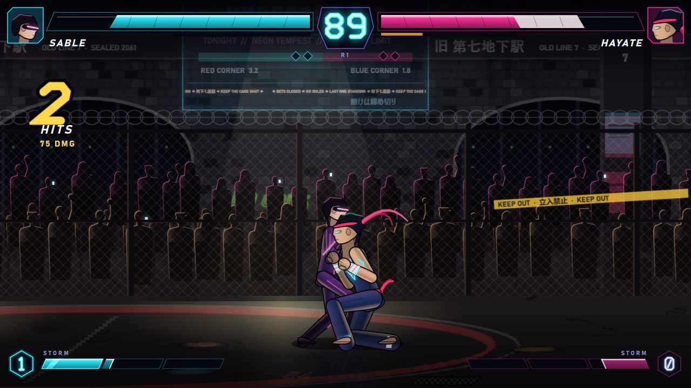 | 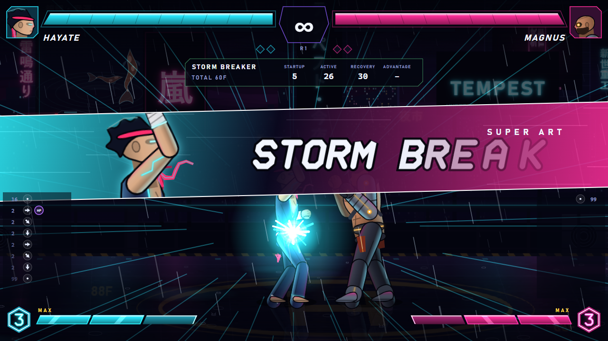 |
| 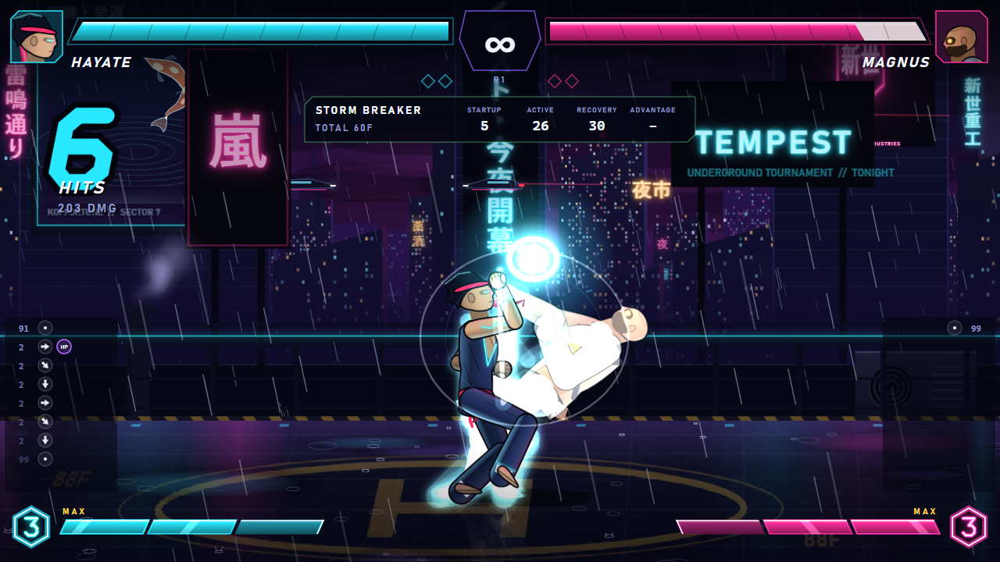 | 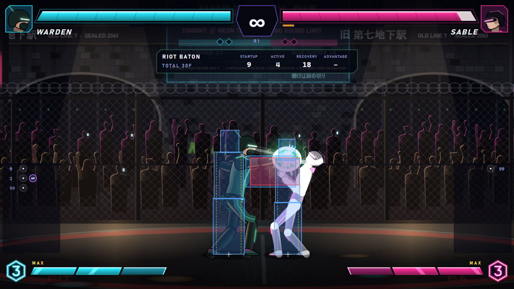 |
| 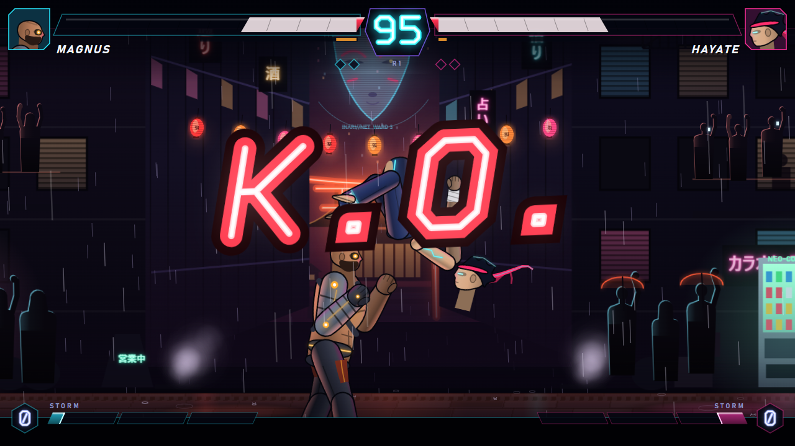 | 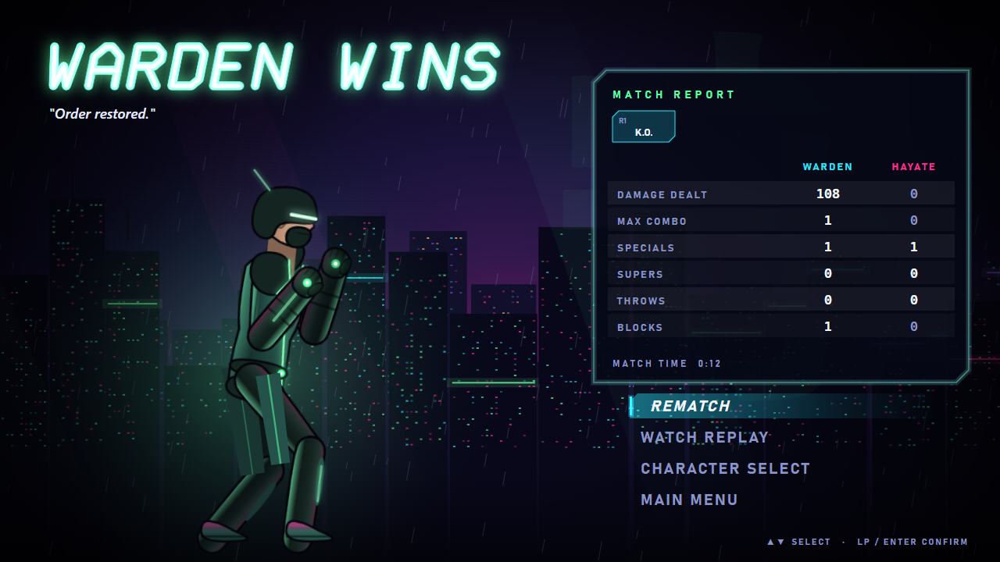 |
| 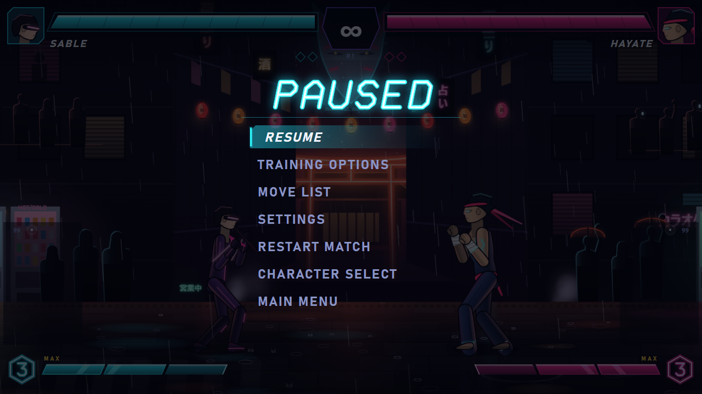 | 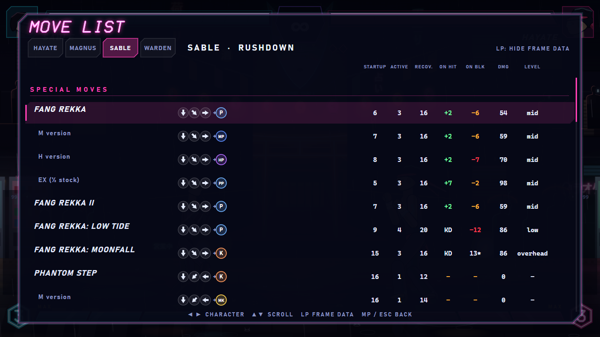 |

## Known limitations

- **No online play.** The simulation is rollback-ready (serializable state, deterministic stepping, hash checks, input-only replays), but there's no networking layer.
- **Audio not human-tuned.** It's all synthesized. Every cue is verified as audible and non-clipping by analysis, but mixing and taste were not tuned by ear.
- **Gamepad tested with a mock only.** Support uses the standard mapping; the e2e test drives a mocked pad, not physical hardware. Touch works for menus, but there's no on-screen fighting pad.
- **CPU-vs-CPU balance.** Overall win rates sit at 46–55%. Individual matchups are less even: the zoner Warden beats the slow grappler Magnus about 4 out of 5 times in CPU play, which reflects archetype counterplay amplified by AI behaviour.
- **Benchmark environment.** Numbers come from an Intel UHD 620 laptop (i7-8650U) with other applications running. The empty-canvas baseline recorded next to the results shows that environment's own frame-pacing noise.
- **Browser.** Canvas `letterSpacing` and `createImageBitmap` are used; Chromium-based browsers and current Firefox are fully supported.
